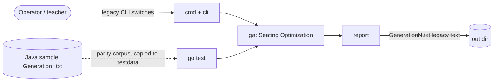

# Architecture: DSSeating Port (Java GA to Go)

**Status:** Draft
**Altitude:** System (small, single deliverable: one CLI binary)
**Paradigm:** Functional core / imperative shell, single bounded context, legacy-quirk registry
**Author:** architect agent (graph fast path, no interview)
**Last updated:** 2026-10-31
**Sources:** `/Users/cgianelle/Projects/dsseating-port/docs/dsseating-port/prd.md` (approved); legacy `/Users/cgianelle/Projects/DSSeating_10_10_03/src/dsseating/DS_Seating.java` (main, SitsNear, SitOnOutsideEisle, CalculateWeightedFitness, selection, crossover, InverseMutation, DumpResults, PlagueSelection, CycleCrossover) and `ClassPopulation.java`. Sample `Generation*.txt` read for output format only. Owner decisions (binding): Go, faithful port, no GUI, legacy bugs preserved but isolated, default crossover follows actual legacy code.

## 1. Purpose & Scope

Governs how the Go port is structured so that independently written pieces (fitness, operators, engine, report, CLI, tests) stay consistent and so that every legacy bug lives in one named, flippable place. It does not decide product scope, GUI (none), or fixes for legacy bugs (explicitly later).

## 2. Design Paradigm

Functional core, imperative shell. `ga` is a pure-ish library (no I/O, no globals, RNG injected). `report`, `cli`, `cmd` are the shell. Faithful port means **behavior-faithful, not structure-faithful**: the Java's copy-pasted per-row code collapses to table/loop code, but every observable behavior (scores, selection pool composition, operator outputs given the same inputs, crash-or-not, report text) is preserved. Each legacy oddity is a registered Quirk (AD-2) so a later "fix" is a one-line default flip plus a test change, never a refactor.

## 3. Context & Constraints

- Greenfield Go module in `/Users/cgianelle/Projects/dsseating-port/`; Java directory is read-only input (NFR Safety).
- Hard constraints: Go only, stdlib only, no cgo, no GUI, CLI-only, macOS/Linux.
- A JVM may exist at `/usr/bin/java` `[ASSUMPTION: it is a working JDK, not the macOS stub]`; if so it is usable for differential checks of operators (not for random-stream parity).



## 4. Ubiquitous Language

PRD terms verbatim. One conflict flagged.

| Term | Meaning | Do not call it |
|------|---------|----------------|
| Student | One of 20 labels A-T | person, allele (except in operator comments) |
| Chromosome / Individual | A permutation of A-T (20 genes). "Individual" is the scored object; "Chromosome" is its gene string. | genome, solution |
| Row, Seat, Column | 5 rows x 4 seats; row = gene slice [0:4]..[16:20]; column = index within row 0..3 | desk |
| Phenotype | The 5-row view of a chromosome | layout |
| Front-row rule / Proximity rule / Aisle rule | The three teacher rules from `-frontrow`, `-proximity`, `-isle` | constraint |
| Front Row Score / Near By Score / Isle Score | The three integer scores. Report labels keep the legacy spelling ("Isle Score", "Near By Score"). | |
| Total Fitness Score (`Fitness`) | Sum of the three scores (int) | |
| Weighted Score (`WeightedFitness`) | Weighted float64 per FR-7, floored at 0 | |
| Population, Generation | 100 individuals; Generation N is the scored population after crossover+mutation in loop iteration N (0-based) | |
| Mating pool | Ordered list of 100 individual references; consecutive pairs (2i, 2i+1) are parents | |
| Queen | Individual used by queen-bee selection | |
| Quirk | A registered, named legacy behavior (AD-2), id `Q-n` | bug (in code), hack |

**Conflict (not renamed silently):** PRD prose says "aisle" while the CLI flag and report say "isle". Decision: Go identifiers use `Aisle`; only the CLI flag `-isle` and report label `Isle Score:` use the legacy spelling.

## 5. Domain Landscape

| Subdomain | Kind | Where effort goes |
|-----------|------|-------------------|
| Fitness scoring (FR-4..7) | core | Exact numeric parity; parity corpus (FR-16) |
| Selection / crossover / mutation (FR-8..10) | core | Line-faithful port of Java semantics incl. aliasing and quirks |
| Report format (FR-12) | supporting | Byte-faithful text incl. Java double printing |
| CLI parsing (FR-3, FR-13) | supporting | Reproduce legacy switch semantics |
| RNG, file I/O, flag plumbing | generic | stdlib, minimal |

## 6. Bounded Contexts & Context Map

One bounded context: **Seating Optimization** (everything under `ga`). No second context exists; no ACL needed. Edges are to the outside world only.

| Edge | Direction | Pattern |
|------|-----------|---------|
| CLI to `ga` | cli depends on ga | Conformist to the legacy switch language (Published Language); `ga` takes a plain `Config`, knows nothing of argv |
| `report` to `ga` | report depends on ga types | Conformist to legacy text format; `ga` does not know the report exists |
| `ga` to filesystem | none (ga has no I/O) | Engine emits generations through an `Observer` callback (AD-1) |
| Tests to Java sample outputs | tests read copied files | Separate Ways at runtime; Conformist for scores |
| Port to Java source/jar | none at runtime | Separate Ways |

## 7. Architecture Decisions

### AD-1 — Package layering and dependency direction
- **Status:** Adopted
- **Binds:** all FRs
- **Prevents:** I/O or argv parsing leaking into operators; import cycles; untestable engine
- **Rule:** Packages `internal/ga` (domain, rules, fitness, operators, engine, quirks), `internal/report` (legacy text writer, Java double formatting), `internal/cli` (legacy argv to `ga.Config` + messages), `cmd/dsseating` (wiring only). Dependencies: `cmd -> cli, report, ga`; `cli -> ga`; `report -> ga`; `ga -> stdlib only`. `ga` performs no file or stdout I/O. The engine reports progress via `Observer` with `OnInitial(pop)` and `OnGeneration(n, pop)`; `report` implements it. `ga` returns `error` for legacy-crash cases (AD-7); it never panics out of `Run`.
- **Alternatives considered:** one flat `main` package (fast, but untestable operators); package per operator (Rule of Three not met); engine writing files directly (couples core to I/O).

### AD-2 — Legacy Quirk registry
- **Status:** Adopted
- **Binds:** FR-3, FR-5, FR-8, FR-9, FR-10, FR-12; owner decision "legacy bugs preserved, easily changed"
- **Prevents:** bug behavior scattered as inline special cases that cannot be found or flipped later; accidental half-fixes
- **Rule:** `ga.Quirks` is one struct of named fields, one per quirk in the table below, built only by `ga.LegacyQuirks()` (all legacy). Every quirk has: an id `Q-n`, one file `ga/quirk_<name>.go` (or one function) containing the legacy implementation, a doc comment `// Q-n legacy: DS_Seating.java:<lines>`, and a test named `TestQ<n>_...` pinning the legacy behavior. Operators receive `Quirks` and call the quirk hook; no operator may inline legacy-bug logic. A future fix adds a second implementation behind the same field and flips `LegacyQuirks()`; the test for that quirk is then deliberately changed. Non-quirk behavior is not a quirk: do not register intended behavior.
- **Alternatives considered:** build tags (hard to test both); comments only (not flippable); fix-and-document (violates owner decision).

Quirk register (initial; implementers may add `Q-n` only by appending):

| ID | Legacy behavior preserved | Source |
|----|---------------------------|--------|
| Q-1 | Default crossover (no switch, or `-cx`, or any value other than `-pmx`) is **Cycle Crossover**; help text claiming PMX default is wrong. Only `-pmx` selects PMX. Default selection is random. | main 243-263 |
| Q-2 | Proximity: for the Y student in the last row the x-coordinate is written to the X student's x (copy-paste); coordinates for a student not found in any row are stale from the previous pair (X/Y locals declared once per call, reused across pairs). | SitsNear 389-480 |
| Q-3 | Proximity formula: d = (|dx|+|dy|)/2 as float32; d > 1 gives +10d, else -10d; added to int scores via compound assignment (truncation toward zero). | SitsNear 464-478 |
| Q-4 | Rate semantics: crossover/mutation fire when `rand.Intn(100) <= int-compare rate*100` (inclusive, so rate 0.9 gives 91%, 0.1 gives 11%); a rate argument of exactly 0.0 silently becomes the default (0.9 / 0.1); killrate 0 becomes 50 at selection time. | main 138-141, 247, 640, 1395 |
| Q-5 | Mutation: at most one mutation per generation; target index uniform in 0..99; the mutated individual is edited **in place** (shared references see it) and then **inserted** at that index (list grows to 101; only the first 100 are scored/dumped, so the last is dropped and the index appears twice). | InverseMutation 1387-1402 |
| Q-6 | Inversion segment: start in 1..4, end = nextInt(14)+2 (2..15); if start >= end then end += start; inverts `[start,end)`. Always yields a valid permutation (PRD OQ-4e bounds concern does not occur). | Mutate 1404-1443 |
| Q-7 | Plague selection: sorts by weighted fitness using strict `>` starting from a blank placeholder with weighted 0, so individuals with weighted score 0 never win a sort round and are replaced by a blank placeholder (Individual = ""); removes `killrate` tail; picks 100 with `nextInt(survivors-1)` so the last survivor is never chosen; killrate 100 leaves `nextInt(-1)`. Ties resolve by "last index with equal chromosome string". A selected blank placeholder crashes later (AD-7). | PlagueSelection 2022-2101 |
| Q-8 | Queen bee: the Queen is the best of the **initial** population (strict `>`), held by reference, never re-evaluated; because of aliasing (Q-5) the Queen object can be mutated. Pool is 50 x (Queen, random mate). | main 233, 579-597 |
| Q-9 | Weighted fitness floors at 0, so all poor individuals tie at 0.0. | CalculateWeightedFitness |
| Q-10 | Best Individual block: strict `>` from a blank/zero start, so if every weighted score is 0 the block prints `Best Individual: null` with zero scores. | DumpResults 1445-1463 |
| Q-11 | Argv scanning: switch values are not consumed; each value token is re-scanned and prints `<token>: Argument Not Recognized!`; `-h` is honored only as args[0]; no args prints help. A missing value for a value-taking switch or a non-numeric number is a legacy crash (AD-7). | main 89-130 |
| Q-12 | Initial scored population is dumped as `Generation5050.txt`; generations are `Generation0..49.txt`. | main 240, 284 |
| Q-13 | PMX is the hand-rolled `IndividualMapsTo` cascade with fixed 4-wide window, start in 1..12, **not** textbook PMX; result then passes through the repair step (AD-6). Do not replace with a standard PMX. | PartiallyMatchedCrossover 950-1385 |
| Q-14 | Unscored/unrecognized student labels (outside A-T) silently score nothing. | SitsInFrontRow etc. |

### AD-3 — Population identity semantics (aliasing is behavior)
- **Status:** Adopted
- **Binds:** FR-8, FR-9, FR-10, Q-5, Q-8
- **Prevents:** copy-on-select implementations that silently remove legacy effects (mutation hitting shared parents, Queen mutating, duplicate index)
- **Rule:** `Population` is `[]*Individual`. Selection and crossover pass-through (xover skipped) append the **same pointer**, never a copy. Crossover offspring are new `Individual`s. `Individual` holds `Genes [20]byte` plus scores; phenotype is derived from genes. Rescore resets all score fields from zero before scoring (as the Java loop does). This is flagged under Q-5/Q-8 so a fix can switch to copying.
- **Alternatives considered:** value-typed individuals (cleaner, changes results; this is the "later fix").

### AD-4 — RNG: one injected stream, deterministic draw order
- **Status:** Adopted
- **Binds:** FR-2, FR-8..10, FR-13, NFR Reproducibility/Testability
- **Prevents:** global `rand`, per-call time-seeding (the Java defect), concurrency-dependent order, tests that cannot pin outputs
- **Rule:** Use `math/rand/v2` with `rand.New(rand.NewPCG(seed, seed2))`; `-seed N` sets `seed=N`, `seed2` a fixed constant; no `-seed` takes time seed and the CLI prints it. A single `*rand.Rand` is passed explicitly to every function that draws; no package-level RNG. A run is single-goroutine. Draw order is part of the determinism contract: golden-run tests pin it, and any reorder is a deliberate golden regeneration. Java's `nextInt(1e9) % 100` modulo bias is **not** preserved (uniform `IntN(100)`); Java random streams are explicitly out of parity (PRD).
- **Alternatives considered:** `math/rand` v1 (global state temptation, older API); crypto/rand (not reproducible); per-operator seeds (hides ordering).

### AD-5 — Fitness numerics and ordering
- **Status:** Adopted
- **Binds:** FR-4..7, FR-16, FR-12
- **Prevents:** weighted scores differing in the last bit from Java (e.g. `49.599999999999994`), via expression reordering or FMA fusion
- **Rule:** Front/Near/Isle scores are `int`; Total = their sum. Weighted is computed in `float64` in the exact Java expression order: `(F+N)*0.60 + (F+I)*0.10 + (N+I)*0.10 + (F*0.04) + (N*0.04) + (I*0.02)` with int sums converted to float64 first, left-to-right additions, then floor at 0. Wrap each product in an explicit `float64(...)` conversion so Go on arm64 cannot fuse multiply-add. Proximity uses `float32` for the intermediate (Q-3) then converts to int by truncation. Front-row table `{10,7,0,-7,-10}`, aisle columns {0,3}. Scoring is a loop over rules (no per-row copy-paste), Q-2 isolated.
- **Alternatives considered:** big/decimal (unneeded); tolerance compare only (loses bit parity on corpus).

### AD-6 — Permutation validity: repair is part of behavior, not dead code
- **Status:** Adopted
- **Binds:** FR-9, FR-10, Q-13
- **Prevents:** treating `VerifyValidness` as dead (PRD says dead; it is called by both crossovers) or replacing it with a different repair, changing offspring
- **Rule:** Port `VerifyValidness` (DS_Seating.java:1550-end) as `repairPermutation`, called exactly where Java calls it (end of CX offspring and both PMX offspring). Engine asserts post-condition "every individual is a valid permutation of A-T" in tests and in a debug check; violation returns an error (AD-7) rather than silently continuing. Cycle crossover stays rule-aware: leftover students who are front-row students are seated first, using `Config.FrontRow` (as Java reads `testFrontRow`).
- **Alternatives considered:** textbook CX/PMX plus no repair (different results); skipping repair (invalid output).

### AD-7 — Legacy-crash behavior becomes typed errors, not panics
- **Status:** Adopted
- **Binds:** FR-3, FR-8, FR-15 (partly), Q-7, Q-11
- **Prevents:** Go panics/index-out-of-range escaping, or "helpfully" continuing where Java crashed with an exception
- **Rule:** Where the Java throws (missing switch value, `NumberFormatException`, `nextInt(<=0)` in plague, blank placeholder individual reaching crossover, etc.), the Go code returns a `ga.LegacyCrashError{Quirk: "Q-n", Detail}`; CLI prints it to stderr and exits 1. It is not caught-and-fixed. Range validation per FR-15 (rates in [0,1], killrate 1-90, labels A-T) is **not** part of the faithful MVP; it is deferred and, when added, is a distinct `validate` step that can be switched off.
- **Alternatives considered:** recover() all panics (hides bugs); validate everything now (contradicts "as-is").
- **Notes:** Whether blank-placeholder crashes (Q-7) are reachable under common rules is derived by reading, not running `[ASSUMPTION]`; confirm with the JVM differential if available.

### AD-8 — Report format is a Published Language, byte-faithful
- **Status:** Adopted
- **Binds:** FR-12, FR-14 (stdout summary is separate), FR-16, Q-10, Q-12
- **Prevents:** divergent number formatting or labels across writers/tests
- **Rule:** `report` writes, per dump: `Best Individual:`, `Front Row Score:`, `Near By Score:`, `Isle Score:`, `Total Fitness Score:`, `Weighted Score:`, the 49-underscore separator line, then 100 blocks beginning `Individual:` with the same five score lines and separator; `\n` line endings (the Java `println` was platform-dependent: `[ASSUMPTION]` `\n`). Only the first 100 entries of the population are dumped (Q-5). Weighted printing uses `FormatJavaDouble`: shortest round-trip decimal (`strconv.FormatFloat(f,'f',-1,64)`), appending `.0` when there is no fractional part (Java prints `122.0`); sci notation is not needed because values are multiples of 0.02 in 0..few hundred. The sample files were produced by a 2003 JDK whose `Double.toString` is occasionally non-shortest, so the parity harness compares parsed numbers, and byte-exactness is asserted only on the Go writer's own golden files `[ASSUMPTION]`. Output goes to `-out` (default `./out/`, created if missing), never CWD (FR-12); file names `Generation<N>.txt` as in Q-12. Writes are buffered, one file handle per dump.
- **Alternatives considered:** JSON (FR-18, deferred); new format (breaks FR-16 comparison and "faithful").

### AD-9 — Engine loop order is fixed
- **Status:** Adopted
- **Binds:** FR-2, FR-8..11, Q-5, Q-8, Q-12
- **Prevents:** reordering that changes which individuals are scored/dumped/selected
- **Rule:** `Run(cfg, rng, obs)`: (1) build `Pop` random permutations (uniform; draw method free but single stream); (2) score all; Queen = strict `>` best (Q-8); `obs.OnInitial`; (3) select mating pool of 100 from the initial population; (4) for g in 0..Gens-1: crossover over pairs (probability per Q-4; skipped pairs pass parents by pointer) -> mutation (Q-5) -> rescore first `Pop` entries -> `obs.OnGeneration(g, pop)` -> select next mating pool from the new generation. `Config` carries `Pop`(100), `Gens`(50) defaults so FR-17 is a flag later, but random selection's 50+50 split and mating-pool sizing derive from `Pop`. Final best (FR-14) = strict-`>` best of the last generation (Q-10 applies).
- **Alternatives considered:** per-generation struct pipeline of stages (over-abstraction, Rule of Three).

### AD-10 — Parity and test strategy
- **Status:** Adopted
- **Binds:** FR-16, NFR Testability, success metrics
- **Prevents:** claiming parity with no corpus; tests depending on the Java folder at runtime
- **Rule:** Copy (one-time, read-only source) the sample `Generation*.txt` into `testdata/java_samples/`. `TestParity` parses each individual's chromosome and recorded scores and re-scores with Go under a rule set inferred from the Java source comments (front row A,F,K,L,R,T-style lists and proximity pairs; implementer determines by search so that 100% of individuals match, then records the rule set in `testdata/java_samples/RULES.md`) `[ASSUMPTION: a single rule set explains all samples]`. Operator tests: permutation validity over many seeds for CX/PMX/mutation; pool-composition tests for each selection; golden run for `-seed 1` default args; determinism test (10 runs equal). Each Quirk has a pin test (AD-2). Optional, if a working JVM exists: differential harness feeding fixed parents to Java `CycleCrossover`/`PartiallyMatchedCrossover` via a small throwaway Java driver kept outside this repo.
- **Alternatives considered:** run Java in CI (toolchain-heavy).

## 8. Consistency Conventions

| Convention | Rule |
|------------|------|
| Student type | `type Student byte` ('A'..'T'); chromosome `[20]Student`; string only at I/O boundary |
| Layout constants | `Rows=5, Cols=4, Students=20` in `ga`; row/col via `i/Cols`, `i%Cols` only; no literal 4/5/20 elsewhere |
| Naming | Go idioms; domain nouns from section 4; legacy names appear only in comments with `DS_Seating.java:line` |
| Legacy traceability | Every ported function has `// Java: <method> DS_Seating.java:<a>-<b>` |
| Errors | Return `error`; legacy crashes use `LegacyCrashError` (AD-7); no `panic` in `ga`, `cli`, `report` |
| Output streams | stdout: program messages (`Argument Not Recognized!`, final best grid, seed line); stderr: errors; files: reports only |
| CLI exit codes | 0 success or help; 1 error |
| Help text | Reproduce legacy `UI()` text verbatim; the only permitted addition is a note `(code default: Cycle Crossover)` next to the wrong "PMX is default" line, recorded under Q-1 |
| Determinism | No map iteration order dependence, no time, no goroutines inside a run |

## 9. Stack & Versions

| Component | Choice | Version | Notes |
|-----------|--------|---------|-------|
| Language / runtime | Go | 1.27.3 (verified `go version` at `/opt/homebrew/bin/go`, darwin/arm64) | `go.mod` declares `go 1.27`; PRD's "Go not installed / 1.22+" is superseded |
| Module path | `dsseating` | n/a | local module |
| Libraries | stdlib only (`math/rand/v2`, `flag` not used, `strconv`, `bufio`, `os`) | n/a | argv parsed by hand to keep Q-11 |
| Test | `go test ./...` stdlib `testing` | n/a | no testify |

Version check was against the installed toolchain, not the web; `math/rand/v2` PCG is stable API since Go 1.22. `[ASSUMPTION]` no web verification needed for a stdlib-only build.

## 10. Structural Seed

```text
/Users/cgianelle/Projects/dsseating-port/
  go.mod
  cmd/dsseating/main.go        # wiring: cli.Parse -> ga.Run(+report observer) -> exit code
  internal/ga/                 # domain, rules, fitness, selection, crossover, mutation, engine
    quirks.go                  # Quirks struct + LegacyQuirks()
    quirk_*.go                 # one file/function per Q-n (see AD-2)
  internal/report/             # legacy text writer, FormatJavaDouble
  internal/cli/                # legacy argv semantics, help text, Config build
  testdata/java_samples/       # copied Generation*.txt + RULES.md
  docs/dsseating-port/         # PRD, UX (n/a), architecture
```

## 11. Data & State

- Ownership: `ga.Run` owns all mutable state (population, queen, mating pool) for one run; nothing is shared across runs; `report` only reads populations passed to observers. No persistence beyond report files.
- Entities: `Config`, `Rules{FrontRow []Student; Proximity [][2]Student; Aisle []Student}`, `Individual`, `Population`, `Quirks`.
- Aggregates / consistency boundary: one `Run`; invariant = each individual is a valid permutation after crossover+mutation (AD-6). Individuals are referenced by pointer inside a run (AD-3).
- Domain events: none beyond observer callbacks `OnInitial`, `OnGeneration`.

## 12. Quality Attributes

| Attribute | Requirement | Notes |
|-----------|-------------|-------|
| Performance | Default run < 100 ms | Operators allocate-light (`[20]byte` arrays); reports buffered; 51 files x 100 blocks is the largest cost |
| Reproducibility | Same seed + args => byte-identical files and stdout | AD-4, AD-9 |
| Portability | No cgo, stdlib only | |
| Testability | Operators accept injected RNG; fitness is pure | |
| Safety | Never write into Java directory; output default `./out/` | `-out` path inside the legacy directory is rejected `[ASSUMPTION]` |
| Evolvability | Sacrificial: Quirk implementations (Q-1..14), hand-rolled PMX mapping (Q-13), report format. Trigger to replace: owner starts the "fix legacy bugs" phase, then flip quirks one by one. Stable: `ga` API, layering, fitness numerics. | |

## 13. Delivery & Operations

`go build ./cmd/dsseating` single binary; `go test ./...` is the gate. No CI, deploy, or config files. Seed is the only environment-independent knob.

## 14. Deferred

| Item | Why deferred | Revisit when |
|------|--------------|--------------|
| Fixing any Q-n | Owner: bugs fixed later | Owner starts fix phase |
| FR-15 range validation | Contradicts as-is; P1 | After MVP parity sign-off |
| FR-17 `-gens/-pop`, FR-18 JSON, `-quiet` (OQ-7) | P2 | After MVP |
| FR-14 final grid details | P1, presentation only | With first P1 pass (does not affect `ga`) |
| Dead operators (BestFit, FirstFit, FPR) | Unused (note: `VerifyValidness` is NOT dead, AD-6) | Never unless requested |

## 15. Open Questions & Assumptions

- **Open:** Which rule set generated the sample files (PRD OQ-5)? AD-10 has the implementer infer it; owner confirms. Needed before FR-16 sign-off.
- **Open:** Line endings and `Double.toString` exactness for sample comparison (PRD OQ-4): assumed `\n`, shortest-decimal formatting (AD-8).
- **Assumed:** PRD OQ-1 resolved to Go; OQ-2 resolved to Cycle Crossover default (Q-1); OQ-3 resolved to "preserve all" (Q-2..Q-10); OQ-6 resolved "no dead operators"; OQ-7 keep per-generation files.
- **Assumed:** Q-2 stale-coordinate details (which locals persist across pairs) are as read from lines 389-480; implementer must re-read the source before porting. `[ASSUMPTION]`
- **Assumed:** Blank-placeholder crash in plague mode (Q-7) is reachable. `[ASSUMPTION]`
- **Assumed:** a working `java` exists for optional differential checks. `[ASSUMPTION]`

## 16. Risks

| Risk | Impact | Mitigation |
|------|--------|------------|
| PMX hand-rolled cascade (Q-13) ported incorrectly | Offspring differ from Java; hard to detect without Java | Line-faithful port; validity property tests; optional JVM differential |
| Aliasing semantics (AD-3) subtly missed | Mutation/queen behavior diverges | Q-5/Q-8 pin tests asserting shared-pointer effects |
| FMA / float ordering | Last-bit weighted diffs | AD-5 explicit conversions; corpus test |
| Plague/CX crash cases surprise the owner | Run exits 1 where users expect output | Document in Q-7; typed error names the quirk |
| Faithful quality below the "not worse than Java" metric | Metric miss | Metric is measured against preserved-bug Java, so parity is expected; compare over 30 seeds |

## 17. PRD review (graph runs)

| ID | Severity | Finding | Suggested change |
|----|----------|---------|------------------|
| PRD-1 | Warning | PRD section 6 lists `VerifyValidness` as dead code. It is called by both Cycle Crossover and PMX (lines 1375, 1377, 2212) and repairs invalid offspring. | Remove from "unused legacy code"; add to FR-9 notes. See AD-6. |
| PRD-2 | Note | OQ-3(e) mutation bounds "can exceed string length": they cannot (start 1..4, end 2..15, or <= 8 after adjustment). The real mutation defects are insert-not-replace and in-place aliasing. | Reword FR-10 notes; see Q-5, Q-6. |
| PRD-3 | Warning | FR-10 and OQ-3(d,f,g) "default: fix" conflicts with the owner decision "preserve all, isolate". | Mark all OQ-3 defaults as "preserve (Q-n)"; FR-10 "must never emit invalid output" holds anyway (inversion is always valid). |
| PRD-4 | Warning | FR-3 default crossover text says "PMX default" in OQ-2; owner decided legacy code (Cycle Crossover). | Close OQ-2 as Cycle Crossover (Q-1). |
| PRD-5 | Note | FR-12 omits that the initial scored population is dumped as `Generation5050.txt` and that generation files are 0..49. | Add to FR-12 (Q-12). |
| PRD-6 | Note | FR-3 "Unrecognized args print a message": in legacy every switch **value** also triggers this message (values are re-scanned). | Clarify FR-3 (Q-11). |
| PRD-7 | Note | FR-15 validation and FR-17/18 conflict in spirit with "as-is"; treated as deferred. | Mark FR-15 post-MVP. |
| PRD-8 | Note | PRD section 7 says Go is not installed; Go 1.27.3 is installed at `/opt/homebrew/bin/go`. FR-7 floor and plague ties also mean many individuals tie at 0.0 (Q-9, Q-7), which interacts with plague crashes. | Update section 7. |
| PRD-9 | Note | Legacy rate checks are inclusive (0.9 gives 91%) and a rate of 0 is replaced by the default (Q-4); FR-3 defaults imply neither. | Add a note to FR-3/FR-9/FR-10. |
