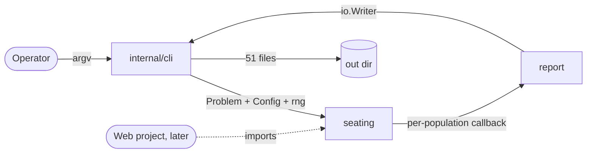
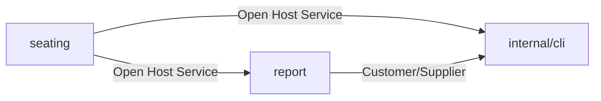

# Architecture: DSSeating Port (Go)

**Status:** Draft
**Altitude:** System (small, greenfield)
**Paradigm:** Functional-core library with thin adapters (hexagonal-lite): pure engine package, CLI and report as outer adapters
**Author:** architect agent
**Last updated:** 2026-10-31 (spec round 2: B-1, B-2, B-3, W-1..W-5 as they apply here; PRD FR-16/17/18/19/24/25)
**Sources:** `/Users/cgianelle/Projects/dsseating-port/docs/dsseating-port/prd.md` (owner decisions D1-D18); Java original `DS_Seating.java`, `ClassPopulation.java`, `IndividualMapsTo.java` and sample `Generation5050.txt` (read-only, consulted for defaults and report layout only)

## 1. Purpose & Scope

Governs how the Go port is split into packages, how the GA engine stays independent of CLI and files, how randomness and scoring are made deterministic, and the few cross-cutting rules (errors, report shape, tests) that independent implementers could otherwise choose incompatibly.

Does not decide: product scope (PRD), the web front end (D14, separate project), tactical code structure inside a package (entities, helper names; `clean-code`), or any UX beyond CLI text, which the PRD fixes.

## 2. Design Paradigm

Functional core, imperative shell. The `seating` package is a pure library: immutable problem definition in, immutable populations out, every operator a function of its inputs plus one injected `*rand.Rand`. The CLI and report writer are adapters that depend on the engine; the engine depends on nothing but the standard library. Implication: nothing in `seating` prints, reads flags, touches the filesystem, reads the clock, or holds package-level mutable state, and operators never mutate their arguments.

## 3. Context & Constraints

- Greenfield Go module at `/Users/cgianelle/Projects/dsseating-port/` (currently only `docs/`). The Java project is read-only reference (D1).
- Hard constraints: Go standard library only, no cgo, macOS and Linux (PRD section 5); Go 1.27.3 installed at `/opt/homebrew/bin/go` (D1). Single process, single goroutine for a run.
- External systems: none at runtime. Filesystem output directory only, touched by the CLI/report adapter.
- Brownfield ratified from Java: default selection is Random (`SelectionType` 0 is treated as random, see PRD review R-1); legacy report layout (sample `Generation5050.txt`).



## 4. Ubiquitous Language

Inherited verbatim from the PRD. Conflicts and resolutions:

| Term | Meaning in this system | Do not call it |
|------|------------------------|----------------|
| Layout | List of seats, each with row and column (FR-1). Default 5 rows x 4 columns | grid, room, classroom (in code) |
| Seat | One position with `Row`, `Col` (1-based, row 1 is front) and `Aisle` flag | slot, desk |
| Person | One entry of the people list, identified by `Label` (default A-T). Code term, per FR-1. User-facing CLI text says "student" because the legacy flags do | member, attendee, gene value |
| Chromosome | Permutation of people over seats: element `i` is the person in seat `i` (FR-1) | genome, string |
| Individual | A Chromosome together with its scores. Reports print `Individual:` | phenotype, member |
| Population | Exactly `PopSize` Individuals scored together; one report file | generation (the generation is the index, not the set) |
| Generation | Integer index of a population: `-1` (initial; file name `5050`) then `0..49` | step, epoch |
| Rule set | The `-frontrow`, `-proximity`, `-isle` rules. Code says `RuleSet`; user-facing text (help, summary, errors) may say "rules" (UX owns wording) | constraints (in code and user text) |
| Front Row Score, Near By Score, Isle Score, Total Fitness Score, Weighted Score | PRD FR-3..FR-7 labels; "Isle" spelling is fixed in report and flag text; code identifiers say `Aisle` | any rename of report labels |
| Mating pool | Ordered list of `PopSize` Individuals produced by selection; adjacent slots `(2i, 2i+1)` are mated | parents list, tournament |
| Queen | Best Individual of the population being selected from (FR-9) | elite |
| Kill rate | Integer percent of weakest Individuals removed by plague | cull rate |

Conflict flagged, not renamed: the PRD uses "people" (FR-1) and "students" (FR-3..6, flags). Resolution above: Person in code, student in user-facing text. Also "Individual" (reports) vs "chromosome" (FR-1) are kept as two terms with the meanings above.

## 5. Domain Landscape

| Subdomain | Kind | Where effort goes |
|-----------|------|-------------------|
| Fitness scoring (FR-3..7, 21) | core | Correctness by hand-computed unit tests; integer arithmetic (AD-4) |
| GA operators: selection, crossover, mutation (FR-8..14) | core | Validity by construction, strict probability semantics, determinism (AD-3, AD-5) |
| Run loop and ordering (FR-15) | core | Documented phase order (AD-6) |
| Layout and constraint model (FR-1) | supporting | Keep minimal; the seam for the web project (AD-2) |
| CLI parsing/validation and help (FR-17..19) | supporting | Table-driven, exhaustive validation tests (AD-8) |
| Report writing (FR-16) | supporting | Golden-file test; sacrificial format (AD-7) |
| RNG, file IO, number formatting | generic | stdlib only, no abstraction |

## 6. Bounded Contexts & Context Map

One real domain context (Seating Engine). CLI and Report are adapters in separate packages, listed because they carry their own vocabulary (flags, legacy file names).

| Context | Owns | Language notes | Upstream / downstream | Integration pattern |
|---------|------|----------------|-----------------------|---------------------|
| Seating Engine (`seating`) | Layout, people, rule set compilation, scoring, selection, crossover, mutation, run loop | Person, Chromosome, Individual, Generation (-1 = initial) | Upstream of CLI and Report | Open Host Service (exported Go API is the published contract) |
| Report (`report`) | Legacy text format, file naming incl. `5050`, "Isle" labels | Legacy labels; maps Generation -1 to `5050` | Downstream of Engine; upstream of CLI | Conformist to Engine types; Anticorruption Layer for legacy naming (engine never learns "5050") |
| CLI (`internal/cli`) | argv grammar, validation messages, help, stdout summary, stderr errors/notes, exit codes, seed defaulting, output dir, atomic file creation | Student, flag names | Downstream of Engine and Report | Conformist to Engine (builds `Problem`/`Config`); Customer/Supplier with Report (CLI supplies an `io.Writer` per file) |



Dependency direction is one-way: `cmd/dsseating` -> `internal/cli` -> {`report`, `seating`}; `report` -> `seating`; `seating` -> stdlib only.

## 7. Architecture Decisions

### AD-1 — Package split and dependency direction

- **Status:** Adopted
- **Binds:** all FR; NFR Maintainability, Portability
- **Prevents:** engine importing CLI/report/os (FR-1 reuse broken); duplicate parsing in tests; web project forced to untangle a `main` package
- **Rule:** Packages as in Structural Seed. `seating` (exported, importable by the later web project) imports only stdlib packages that are pure (`math/rand/v2`, `sort`/`slices`, `errors`, `fmt` for error values only). It must not import `os`, `io/fs`, `flag`, `time`, `bufio`, or `log`, and must not print. A test runs `go list -f '{{join .Imports "\n"}}' ./seating` and fails if a forbidden import appears. `report` imports `seating` plus the pure stdlib set `io`, `strconv`, `strings` (number formatting and line assembly); it must not import `os`, `io/fs`, `flag`, `time`, `log`, or `math/rand*`, enforced by the same `go list` test. `report` never opens, creates, renames or removes files: temp-file and rename logic lives in `internal/cli` (AD-7). All `os`, `flag`-free argv handling, file creation and clock access live in `internal/cli`; `cmd/dsseating/main.go` is a ten-line shim calling `cli.Run(args, stdout, stderr) int` and `os.Exit`. `Run` taking writers and returning the exit code is what makes CLI tests possible without subprocesses.
- **Alternatives considered:** single `main` package (fast, but violates FR-1 reuse and testability); `internal/` for the engine (blocks the web project from importing it); engine + report in one package (couples legacy naming to the engine).

### AD-2 — Layout seam: seats carry their own coordinates and aisle flag

- **Status:** Adopted
- **Binds:** FR-1, FR-3, FR-4, FR-5, FR-6, FR-22 (non-5x4 test)
- **Prevents:** hardcoded 5/4 constants in scoring (the legacy copy-paste bug class); aisle meaning "column 1 or 4" baked into fitness; two implementers modeling chromosome position differently
- **Rule:** `type Seat struct{ Row, Col int; Aisle bool }`; `type Layout []Seat`. Chromosome index `i` is `Layout[i]`; seat identity is its index. `seating.Grid(rows, cols int) Layout` builds row-major seats with `Aisle = (Col == 1 || Col == cols)` (FR-6), rows 1-based from the front. Scoring reads only `Seat.Row`, `Seat.Col`, `Seat.Aisle`; it never references 5, 4, or the grid dimensions. Front-row scores are a per-row table on the scoring config: `FrontRowScores []int` indexed by `Row-1`, validated `len == max Row`; `seating.DefaultFrontRowScores = {10,7,0,-7,-10}` (D6) is used by the CLI. A non-5-row layout must supply its own table; the engine never interpolates. People are `[]Person{Label string}`; `len(People) == len(Layout)` is validated. Rule-set members are person indices, resolved from labels by the caller (CLI), never by label strings inside the engine.
- **Alternatives considered:** `Rows, Cols` ints in config (re-bakes the grid, blocks round tables); interface `Topology` (Rule of Three: one implementation exists); label strings as gene values (string compares in hot loop and a validation surface in the core).
- **Notes:** The table-per-row approach is `[ASSUMPTION]` adequate for the web project's first iteration; a general scoring function is deferred (section 14).

### AD-3 — One injected RNG, fixed generator, fixed draw order

- **Status:** Adopted
- **Binds:** FR-14, FR-20, NFR Reproducibility
- **Prevents:** per-call time-seeded RNGs (legacy correlation); two generators in one run; rate comparisons that disagree at 0.0 and 1.0; map-iteration or goroutine nondeterminism making `-seed` runs differ
- **Rule:** Every function that needs randomness takes `*rand.Rand` (`math/rand/v2`) as an explicit parameter; no package-level `rand` functions and no `time` in `seating`. The CLI builds the one RNG as `rand.New(rand.NewPCG(seed, 0x9E3779B97F4A7C15))` with a fixed second word (`seed` is `uint64`; negative or non-numeric `-seed` is a usage error). A rate event is `rng.Float64() < rate`: 0.0 never fires, 1.0 always fires (Float64 is in [0,1)). A rate draw is always consumed even when the rate is 0 or 1, so the stream shape does not depend on rate values. The run is single-goroutine; output paths never iterate Go maps. Phase-level draw order is fixed by AD-6; intra-operator draw order is implementer's choice because tests assert properties, not exact streams. Seed omitted: CLI seeds from `time.Now().UnixNano()` (cast to `uint64`); the seed used is always reported in the stdout summary whether given or derived (FR-20, FR-24, AD-8).
- **Alternatives considered:** `math/rand` v1 global (shared mutable state, deprecated seeding semantics); an `RNG` interface (no second implementation yet); ChaCha8 (heavier, no benefit here).
- **Notes:** `[ASSUMPTION]` `math/rand/v2` PCG output and `IntN`/`Float64` reduction are stable for the same Go version; the PRD scopes byte-identical output to the same Go version and OS (NFR Reproducibility), and the reproducibility test is the tripwire if a toolchain bump changes it.

### AD-4 — Scores are exact integers; Weighted Score is an integer in hundredths

- **Status:** Adopted
- **Binds:** FR-3..FR-7, FR-16, FR-21, FR-23
- **Prevents:** float ranking noise and FMA-fusion differences across CPUs (arm64 may fuse `x*y+z`), which would break byte-identical reports and make ties unstable; ambiguity about "truncated to int as in legacy"
- **Rule:**
  - Distance is kept in half-units: `h = |dx| + |dy|` (so `d = h/2`, FR-4). Default mode (D5): `h > 2` gives `+5h`, else `-5h`. `-strictprox`: `h > 2` gives `+5h`, else flat `-30`. These equal `+/-10d` exactly for every half-integer `d`, so no truncation or floats occur. Per-pair scores are summed as `int`.
  - `Scores{Front, NearBy, Isle, Total int; Weighted100 int}` with `Total = Front+NearBy+Isle` and `Weighted100 = 60*(F+N) + 10*(F+I) + 10*(N+I) + 4*F + 4*N + 2*I` (exactly FR-7 times 100; no floor, D7). Selection, plague ranking and "best" compare `Weighted100` only.
  - `Weighted()` returns `float64(Weighted100)/100` and is used only for printing; the report prints it with `strconv.FormatFloat(v, 'f', -1, 64)` plus `.0` when no decimal point results (FR-16, D11).
  - Best Individual = highest `Weighted100`; ties go to the lowest population index (strict `>` scan). It is always an actual Individual, never null (FR-21).
  - Person-to-seat lookup is rebuilt per Individual from the Chromosome (inverse array), so no coordinate state survives between individuals (FR-4 stale-coordinate fix). Duplicates are never scored twice (FR-19): `NewProblem` rejects, with `ErrInvalidConfig`, a person repeated in the front-row list, a person repeated in the aisle list, a not-near pair repeated (unordered: `(a,b)` equals `(b,a)`), and a pair `(a,a)`. A person may appear in different rule types. The CLI detects the same conditions first, after uppercase normalization, to produce FR-19 messages; `NewProblem` is defense in depth for non-CLI callers (the later web project).
- **Alternatives considered:** `float64` with the PRD formula (works but FMA/ordering risk, tie ambiguity); `math/big.Rat` (overkill).

### AD-5 — Operators are pure, valid by construction, and copy-on-write

- **Status:** Adopted
- **Binds:** FR-8..FR-14, FR-2, FR-22 validity property tests; NFR Safety
- **Prevents:** in-place mutation of shared slices (legacy in-place mutation, 101-entry list); repair steps masking invalid crossover; panics on edge rates; selection outputs of the wrong length
- **Rule:**
  - A `Chromosome` is `[]int` (person index per seat) and is never modified after creation. Every operator returns freshly allocated slices; mutation copies before reversing (FR-13).
  - Selection returns a mating pool of exactly `PopSize` Individuals in pairing order. Random: `PopSize` uniform picks with replacement (FR-8). Queen: the pool is `queen, other_1, queen, other_2, ...` (50 pairs), each `other` drawn uniformly with replacement from the population excluding the queen's index; if the population has no other member, the queen is used (FR-9). Plague: `kill = PopSize*KillRate/100` (integer division); the `kill` lowest by `Weighted100` (ties broken by higher index removed first, via a stable sort, for determinism) are removed; the pool is `PopSize` uniform picks with replacement from all survivors, including the last (FR-10). BeePlague: plague yields the survivor set, then Queen is applied to survivors (FR-11); the pool is queen-paired as above, and with one survivor it is that survivor repeated.
  - PMX uses a contiguous block of `min(4, n)` positions at a random start (D9 block size 4); standard PMX position-mapping so both children are valid permutations. CX picks the cycle start position uniformly from the seeded RNG per pair (D18); child 1 takes the cycle positions from parent A and the rest from parent B, child 2 the reverse. If the crossover rate does not fire, the two parents pass through as copies (FR-12).
  - Mutation: per Individual, `rng.Float64() < MutRate`; if it fires, two distinct positions `i<j` are chosen and `[i..j]` reversed on a copy (D10, FR-13).
  - `Run` verifies each new population (every Chromosome is a permutation of `0..n-1`, population length is `PopSize`) and returns an error instead of continuing or panicking; the same helper `seating.IsPermutation` backs the property tests (>= 1000 runs).
- **Alternatives considered:** keep legacy repair-after-crossover (hides bugs); in-place mutation with pooling (premature optimization, population is 100x20); strategy interfaces per operator (function values suffice; Rule of Three).

### AD-6 — Run loop order, pairing and callback contract

- **Status:** Adopted
- **Binds:** FR-2, FR-15, FR-16, NFR Reproducibility
- **Prevents:** two plausible loop orders (dumping parents vs offspring, an unscored last generation), different pairing conventions, and engines that write files themselves
- **Rule:** `Run(p Problem, c Config, rng *rand.Rand, observe func(Population) error) (Population, error)`.
  1. Build the initial population: `PopSize` random permutations (Fisher-Yates via `rng.Shuffle` or `rng.Perm`), score, `observe` with `Generation = -1`.
  2. For `g = 0 .. Generations-1`: select a mating pool from the current population; cross each adjacent pair `(2i, 2i+1)` in order; mutate every offspring in order; score; `observe` with `Generation = g`; the offspring become the current population. No elitism beyond what selection does.
  3. Draw order across phases is: selection draws, then crossover draws (pairs in order), then mutation draws (Individuals in order). Return the final population.
  `observe` is called synchronously, in order, exactly `Generations+1` times; a non-nil error aborts the run and is returned. Every observed population is a complete scored `Population` (Individuals plus the index of the Best), safe to retain because operators never mutate. `Config` validation (in `Config.Validate`, returning errors that wrap `seating.ErrInvalidConfig`): `PopSize` even and >= 2, `Generations >= 1`, rates in [0,1] and not NaN, `KillRate` in [0,99].
- **Alternatives considered:** dump-then-breed (the last bred population would be unscored/unreported); channel/iterator of populations (concurrency and ordering risk with no benefit); engine writes reports (breaks AD-1).

### AD-7 — Report format is a sacrificial legacy adapter, tested by golden file

- **Status:** Adopted
- **Binds:** FR-16, FR-21, D4, D11
- **Prevents:** engine learning file names or label spellings; report drift between implementers; Windows/Unix newline disagreement; half-written files under a final report name
- **Rule:** `report.Write(w io.Writer, pop seating.Population, people []seating.Person) error` writes one population; `report.FileName(generation int) string` returns `Generation5050.txt` for `-1` else `Generation<g>.txt`. Layout of a file, derived from the sample `Generation5050.txt`: `Best Individual: <labels>` then the five lines `Front Row Score: n`, `Near By Score: n`, `Isle Score: n`, `Total Fitness Score: n`, `Weighted Score: x`, then a separator of exactly 49 underscores; then 100 blocks identical except the first line is `Individual: <labels>`. `<labels>` is the person `Label`s concatenated in seat order. Line endings are `\n` (PRD assumption; the Java samples are CRLF, see R-3). `report.Write` writes to the `io.Writer` it is given and surfaces errors; the CLI supplies a `bufio.Writer` over a temp file and flushes it. Atomic writes (FR-16) are a CLI responsibility: for each `observe` call the CLI creates the output dir once with `os.MkdirAll(dir, 0o755)`, creates a temp file in that same dir (`os.CreateTemp(dir, ".Generation*.tmp")`, same filesystem so rename is atomic), writes, flushes, `Sync`s, closes, `os.Chmod(0o644)` (CreateTemp makes 0600), then `os.Rename`s onto `report.FileName(g)`, replacing any existing file. On any error the CLI closes and removes the current temp file, aborts the run (returning the error from `observe`) and exits 1. A final report name therefore never holds partial content. Completed files from earlier generations of the same failed run are left in place `[ASSUMPTION]` (each is whole; see PRD review R-8). Sacrificial: replace `report` with a JSON/streaming adapter when the web project needs it (trigger: first non-CLI consumer); the engine is untouched.
- **Alternatives considered:** `text/template` (overkill for 6 fixed lines); engine-level `String()` methods carrying labels (pushes legacy format into the core).

### AD-8 — Hand-rolled, table-driven argv parser; one error type; fixed exit codes

- **Status:** Adopted
- **Binds:** FR-17, FR-18, FR-19, FR-20, FR-24, FR-25, D15
- **Prevents:** the stdlib `flag` package silently diverging from required behavior (stops at first non-flag, accepts `--x`/`-x=v`, owns `-h`/exit codes, last-wins on conflicts and repeats); each implementer inventing different stdout shape, error format, exit codes or recover policy
- **Rule:**
  - **Grammar.** `internal/cli` parses `args` with a table `flag -> arity` (`-frontrow 1`, `-proximity 2`, `-isle 1`, `-xoverrate 1`, `-mutrate 1`, `-killrate 1`, `-seed 1`, `-out 1`, and zero-arity `-random -queen -plague -beeplague -pmx -cx -strictprox`). Case-sensitive exact match; values are consumed by their flag and never re-scanned (FR-17). A flag missing its value (end of args, or the next token exactly equals a known flag or help alias) or an unknown token is a usage error naming the token. Parsing yields a plain `Options` struct (no `os` access) so it is unit-testable.
  - **Help first.** Before any other parsing or validation, if `args` is empty or any raw token equals `-h`, `-help` or `--help`, print help to stdout and return 0. Help beats every other error (FR-17). Help text must state the defaults: random selection, cycle crossover (FR-18); wording is UX's.
  - **Defaults.** No selection flag means `-random`; no crossover flag means `-cx` (FR-17). These come from `seating.DefaultConfig()`, not from CLI literals.
  - **Conflicts (D15).** More than one selection flag token from {`-random`,`-queen`,`-plague`,`-beeplague`}, or more than one crossover flag token from {`-pmx`,`-cx`}, is an exit-2 usage error, counted by occurrence: a distinct pair (`-queen -plague`, `-pmx -cx`) and an identical repeat (`-plague -plague`, `-cx -cx`) are both errors, matching FR-19's literal "more than one selection flag or more than one crossover flag" (closes B-1). Parser tests must cover the identical-repeat cases.
  - **Validation (FR-19), all exit 2.** Labels are uppercased first (lowercase accepted), then must be in the people set. Rates parse as finite float64 in [0,1]; `-killrate` parses as int in [0,99]; `-seed` parses as `uint64`. Duplicates are errors, never scored twice (see AD-4): a label repeated in `-frontrow`, a label repeated in `-isle`, a `-proximity` pair repeated (unordered), `-proximity X X`. Any of `-seed`, `-out`, `-xoverrate`, `-mutrate`, `-killrate`, `-strictprox` given more than once is an error. A label may appear in different rule types. `ErrInvalidConfig` from the engine maps to exit 2 with its message.
  - **Errors (FR-25, closes B-3).** Every error is exactly one line on stderr: `dsseating: error: <message>`, the message naming the offending token, value or file. No fix-it or usage trailer lines; UX owns message wording and any hint text must live inside that single line. Exit codes: 0 success or help, 2 usage/validation/`ErrInvalidConfig`, 1 filesystem I/O failure and internal errors. `cli.Run` installs a `defer recover()` that turns any panic into `dsseating: error: internal error: <value>` and exit 1; no stack trace is printed. This is a last-resort net only; input-dependent conditions must still return errors (section 8).
  - **Notes (FR-19).** Non-fatal conditions are single stderr lines `dsseating: note: <message>`, exit stays 0, emitted after validation and before the run starts, in fixed order: `-killrate` without `-plague`/`-beeplague`; `-strictprox` with no `-proximity` rule; no rules at all. Notes never go to stdout.
  - **Stdout contract (FR-24, closes B-1).** On success stdout contains, in this order and nothing else: (1) the seed used, always printed, given or time-derived; (2) the final generation's Best Individual with its five scores (Front Row, Near By, Isle, Total Fitness, Weighted); (3) the output directory and the number of files written (`Generations+1`, 51 by default). Exact wording and layout are UX's (`ux.md` section 8.2) and must not add lines beyond these three items; the architecture binds only content, order and determinism. Stdout is produced by one pure function from a plain summary value (seed, best Individual and labels, out dir, file count), so it is golden-testable and byte-identical for the same argv+seed; it contains no timestamps, durations or temp paths. Help goes to stdout only on the help path.
- **Alternatives considered:** stdlib `flag` with `flag.Func` (cannot express two-value `-proximity`, `-h` and unknown-token behavior without fighting it); third-party CLI libs (violates D1 stdlib only).

### AD-9 — Test layout: fast unit tests by default; quality check and sample check are opt-in/skippable

- **Status:** Adopted
- **Binds:** FR-22, FR-23, D13, D17, Goals "Strict mode works", "Informational only"
- **Prevents:** a statistical check turning `go test ./...` flaky or blocking; sample tests failing when the Java folder is absent; tests asserting exact RNG streams
- **Rule:** `go test ./...` runs deterministic unit and property tests only (fixed seeds, no wall-clock thresholds; the "well under 1 s" check is a benchmark, not an assertion). The D17 strict-mode check (30 seeded runs, paper rule set front A,D,F,I,L,P,R; not-near Q,R,S as three pairs; isle F; `-strictprox`) lives in `seating/quality_test.go` behind build tag `quality` (`go test -tags quality -run Quality -v ./seating`), with threshold constants in one place and output as PASS/FAIL plus the measured fraction; the informational median-vs-96.92 comparison logs only and never fails. The FR-23 sample tests live in test files only (no production parser), read the directory from env `DSSEATING_SAMPLES` defaulting to `/Users/cgianelle/Projects/DSSeating_10_10_03` (read-only), and call `t.Skip("unverified: ...")` when files or an inferable rule set are missing. The sample parser must tolerate CRLF (trim `\r`); the Java samples are CRLF while our reports are LF. Per FR-23 they assert permutation validity, Total = F+N+I, and Weighted from recorded F/N/I only where recorded Weighted > 0 (tolerance 1e-9, since Java printed binary floats), and Near By only in default mode with an inferred rule set. Tests assert properties (validity, ranges, counts, determinism by running twice), never specific RNG outputs. Fitness tests use hand-computed cases; each fixed quirk has a named test.
- **Alternatives considered:** put quality check in default tests (flaky/blocking, violates D17); separate harness (rejected by D13).

## 8. Consistency Conventions

| Convention | Rule |
|------------|------|
| Errors | Return `error`; no `panic` for input-dependent conditions anywhere. Engine sentinel `seating.ErrInvalidConfig` (wrap with `%w`). CLI maps errors to exit codes and the single-line `dsseating: error: <message>` format per AD-8; `cli.Run` alone recovers panics (internal error, exit 1) |
| Output streams | Only `internal/cli` writes to stdout/stderr. Stdout: help, or the FR-24 summary. Stderr: errors and notes. Nothing else |
| Naming | Go identifiers say `Aisle`; any user-visible string uses legacy `Isle` (labels, flag, help). Report labels are constants in `report`, flag names constants in `cli` |
| Slices | Treat any slice received from another package as read-only; copy before changing |
| Immutability | `Problem` (layout, people, compiled rule set, scoring) is constructed once via `seating.NewProblem(...)` which validates, and is never mutated after |
| Rule-set compilation | `NewProblem` accepts person indices for front-row, not-near pairs, and aisle lists; out-of-range index is `ErrInvalidConfig` |
| Defaults | Defaults live in one place: `seating.DefaultConfig()` (pop 100, gens 50, xover 0.9, mut 0.1, kill 50, PMX block 4, CX, Random) and `seating.DefaultPeople()` (A-T) with `Grid(5,4)` |
| Formatting | `gofmt` and `go vet` clean; `go test ./...` green is the gate |
| Dependencies | Zero entries in `go.sum`; `go.mod` has no `require` |

## 9. Stack & Versions

| Component | Choice | Version | Notes |
|-----------|--------|---------|-------|
| Language / runtime | Go | 1.27.3 | Verified current stable on go.dev download index (2026-10-31); installed at `/opt/homebrew/bin/go`. `go.mod`: `module dsseating`, `go 1.27` |
| RNG | `math/rand/v2` PCG | stdlib | See AD-3 |
| CLI | hand-rolled | n/a | AD-8 |
| Test | `testing` | stdlib | Build tag `quality` for AD-9 |
| Third-party | none | n/a | D1 |

## 10. Structural Seed

```text
/Users/cgianelle/Projects/dsseating-port/
  go.mod                       # module dsseating, go 1.27, no requires
  README.md                    # states web front end is a separate future project
  cmd/dsseating/main.go        # shim: os.Exit(cli.Run(os.Args[1:], os.Stdout, os.Stderr))
  internal/cli/                # Options parse, validate, help, wiring, file creation, seed, exit codes
  report/                      # Write, FileName (legacy format, 5050 mapping)
  seating/                     # Layout/Seat/Person, Problem, Config, Scores, fitness,
                               # selection (random/queen/plague/beeplague), crossover (pmx/cx),
                               # mutation, Run, IsPermutation; *_test.go; quality_test.go (tag)
  docs/dsseating-port/         # prd.md, architecture.md, ...
```

Runtime view: argv -> `Options` -> (`Problem`, `Config`, rng) -> `seating.Run` -> per-population callback -> `report.Write` -> `Generation*.txt`.

## 11. Data & State

- Ownership: `seating` owns all domain state in memory for the duration of one `Run`; `cli` owns the output directory and files. There is no database, cache, or shared state; nothing survives between invocations except report files.
- Key entities: `Layout`, `[]Person`, `Problem` (immutable), `Config` (immutable), `Chromosome`, `Individual`, `Population` (+ Generation index, Best index).
- Aggregates (consistency boundary): a `Population` is the unit of consistency: `PopSize` Individuals, each a valid permutation, each scored against the same `Problem`. It is created whole by one phase and never edited; the next population is a new value. Individuals reference people and seats by index only.
- Cross-aggregate consistency: none needed; a run is a pure sequence of Populations.
- Domain events: none as a mechanism. The observer callback delivers each completed Population, named by its Generation (`-1`, `0..49`); that is the sole contract between Engine and Report/CLI.
- Output set: exactly `Generations + 1` files (51 by default) per run, all in the `-out` directory (default `./out/` relative to CWD, never CWD itself). Each file appears under its final name only complete (AD-7 temp + rename). A failed run exits 1 and may leave the whole files from earlier generations, never a partial file or stray temp file.

## 12. Quality Attributes

| Attribute | Requirement | Notes |
|-----------|-------------|-------|
| Performance | Default run well under 1 s on dev machine | Trivially met: ~5100 evaluations of 20 genes; buffered writes. No premature optimization |
| Reproducibility | Same seed + args -> byte-identical files and stdout (10 repeats) | AD-3, AD-4, AD-6; same Go version and OS |
| Safety | No panic on bad input; original Java folder never written | AD-8; sample tests open it read-only |
| Portability | stdlib only, no cgo, macOS/Linux | AD-1; use `filepath` for paths |
| Evolvability | Expected to change: layout topology, scoring rules, constraint types, output format. Sacrificial: legacy report format (AD-7), per-row front table (AD-2), CLI flags. Durable: pure `seating` API and operator validity rules | Replace report when first non-CLI consumer appears; generalize scoring when a second constraint type is required (Rule of Three) |

Security, tenancy, availability, observability: no requirement.

## 13. Delivery & Operations

Local `go build ./cmd/dsseating` and `go test ./...` only. No CI, packaging or deploy specified. Config is argv only; no environment variables in production code (`DSSEATING_SAMPLES` is test-only).

## 14. Deferred

| Item | Why deferred | Revisit when |
|------|--------------|--------------|
| General scoring function / constraint plug-ins (age, family) | One constraint family exists (Rule of Three) | Web project needs a second constraint type |
| Non-grid topologies | Out of scope (PRD) | Round tables requested; Layout is already coordinate-based |
| CLI flags for size/pop/gens | PRD defers | Owner asks |
| JSON/other report formats | Out of scope | Web project start |
| Concurrency across runs (e.g. many seeds in parallel) | Not needed; hurts determinism if shared RNG | Quality check runtime becomes a problem |
| Varying PMX block size, anti-convergence, per-generation selection switch | Paper future work | Owner asks |

## 15. Open Questions & Assumptions

- **Assumed:** `[ASSUMPTION]` `math/rand/v2` PCG streams and method reductions are stable within a Go version (AD-3).
- **Settled by PRD (round 2):** default selection `-random`, default crossover `-cx` (FR-17/FR-18); zero arguments prints help, exit 0; `-help`/`--help` aliases; stdout contract (FR-24); error format (FR-25); duplicate and repeated-flag errors (FR-19); atomic writes (FR-16). The PRD marks several as owner-unconfirmed (R); the architecture follows them.
- **Settled (B-1):** repeating an identical selection or crossover flag (e.g. `-queen -queen`, `-cx -cx`) is an exit-2 error, per FR-19's "more than one selection flag or more than one crossover flag" (AD-8).
- **Assumed:** `[ASSUMPTION]` a value token that exactly equals a known flag or help alias counts as a missing value (`-out -seed`).
- **Assumed:** `[ASSUMPTION]` Queen "others" are drawn with replacement from the rest of the population (FR-9 says "50 randomly chosen others" without specifying).
- **Assumed:** `[ASSUMPTION]` PMX block start is uniform random in `[0, n-block]`; the PRD fixes only the size.
- **Assumed:** `[ASSUMPTION]` the 49-underscore separator and the block layout in AD-7 are read correctly from the sample; a golden test is the check.
- **Open:** none blocking.

## 16. Risks

| Risk | Impact | Mitigation |
|------|--------|------------|
| Toolchain bump changes `math/rand/v2` output | Seeded outputs differ across Go versions | Reproducibility test within one version; pin Go in `go.mod`; document |
| Per-row front table does not generalize for the web project | Rework of scoring config | Isolated in `Problem`; table is data, not code (AD-2); revisit per section 14 |
| Quality (D17) result below threshold | Informational fail only | Not a build blocker; thresholds calibrated after first measurement |
| Report format misread from sample | Golden test would encode the mistake | Verified against `Generation5050.txt` (separator, label text); owner reviews first run (PRD section 10) |
| Tie-breaking choices differ from owner's intuition | Different "best" in equal-score cases | Documented in AD-4; low impact |

## 17. PRD review (graph runs)

| ID | Severity | Finding | Suggested change |
|----|----------|---------|------------------|
| R-1 | Closed | Default selection now stated in FR-17/FR-18 (`-random`) | none |
| R-2 | Note | FR-9 does not say whether the queen can be drawn as an "other", nor how many pairs when `PopSize` differs from 100 | Architecture draws others excluding the queen and pairs to fill `PopSize`; confirm or restate |
| R-3 | Note | The assumption that report files use `\n` differs from the Java samples, which use CRLF. Matters only to byte-comparing against old files | Keep `\n`; sample parser trims `\r` (AD-9) |
| R-4 | Note | FR-16 does not give the separator width or whether the Best block ends with a separator; derived from the sample (49 underscores, separator after every block) | Optionally state in FR-16 |
| R-5 | Note | FR-19 range for `-killrate` is [0,99] while the Java help said 1-90; consistent with FR-10 | None |
| R-6 | Closed | Seed always printed: now FR-20/FR-24 | none |
| R-7 | Note | D5 uses `d` as half-steps. Architecture implements this exactly in integers (AD-4); the PRD's "truncated to int" never actually truncates | None |
| R-8 | Note | FR-16 says on write failure "no partial report file is left". Architecture removes the in-flight temp file only; whole files from earlier generations of the failed run remain | Confirm, or require removing all files written by that run |
| R-9 | Note | FR-25 allows one stderr line per error; the UX draft's extra fix-it and `Try 'dsseating -h'` lines conflict. Architecture follows FR-25 | UX to fold any hint into the single line |
| R-10 | Note | FR-19 says "more than one selection flag or more than one crossover flag"; architecture reads this literally, so an identical repeat (`-queen -queen`) is an exit-2 error, same as a distinct pair | Resolved by B-1; confirm the literal reading is intended |
