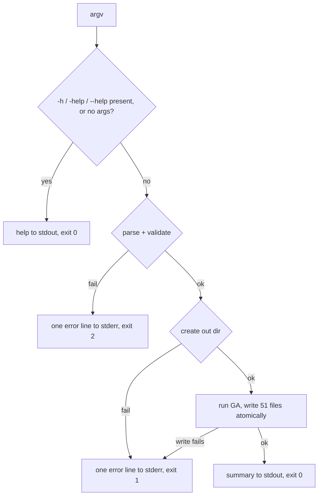

# UX: DSSeating Port (CLI surface)

**Status:** Draft (revision round 3)
**Author:** Sally
**Last updated:** 2026-10-31
**Sources:** /Users/cgianelle/Projects/dsseating-port/docs/dsseating-port/prd.md (revised, owner-approved), /Users/cgianelle/Projects/dsseating-port/docs/dsseating-port/check-report.md

Scope note: the "UI" of this feature is a command-line tool plus 51 report files. There are no screens. Per the template, "screens" below are CLI surfaces (help, run output, error output, report file). The web front end is out of scope (D14) and is not designed here.

## Revision log (round 2)

| Issue | Fix in this file |
|-------|------------------|
| B-1 | 8.2 rewritten to the PRD stdout contract (FR-24): seed, final best individual with five scores, output dir and file count; nothing else. Seed line has one form whether given or time-derived. |
| B-2 | 8.3 / 9 aligned to PRD FR-19: duplicates, repeated scalar flags (now including `-strictprox`), and `-proximity X X` are exit-2 errors; lowercase labels are accepted and normalized (previously rejected with a hint; changed). U-2, U-3 closed by the PRD. |
| B-3 | 8.3 rewritten to the PRD single-line error format (FR-25): `dsseating: error: <message>`. The separate fix line and the "Try -h" line are removed; the fix is folded into the one line. Internal errors use the same format, exit 1. |
| W-1 | `<DEFAULT>` replaced: default selection is `-random`, default crossover `-cx` (FR-17, FR-18). O-1 closed. |
| W-2 | `-help` / `--help` aliases, notes, duplicate rejection, lowercase normalization now come from the PRD, not from assumptions here. Remaining UX-only behaviours are listed in section 11. |
| W-3 | 8.4 aligned to FR-16: temp file in the output dir, then rename; partial files removed on failure. |
| W-5 | User-facing text uses "rules" (the PRD's wording: "no rules at all", "rule set"). The word "constraints" is not used in CLI text. Architecture's do-not-call list must permit "rules" in user-facing strings. |

## 1. Goal

A teacher-style operator (the owner) types one command with seating rules, gets a short, trustworthy confirmation on the terminal, and finds the 51 reports in a predictable folder. When the input is wrong, the tool prints one line that says exactly which token is wrong and how to fix it, and exits with a code a script can rely on. A developer can trust that identical `-seed` + args give byte-identical stdout and files.

## 2. Recommended direction

One direction: a conventional single-binary CLI that keeps legacy single-dash, single-token flags, with these principles.

1. **Quiet and deterministic on success.** Stdout is the fixed-shape summary defined by FR-24 (8 lines). No timings, no progress spam, no absolute temp paths that vary by run. With `-seed`, stdout is byte-identical across runs (FR-20, NFR).
2. **Streams carry meaning.** Help and success summary go to stdout. Errors and advisory notes go to stderr. Help is success (exit 0).
3. **Fail early, fail once, fail specifically.** All validation happens before any file is written. The first problem found, in argv order, is reported as one line naming the offending token with the fix folded in. No partial output on usage errors.
4. **Strictness is consistent.** Conflicting selection/crossover flags (D15), repeated scalar flags, duplicate rules and `-proximity X X` are all hard errors (FR-19). Nothing is "last wins", silently ignored, or scored twice.
5. **Reports are for reading and for parsing.** Same layout as the legacy files (verified against the sample `Generation49.txt`) so FR-23 can parse both; the only deliberate difference is line endings (see U-1).
6. **No wizard, no prompts.** The tool never reads stdin and never asks questions; it is scriptable and CI-safe.

## 3. PRD review (UX lens)

The revised PRD closes the earlier gaps. Remaining items are small; each has an assumed default here so build can proceed.

| ID | Severity | Status | Finding | Suggested change |
|----|----------|--------|---------|------------------|
| U-1 | Medium | Open | FR-16 / section 9 assume `\n` line endings, but the sample files (and legacy output) are CRLF. FR-23 must parse the CRLF samples, and the owner may diff new vs old files. | Keep `\n` as the PRD says; require the sample parser to accept both `\r\n` and `\n` (arch AD-9 should say so explicitly). Mention in README. Assumed here: LF output. |
| U-2 | Medium | Closed by PRD | Duplicate labels / pairs / repeated scalars. | Now in FR-19. |
| U-3 | Medium | Closed by PRD | `-proximity X X`. | Now in FR-19. |
| U-4 | Low | Closed by PRD | No arguments: help, stdout, exit 0. | Now in FR-17. |
| U-5 | Low | Open (UX-only) | FR-19 says "missing or non-numeric values" but not how a value that is itself a flag (`-frontrow -isle F`) is handled. | Specified here: reported as "needs ..." naming the flag (8.3). Within FR-19 "missing value"; no PRD change. |
| U-6 | Low | Closed by PRD | Notes for `-killrate` without plague, `-strictprox` without `-proximity`, no rules. | Now in FR-19. |
| U-7 | Low | Closed by PRD | No-rules run is legal with a note. | Now in FR-19. |
| U-8 | Low | Closed by PRD | Seed always printed. | Now in FR-20 / FR-24. |
| U-9 | Low | Closed by PRD | Report path discoverability. | FR-24 requires dir and file count on stdout. |
| U-10 | Low | Open (question) | FR-19 forbids "more than one selection flag". An identical repeat (`-plague -plague`) is literally two selection flags. This spec treats it as an error ("given twice"), consistent with "duplicates are never silently accepted". If the owner prefers idempotent repeats, say so; only the 8.3 row changes. | Confirm: FR-19 wording could say "or one of them repeated". |
| U-11 | Low | Open (question) | FR-16 says "no partial report file is left" on failure. Read here as: the temp file is removed; files already completed and renamed earlier in the run remain. If the owner wants all 51 removed on any failure, 8.3/8.4 change. | Confirm reading. |

No change to scope, FR text, or decisions D1-D18 is requested. U-10 and U-11 are clarifications.

## 4. Users and jobs

- **Primary:** the owner / teacher-style operator. Job: "seat these 20 students given my rules, then let me read the best seating and see how the GA converged." Comfortable on a terminal; remembers legacy flags; expects `Generation*.txt` files.
- **Secondary:** a developer (and later the web project's author). Job: "run a reproducible command in tests or CI, parse the reports, and rely on exit codes." Needs stable stdout, stable file names, and a parseable file format.
- Context: macOS/Linux, interactive terminal or script, Go standard library only (D1), so no CLI framework. Help is hand-written text. Parsing is a small custom argv loop (the standard `flag` package cannot do `-proximity X Y` two-value switches or repeatable switches cleanly, and would accept `--x` and `-x=v` forms the PRD does not promise).
- Existing patterns reused: legacy flag names and the legacy report layout (D4). No design system applies.

## 5. Key flow

### 5.1 Happy path

1. Operator runs: `dsseating -frontrow A -frontrow D -proximity Q R -isle F -plague -pmx -seed 7`
2. Tool parses and validates all of argv (no files touched).
3. Tool creates the output directory (`./out/` by default) if missing.
4. Tool runs 1 initial evaluation + 50 generations, writing 51 files.
5. Tool prints the run summary to stdout and exits 0.
6. Operator reads the best individual and its five scores in the summary, and opens `out/Generation49.txt` for the full population.

### 5.2 Recovery paths

| Situation | What the user sees | Exit |
|-----------|--------------------|------|
| Wants help | `-h`, `-help` or `--help` anywhere, or no arguments: help on stdout | 0 |
| Typo in a flag | One `error:` line naming the token, with a "did you mean" hint when close | 2 |
| Bad label / rate / number | One `error:` line naming flag, value, and the accepted range | 2 |
| Duplicate or repeated input | One `error:` line naming the repeat | 2 |
| Conflicting flags | One `error:` line naming both flags | 2 |
| Output dir not creatable / file not writable | One `error:` line with path and OS reason; temp file removed; no further files attempted | 1 |
| Re-run into the same dir | The 51 named files are overwritten; other files in the dir are untouched | 0 |



## 6. Information architecture and navigation

The CLI has one command and no subcommands (legacy parity, FR-17). Flags group into five families, and the help text is organised in the same order so users find things where they expect.

1. Rules (what the teacher wants): `-frontrow`, `-proximity`, `-isle`, `-strictprox`
2. Selection (pick at most one): `-random`, `-queen`, `-plague`, `-beeplague`; modifier `-killrate`
3. Crossover (pick at most one): `-pmx`, `-cx`; modifier `-xoverrate`
4. Mutation: `-mutrate`
5. Run control and output: `-seed`, `-out`, `-h` (aliases `-help`, `--help`)

Defaults when a family is not specified: selection `-random`, crossover `-cx` (FR-17, FR-18, D3).

Entry point: the binary name. Exit point: the `out/` directory. The Java project is never touched (NFR safety).

## 7. Surface inventory

| Surface | Purpose | Primary FR IDs |
|---------|---------|----------------|
| S1 Help text | Teach every flag, defaults, and exit codes | FR-17, FR-18 |
| S2 Run summary (stdout) | Confirm seed, best result, and where the output is | FR-20, FR-21, FR-24 |
| S3 Error and note output (stderr) | Explain bad input in one line; advise on odd-but-legal input | FR-17, FR-19, FR-25 |
| S4 Report file `GenerationN.txt` | The deliverable: best seating and population scores | FR-2, FR-3..FR-7, FR-16, FR-21 |
| S5 Exit codes | Machine-readable result | FR-19, FR-25 |

## 8. Surface specifications

### 8.1 S1 Help text (FR-17, FR-18)

Triggers: `-h`, `-help`, `--help` at any position (PRD FR-17); or no arguments. If help is requested, help wins over any other error in argv (the user asked for help; do not scold them first). Output to stdout, exit 0.

Text (90 columns max, no tabs, no color). "Isle" spelling kept in the flag and in prose where it names the flag or report label. "Rules" is the user-facing term.

```
dsseating - seat 20 students (A-T) in a 5x4 classroom with a genetic algorithm

USAGE
  dsseating [rules] [options]
  dsseating -h

RULES  (repeat -frontrow, -proximity and -isle to add more rules)
  -frontrow X         Student X wants a front-row seat.
                      Score by row: 1:+10  2:+7  3:0  4:-7  5:-10
  -proximity X Y      Students X and Y should NOT sit near each other.
  -isle X             Student X must sit on an outside aisle seat
                      (first or last column). +10 if so, else -10.
  -strictprox         Harsher -proximity scoring: any pair that is too close
                      (distance <= 1) costs a flat -30. Without it, the legacy
                      scoring is used (the closer, the bigger the penalty).
  List each student once per switch and each pair once (Q R and R Q are the
  same pair). A student may appear under different switches.

SELECTION  (choose at most one; default: -random)
  -random             Pick 100 parents at random, with replacement (default).
  -queen              Queen bee: the best individual of the current generation
                      mates with 50 random others.
  -plague             Remove the weakest -killrate percent, then pick parents
                      from the survivors.
  -beeplague          Plague first, then queen bee on the survivors.
  -killrate N         Percent removed by -plague / -beeplague, 0-99 (default 50).

CROSSOVER  (choose at most one; default: -cx)
  -cx                 Cycle crossover (default). Starting point varies per pair.
  -pmx                Partially mapped crossover, block size 4.
  -xoverrate R        Chance a pair is crossed, 0.0-1.0 (default 0.9).

MUTATION
  -mutrate R          Chance each individual is mutated (inversion), 0.0-1.0
                      (default 0.1).

RUN
  -seed N             Make the run repeatable. Same seed + same options give
                      identical output. Default: taken from the clock. The seed
                      used is always printed.
  -out DIR            Directory for the reports (default ./out, created if
                      missing).
  -h, -help, --help   Show this help.
  Every option except -frontrow, -proximity and -isle may be given only once.

STUDENTS  are the letters A-T. Lowercase is accepted. To keep three students
  apart, list each pair:  -proximity Q R -proximity Q S -proximity R S

OUTPUT
  Writes 51 files to the output directory: Generation5050.txt (the starting
  population) and Generation0.txt .. Generation49.txt. Each starts with the
  best individual. Scores may be negative. Existing files with those names are
  overwritten.

EXIT STATUS
  0 success (also -h)   1 could not write output   2 bad command line

EXAMPLE
  dsseating -frontrow A -frontrow D -proximity Q R -isle F -plague -pmx \
            -xoverrate 0.85 -mutrate 0.05 -killrate 75 -seed 42
```

Help must be generated from one source of truth shared with the defaults constants so it cannot drift (the legacy help claimed PMX default while the code used CX, which D3 fixes). A test asserts that help mentions every flag in FR-17 (including `-help`/`--help`), the word "default" next to `-random` and next to `-cx` (FR-18, FR-22), and that no help line exceeds 90 columns.

States:
- Success: help printed, exit 0.
- Error: not applicable (help cannot fail except stdout closed; ignore SIGPIPE-style write errors quietly).

### 8.2 S2 Run summary (stdout, exit 0) (FR-24, FR-20, FR-21)

Exactly the PRD contract, in the PRD's order: (1) seed used, (2) best individual of the final generation with its five scores, (3) output directory and number of files written. Nothing else goes to stdout on success.

```
Seed: 42
Best Individual: SPARCQBTFOLGIJHDMEKN
Front Row Score: 54
Near By Score: 110
Isle Score: -10
Total Fitness Score: 154
Weighted Score: 119.16
Wrote 51 files to out
```

Rules:
- Line 1 is `Seed: <n>` in one form, whether the seed was given or derived from the clock. The operator repeats a clock run by passing the printed number to `-seed`; the help says so. No suffix text, so the line has a single golden shape.
- Lines 2-7 reuse the exact labels, spelling ("Isle") and number formatting of the report file's `Best Individual:` block (D4, D11), taken from the best individual of `Generation49.txt`. The same formatter serves both so they cannot drift. FR-21 guarantees the best is a real individual, never "null"; the Weighted Score may be negative.
- Line 8 is `Wrote <count> files to <dir>`, count always 51 on success, `<dir>` echoed exactly as typed with `-out` (or `out` by default), never made absolute, so output is portable and deterministic.
- Rules, settings, initial-best score and timings are not printed (removed in round 2; they are not in FR-24). Stderr notes (8.3) are separate and do not touch stdout.
- Seating grid on stdout is deferred in the PRD; do not add it.

### 8.3 S3 Error and note output (stderr, exit 2 or 1) (FR-19, FR-25)

Format: exactly one line per error, then exit. The fix is part of the same line.

```
dsseating: error: <message naming the token, value, or file>
```

Rules:
- Program name is the fixed string `dsseating` (matches the PRD format, so golden tests do not depend on how the binary was invoked).
- The token in the message is quoted verbatim in single quotes. A user-supplied token longer than 60 characters is truncated to 60 with `...` so a pasted blob cannot flood the terminal. Student labels in duplicate messages are shown in their normalized uppercase form.
- Only one error is reported per run: the first violation found, scanning argv left to right (see ordering below).
- No stack traces, no Go panic text, ever (NFR safety). A top-level recover converts any unexpected internal failure to `dsseating: error: internal error: <message>` and exit 1, the same single-line format. This is a safety net, not a design path.
- Plain text, no color, no emoji. No usage pointer line follows an error (it would break the single-line rule); the fix text in the line covers it.
- Ordering (stable and testable): (1) help check: if `-h`, `-help` or `--help` appears anywhere, print help and stop; (2) a single left-to-right pass over argv, reporting the first violation of any kind: unknown or malformed token, missing or invalid value, repeated scalar or repeated selection/crossover flag, conflicting selection or crossover flag, duplicate rule, `-proximity X X`; (3) filesystem (exit 1).

Catalogue (exact wording is normative for tests; the implementer may adjust punctuation if tests are updated together). Every message is prefixed `dsseating: error: ` and is one line.

| Case | Message |
|------|---------|
| Unknown token | `unknown option '-frontrows' (did you mean '-frontrow'?)` when edit distance <= 2; otherwise `unknown option '-zzz' (see -h for the option list)` |
| Stray non-flag token | `unexpected argument 'A' (values must follow their option, for example -frontrow A)` |
| `-seed=5` style | `unknown option '-seed=5' (options take a separate value: -seed 5)` |
| Missing value | `option '-frontrow' needs a student letter (example: -frontrow A)`; similarly `needs two student letters (example: -proximity Q R)`, `needs a number`, `needs a directory` |
| Value is another option | same as missing value; the other option is not consumed |
| Unknown student | `'Z' is not a student for -frontrow (students are the letters A-T)` |
| Multi-char student | `'AB' is not a student for -isle (students are the letters A-T)` |
| Same student in pair | `-proximity needs two different students (got 'Q' twice; example: -proximity Q R)` |
| Duplicate label | `student 'A' is given twice for -frontrow (list each student once)` (same for `-isle`; `-frontrow a -frontrow A` is a duplicate) |
| Duplicate pair | `pair Q R is given twice for -proximity (R Q is the same pair; list each pair once)` |
| Rate not a number | `'abc' is not a number for -mutrate (use a value from 0.0 to 1.0, for example 0.05)` |
| Rate out of range | `-xoverrate 1.5 is out of range (use a value from 0.0 to 1.0)` |
| NaN / Inf | treated as not a number |
| Killrate bad | `-killrate 100 is out of range (use a whole number from 0 to 99)`; `75.5` and `abc`: `'75.5' is not a whole number for -killrate (use 0 to 99)` |
| Seed bad | `'x' is not a whole number for -seed (use a non-negative whole number, for example 42)` |
| Selection conflict (D15) | `conflicting selection options '-plague' and '-queen' (choose at most one of -random, -queen, -plague, -beeplague)`. Names the earlier flag and the flag that triggered the conflict, in argv order. |
| Crossover conflict (D15) | `conflicting crossover options '-pmx' and '-cx' (choose at most one of -pmx, -cx)` |
| Repeated scalar | `option '-seed' was given twice (give it once)`. Applies to `-seed`, `-out`, `-xoverrate`, `-mutrate`, `-killrate`, `-strictprox` (FR-19). |
| Repeated selection or crossover flag | `option '-plague' was given twice (give it once)` (U-10 assumption) |
| Empty `-out` | `option '-out' needs a directory (example: -out reports)` |
| Out dir is a file or uncreatable (exit 1) | `cannot create output directory 'out': <os reason> (choose another with -out DIR)` |
| Write or rename failure (exit 1) | `cannot write 'out/Generation17.txt': <os reason> (18 earlier report files remain in 'out')`. Write order is Generation5050, then Generation0..N, so a failure while writing Generation17 leaves 18 completed files (Generation5050 plus Generation0..16). The CLI counts the files it has completed and renamed; the count excludes the failed file and its temp file. |
| Internal (exit 1) | `internal error: <message>` |

Lowercase labels are not errors: `-frontrow a` is normalized to `A` (FR-19).

Value consumption rule (FR-17): a switch consumes exactly its required value tokens. If a required value token is missing, or is itself one of the known option names, the error is "needs ..." and that option name is not consumed. Any other token (including one starting with `-` that is not a known option, e.g. `-5`) is taken as the value and then validated by type, so `-seed -5` yields the seed error, not "unknown option".

Notes (stderr, non-fatal, exit stays 0), single line each, prefixed `dsseating: note: ` (FR-19):
- `-killrate` given without `-plague` or `-beeplague`: `-killrate has no effect without -plague or -beeplague`.
- `-strictprox` given without any `-proximity`: `-strictprox has no effect without -proximity`.
- No rules at all: `no rules given; every score will be 0`.
- `-xoverrate 0` / `-mutrate 0`: no note (valid, documented as "never").

Notes print in the order above after validation succeeds and before the run starts, so they are not lost behind output. Because notes use stderr, stdout stays the exact 8-line contract.

### 8.4 S4 Report file (FR-16, FR-21, FR-2)

Layout matches the sample files (verified against the legacy `Generation49.txt`): 1 best block, then 100 individual blocks, each block 7 lines.

```
Best Individual: SPARCQBTFOLGIJHDMEKN
Front Row Score: 54
Near By Score: 110
Isle Score: -10
Total Fitness Score: 154
Weighted Score: 119.16
_________________________________________________
Individual: SPARCQBTFOLGIJHDMEKN
Front Row Score: 54
...
```

- The chromosome string is the 20 student letters in seat order of the layout (row-major for the default 5x4). Seat order is part of the format contract and documented in the README.
- Scores are integers; Weighted Score is the shortest round-trip decimal with `.0` when integral (`97.0`, never `97`), D11. Negative values print with a leading `-` and no padding.
- Separator is the underscore line, 49 underscores as in the samples.
- Line endings: `\n` (see U-1). Trailing newline after the final separator.
- Individuals are written in population order (not sorted), as legacy. Best block is a copy of the best-scoring individual of that file's population; ties resolve to the first in population order so output is deterministic.
- All 51 files exist after a successful run; write order is `Generation5050.txt`, then `Generation0.txt` .. `Generation49.txt`. File names are not zero-padded (D4, so a plain `ls` sorts them oddly; the summary names the count and the README lists the logical order).
- Encoding: ASCII only.

States:
- Success: all 51 files complete.
- Empty: not applicable (population is always 100).
- Error: each file is written to a temporary name in the output dir, then renamed to its final name (FR-16). A failure removes the temp file, stops the run, reports the single error line (8.3), and exits 1. A half-written file is never visible under a final name. Files already renamed earlier in the run remain (U-11).
- Destructive: re-running overwrites the 51 named files in the output dir. No prompt, because the tool owns those names, the default is a dedicated `./out/` (never CWD, D4/FR-16), and prompts would break scripts. The tool never deletes or renames any other file. If `-out` points at a dir that already contains other files, they are left alone. Temp names carry a recognisable prefix and are removed on every failure path.

### 8.5 S5 Exit codes

| Code | Meaning |
|------|---------|
| 0 | Success, or help shown |
| 1 | I/O failure (cannot create dir / write file) or internal error |
| 2 | Usage or validation error (everything in the catalogue marked exit 2) |

Matches PRD FR-19 / FR-25. No other codes.

## 9. States and edge cases

- **Empty:** no arguments gives help (exit 0). No rules gives a legal run with a note.
- **Loading / progress:** the run takes well under a second (NFR), so there is no progress indicator and nothing is printed until success. This avoids interleaved partial output on failure.
- **Large rates:** `-xoverrate 1` always crosses; `-mutrate 1` mutates every individual; `-killrate 99` leaves 1 survivor (the pool is still 100 via sampling, FR-10); `-killrate 0` removes none (not "50"). None produce a note.
- **Rate formats:** `0.85`, `.85`, `1`, `1.0`, `0` accepted. `1e-1` accepted if the Go parser accepts it (no special handling). `+0.5` accepted. `0.5%`, `1,5`, `NaN`, `Inf` rejected as non-numbers.
- **Seed:** whole non-negative number up to the 64-bit limit; larger gives the bad-seed message `[ASSUMPTION]`.
- **Case:** student labels are case-insensitive on input and normalized to uppercase (FR-19); flags are lowercase only and not folded.
- **Duplicates:** `-frontrow A -frontrow A`, `-isle F -isle F`, `-proximity Q R -proximity R Q`, `-proximity Q Q`, and any repeated scalar flag are exit-2 errors (8.3). A label may appear under different rule types (`-frontrow F -isle F`; `-proximity Q R -proximity Q S -proximity R S`) with no note.
- **Conflicting-looking but legal:** `-queen -cx`, `-random -pmx`: fine.
- **`-h` plus bad flags:** help wins, exit 0.
- **Offline / permissions:** no network. Permission denied on the output dir is the exit-1 error.
- **Paths with spaces or unicode:** `-out "my reports"` works since values are single argv tokens. The summary echoes the path verbatim.
- **`-out` relative vs absolute:** relative to the current directory, created with parents (like `mkdir -p`).
- **Long content:** help lines never exceed 90 columns. Error and note lines are single lines and may exceed 90 columns (the single-line rule in FR-25 takes priority); user-supplied tokens are truncated to 60 characters.
- **Interrupt (Ctrl-C):** default OS behaviour; because files are renamed into place whole, no half files remain under final names (a leftover temp name is possible on a hard kill and is harmless, `[ASSUMPTION]`).

## 10. Accessibility

WCAG 2.2 AA is mostly out of scope for a text CLI, so the applicable commitments are the terminal-equivalent ones. These are requirements:

- Plain text only: no color, no ANSI escapes, no box drawing, no emoji, no animation or spinners. Meaning never depends on color or position tricks. Safe with screen readers, braille displays, logs, and `NO_COLOR`/pipe contexts.
- Messages are self-contained sentences on one line (the token is quoted in the message itself, not pointed at with a caret column), so a screen reader reads them in one pass and they remain meaningful when copy-pasted into a bug report.
- The error line states what is wrong first and the fix last, in a parenthetical, so a listener who stops early still has the problem.
- Output is stable and line-oriented (one fact per line), which suits `grep`, speech, and diffing.
- Report files are ASCII, one value per line, `Label: value`, so they are navigable by line with assistive tech and trivially parsed. The stdout summary reuses those labels.
- Help fits 90 columns and is not paged (no auto-launching `less`), so it never traps keyboard-only or screen-reader users in a pager.
- No interactive prompts; nothing requires timing or a pointing device.

## 11. Open questions and assumptions

- **Closed:** default selection is `-random` (FR-17/18); help aliases `-help`/`--help` (FR-17); duplicate and repeat rejection, lowercase normalization, notes, atomic writes (FR-16, FR-19); stdout contract (FR-24); error format (FR-25).
- **Open U-1, U-10, U-11** (section 3). None blocks the build; each has a default in this spec.
- **Assumed `[ASSUMPTION]` (UX-only, beyond the PRD text):** LF line endings (PRD section 9 already assumes); "did you mean" hint at edit distance <= 2 (optional, may be cut); a value that is itself a known option name counts as missing (U-5); identical repeated selection/crossover flags are errors (U-10); earlier completed files remain after a later write failure (U-11); seed is a non-negative integer; error text is truncated at 60 characters for user tokens; leftover temp names after a hard kill are harmless.
- **Assumed (from PRD, unchanged):** `-strictprox` and `-beeplague` are final names; Q/R/S rule sets are entered as pairs; the chromosome string order is seat order.
- **Terminology:** user-facing text says "rules" and "students"; it never says "constraints", "people" or "aisle" except where `-isle`/"Isle" is a legacy label. Architecture's ubiquitous-language list should allow "rules" in CLI text (W-5).

## 12. Implementation notes

Do not implement application code in this step. Guidance for build:

- Keep the CLI in its own package (`cmd/dsseating` plus a small argv/parse/usage package); the engine package must not import it (NFR maintainability). Parsing returns a typed config or a typed error carrying (kind, token, message); the message already includes the fix text, so `main` only prefixes `dsseating: error: `, writes one line, and maps kind to exit 2 or 1. Tests assert exact messages without running a process.
- Hand-written argv loop (standard library only, D1), single left-to-right pass implementing the ordering in 8.3. The `flag` package is a poor fit for repeatable multi-value switches and for the "value that looks like a flag" rule; do not bend it.
- One source of truth for defaults (rates, killrate, population, generations, selection `-random`, crossover `-cx`) used by parser, help text and notes.
- The summary's best-individual lines and the report's `Best Individual:` block share one formatter.
- Help, summary, errors and notes are plain functions returning strings, tested by golden strings (FR-22: argv parsing and validation, report format, determinism by seed). A test asserts stdout on success is exactly the 8-line shape and stderr is empty when no note applies.
- Determinism: nothing time-, path-, or map-order-dependent may reach stdout when `-seed` is given (iterate flag slices in argv order, never map iteration).
- Report writer: buffered writer, one file at a time, to a temp name in the output dir, close and check errors, rename; remove the temp file on every failure path; report the failing final path.
- Top-level `recover` produces `dsseating: error: internal error: <message>`, exit 1.
- README must show the same example as the help text, state the output layout and that LF endings are used, and say the web front end is a separate future project (PRD section 10).

## FR coverage map

| FR | Where |
|----|-------|
| FR-1 | 8.4 (seat order), 12 (engine seam) |
| FR-2 | 8.4 |
| FR-3..FR-7 | 8.1 (help scoring text), 8.4 (score lines) |
| FR-8..FR-11 | 8.1 (selection help), 6 |
| FR-12 | 8.1 (crossover help) |
| FR-13, FR-14 | 8.1 (mutation/rates help), 8.3 (rate validation), 9 |
| FR-15 | 5.1 |
| FR-16 | 8.4, 8.3 (I/O errors) |
| FR-17 | 6, 8.1, 8.3 (value consumption, unknown tokens, help anywhere, defaults) |
| FR-18 | 8.1 |
| FR-19 | 8.3, 8.5, 9 |
| FR-20 | 8.2, 9, 12 |
| FR-21 | 8.2, 8.4 |
| FR-22 | 8.1, 12 |
| FR-23 | 8.4, U-1 |
| FR-24 | 8.2 |
| FR-25 | 8.3, 8.5 |
