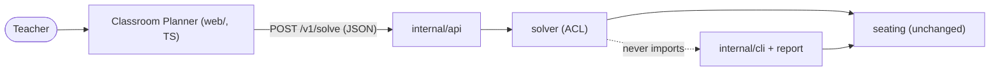
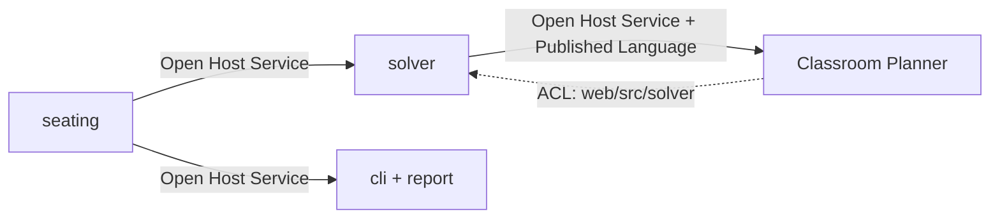

# Architecture: DSSeating Web (visual classroom seating)

**Status:** Draft
**Altitude:** Feature (new front end and service seam on an existing Go engine; brownfield for the engine, greenfield for web)
**Paradigm:** Two-sided hexagonal-lite. Pure functional cores on both sides (TypeScript editor model; Go `seating` engine plus a pure `solver` facade), joined by one synchronous JSON-over-HTTP contract. No shared code, only a shared contract.
**Author:** architect agent
**Last updated:** 2026-11-21 (revision round 1: B-2, B-3, W-1..W-3, W-5, W-6 architecture side; PRD FR-29..FR-37, D-1..D-6)
**Sources:** `docs/dsseating-web/prd.md` (FR-1..FR-37, D-1..D-6); `docs/dsseating-web/ux.md` (section 12 needs); `docs/dsseating-web/check-report.md`; `docs/dsseating-web/routing.md`; `docs/dsseating-port/architecture.md` (AD-1..AD-9, binding, unchanged); `AGENTS.md`; `seating/` source (`Seat`, `Layout`, `Problem`, `Rules`, `Run`) read to confirm what the engine already supports.

## 1. Purpose & Scope

Governs: where the GA stops and the web app starts, the wire contract between them, how a teacher's room (arbitrary grid with gaps, a front edge) maps onto the engine's `Layout`, the meaning of Met/Neutral/Not met per rule on irregular rooms, determinism, the shape of the editor model, and the pins that must not drift.

Does not decide: screens, flows, copy, accessibility detail, how a marker is dragged (`ux.md`); product scope (PRD); component internals, CSS approach, folder layout inside `web/src` below the seed (`clean-code`); persistence, export, mobile (PRD non-goals).

Key finding: the existing `seating` engine already accepts arbitrary seats (`Seat{Row, Col, Aisle}`), up to any size, with a per-row front table. **The engine needs no change** to support FR-18, and this feature makes zero edits to `seating/`, `report/`, `internal/cli/`, `cmd/dsseating/` (the only existing Go package that changes is `internal/archtest`, which gains new import-rule tests). The generalization work is a new adapter (AD-2, AD-3), which keeps FR-27 (no CLI regression) cheap to prove.

## 2. Design Paradigm

Functional core, imperative shell, on both sides of a contract. Web: a pure `model` (grid, markers, students, rules, validation) behind a reducer; React renders it; a single `solver` client module is the only code that touches the network. Go: `seating` (unchanged, pure) behind a pure `solver` facade (anticorruption layer from room language to engine language) behind a thin `internal/api` HTTP shell. Dependency direction is one-way inward on each side. Implication: nothing in the browser scores, ranks, or decides satisfied/violated; nothing in the Go engine learns about desks, markers, names, or JSON.

## 3. Context & Constraints

- Brownfield (Go): ratify AGENTS.md and the port's AD-1..AD-9 unchanged. `seating`, `report`, `internal/cli`, `cmd/dsseating` are not modified by this feature. Go 1.27.x (image pin 1.27.4), standard library only, `go.mod` has no `require` (stays true: new Go code is stdlib only).
- Greenfield (web): React 19 + TypeScript (owner constraint), Vite. Desktop browsers only.
- Hard constraints: GA behind a service layer (FR-26); deterministic (FR-24); 50 students/50 desks max (FR-9, FR-18); no real PII in MVP and names kept out of logs before any real release (PRD section 5).
- External systems: none. No database, no auth, no third-party service.
- Environment note: the host's Node (v22.10.0 here) is irrelevant: all builds, tests and the dev server run in containers pinned to Node 26 LTS (AD-13, lifecycle in section 9). Every pinned web tool's `engines` admits Node 26 (Vite `^20.19 || >=22.12`, Vitest `^22.12 || ^24 || >=26`, ESLint `^20.19 || ^22.13 || >=24`, jsdom `>=26` branch); `package.json` `engines` says `>=24` for anyone running natively.



## 4. Ubiquitous Language

Inherited verbatim from the PRD; the Go engine terms from the port architecture are kept inside the Seating Engine context only. No PRD conflict found.

| Term | Meaning in this system | Do not call it |
|------|------------------------|----------------|
| Room | The teacher's N columns x Y rows grid, plus markers (FR-1) | classroom model, layout (layout is the engine's word) |
| Grid, cell | The room's lattice; a cell is a desk, empty, or holds a marker | tile, slot |
| Desk | A desk cell; counts toward desk count | seat (engine word), table |
| Marker | Non-desk object on a cell: front, back, side, door, teacher's desk | zone, widget |
| Front marker, front edge | Exactly one front marker (FR-6); the grid edge it sits on is the front edge (AD-3) | top, board |
| Student | A named person, 1:1 with a desk at Run (max 50). On the wire: an opaque `studentId`, never the name (AD-4) | person (engine word), pupil, user |
| Rule | One of three types: front, not near (a pair), Isle (FR-11..13). User-visible spelling "Isle" | constraint, wish |
| Run | One click: send room, students, rules to the service (FR-17) | solve (internal verb only), generate |
| Arrangement | One student-to-desk assignment with rank, score, per-rule outcomes (FR-19) | result (the whole set of up to three is "results"), plan, solution |
| Rank, score | Position 1..3 and the weighted score. Score is an integer in hundredths on the wire (`weighted100`); display = value / 100 | fitness |
| Outcome | Per rule, per arrangement: `met` / `notMet`, plus `neutral` for front only, with reason data (FR-20, FR-35). User text: Met, Neutral, Not met | status, pass/fail, satisfied/violated (retired wording) |
| Stale | Results whose inputs have since changed (FR-23) | outdated, dirty |

Engine-side terms (`Seat`, `Person`, `Chromosome`, `Weighted100`, "Aisle" in code) stay inside `seating` and `solver` internals. "Isle" (user text) and `Aisle` (code) rule from AGENTS.md carries over; the wire uses the rule type string `isle`.

## 5. Domain Landscape

| Subdomain | Kind | Where effort goes |
|-----------|------|-------------------|
| GA scoring, operators, run loop | core (exists) | Unchanged; protected by FR-27 regression and the port's tests |
| Room-to-engine mapping and rule outcomes (AD-2, AD-3, AD-7) | core (new) | Hand-computed tests on irregular rooms, rotation, independent recomputation of outcomes |
| Classroom editing (grid, markers, students, rules, validation) | supporting | Pure model with exhaustive unit tests; invariants live in the reducer (AD-9) |
| Results display and rule highlighting | supporting | Thin; renders what the service returned |
| Wire contract and errors | supporting | Shared fixtures tested on both sides (AD-5) |
| Drag and drop, HTTP serving, build tooling | generic | Library defaults (dnd-kit, `net/http`, Vite), no custom abstractions |

## 6. Bounded Contexts & Context Map

| Context | Owns | Language notes | Upstream / downstream | Integration pattern |
|---------|------|----------------|-----------------------|---------------------|
| Classroom Planner (`web/`) | Room, markers, students (names), rules, validation (FR-15/16), run state, results display | Student names live only here (AD-4); Room/Desk/Marker/Arrangement | Downstream of Solving Service | Customer to the service. Anticorruption Layer in `web/src/solver/` maps planner model to/from contract DTOs; zod decodes responses so contract drift fails loudly |
| Solving Service (`internal/api` + `solver`) | Wire contract, request validation, room-to-engine mapping, seed, top-3 selection, outcomes, limits, error codes | Desk, studentId, rule, arrangement, outcome (ids only) | Upstream of Planner; downstream of Seating Engine | Open Host Service + Published Language (`solver` request/response types with `json` tags ARE the contract); Anticorruption Layer toward the engine |
| Seating Engine (`seating`) | Seats, scoring, GA operators, `Run` | `Seat`, `Person`, `Chromosome`, `Weighted100` | Upstream of Solving Service, `report`, `internal/cli` | Open Host Service (exists); Solver is Conformist to it |
| CLI + Report (`internal/cli`, `report`) | Legacy flags and text | Unchanged | Downstream of Engine only | Separate Ways from web: no import in either direction between `solver`/`api` and `report`/`cli` |



Dependency direction (Go): `cmd/dsseating-server -> internal/api -> solver -> seating`; the existing `cmd/dsseating -> internal/cli -> report -> seating` is untouched. Dependency direction (web): `ui -> state -> model`; `state -> solver client`; `model` imports no React and no network.

## 7. Architecture Decisions

### AD-1 — The service is a Go facade in the same module; the browser holds no GA logic

- **Status:** Adopted
- **Binds:** FR-17, FR-18, FR-26, FR-27, FR-19, FR-20, NFR determinism, Goal "GA stays separate"
- **Prevents:** a TypeScript port of scoring or outcome checks "for instant feedback"; a second copy of the engine; the CLI and web diverging in what "score" means; the engine importing HTTP or JSON concerns
- **Rule:** New Go packages in the existing module `dsseating`: `solver` (pure facade) and `internal/api` (HTTP shell), plus `cmd/dsseating-server` (ten-line shim like `cmd/dsseating`). `seating` is called only through its exported API and is not modified for this feature: no new exports, no constants moved (see AD-6, AD-7, which therefore duplicate nothing they cannot test against the engine). The web app computes none of: scores, ranks, distances, rule outcomes, arrangement ordering. Client-side validation (AD-10) is input hygiene only. An import test (extend `internal/archtest`) enforces: `solver` imports only `seating` plus pure stdlib (`context`, `crypto/sha256`, `encoding/binary`, `errors`, `fmt`, `math/rand/v2`, `slices`, `sort`, `strings`) and must not import `os`, `net/*`, `time`, `log`, `io/fs`, `flag`, `report`, `internal/*`; `internal/api` may import `net/http`, `encoding/json`, `context`, `time`, `log/slog`, `solver`, and not `seating`, `report`, `internal/cli` directly. The existing `seating` and `report` rules stay as written in AGENTS.md; stdlib-only stays true.
- **Alternatives considered:** WebAssembly build of `seating` in the browser (rejected: violates the owner's service-layer constraint FR-26 and would put GA in the front end); engine ported to TS (rejected: two engines, FR-27 impossible to guarantee); `solver` logic inside `internal/api` (rejected: untestable without HTTP, and a future non-HTTP caller would re-implement it).

### AD-2 — `solver` is the only translation from Room to engine `Problem`; engine unchanged

- **Status:** Adopted
- **Binds:** FR-1, FR-5, FR-6, FR-18, FR-27, A-2
- **Prevents:** orientation or coordinate handling leaking into `seating` (the legacy "hardcoded 5/4" bug class), or into the web app; two mappers disagreeing on what row 1 means
- **Rule:** `solver.Solve` maps a request to `seating.NewProblem(layout, people, frontTable, rules)` as follows, in this order:
  1. **Canonical order (AD-6):** desks, students, rules sorted by id. Chromosome index `i` is the `i`-th sorted desk; person index `j` is the `j`-th sorted student. Person `Label` is the decimal index (labels are never printed; the engine only needs uniqueness).
  2. **Frame rotation to front-edge-up:** with room coordinates `(c, r)` (column, row, 0-based, row 0 at the top as drawn) and `maxC`, `maxR` the grid's last indices: front edge `top`: `depth = r, lateral = c`; `bottom`: `depth = maxR - r, lateral = c`; `left`: `depth = c, lateral = r`; `right`: `depth = maxC - c, lateral = r`. Mirroring is harmless: scoring is symmetric in the lateral axis.
  3. **Rebase to the desks' bounding box:** `Seat.Row = depth - minDepth + 1`, `Seat.Col = lateral - minLateral + 1`. Empty rows/columns outside the desks are discarded; gaps between desks are kept (they are physical distance).
  4. **Front table:** `FrontScores(R)` for `R = max Seat.Row` (AD-3).
  5. **Aisle flags:** `Seat.Aisle = (Col == 1 || Col == maxCol)` over the rebased columns (AD-3).
  6. **Rules** to person indices (`seating.Rules`, `StrictProximity=false`: legacy proximity, D5/FR-12).
  `seating.ErrInvalidConfig` from `NewProblem` is a server defect after the facade's own validation (AD-5) and maps to `internal` (500), not to a user-facing code. Defaults for the GA parameters come from `seating.DefaultConfig()` via AD-8, never literals.
- **Alternatives considered:** teach `seating.Grid` about edges and gaps (rejected: touches the frozen engine and the CLI path); pass raw room coordinates and let scoring rotate (rejected: scoring must stay coordinate-agnostic per port AD-2); client does the rotation (rejected: GA domain concern, FR-26).

### AD-3 — Irregular-room semantics and rule outcomes (owner-confirmed as PRD D-1..D-3)

- **Status:** Adopted
- **Binds:** FR-11, FR-12, FR-13, FR-20, FR-22, FR-35, FR-36, FR-37, D-1..D-3
- **Prevents:** three implementers (server, UI text, tests) each deciding "near the front", "Isle" or "near" differently on a room with gaps; a second definition that drifts from the scoring the GA optimized
- **Rule:** All outcomes are defined by the engine's scoring on the rebased frame from AD-2. Each outcome has a `result` and reason data (FR-35) computed by `solver`:
  - **Front (3-state):** `FrontScores(R)` is the legacy curve `{10, 7, 0, -7, -10}` stretched over `R` rows by integer linear interpolation: for `k = 0..R-1` (row `k+1`), `s = (4k) / (R-1)` (integer division), `rem = (4k) mod (R-1)`, `v = a[s] + roundHalfAwayFromZero((a[s+1]-a[s]) * rem / (R-1))`, `a` the legacy anchors; `k = R-1` gives `s = 4, rem = 0`, so `a[5]` is never indexed. `R = 1` gives `{10}`. Properties (tests): `R = 5` equals `seating.DefaultFrontRowScores()`; non-increasing; first entry 10; last entry -10 for `R >= 2`. Examples: `R=2: {10,-10}`, `R=3: {10,0,-10}`, `R=4: {10,5,-5,-10}`. Row = distance rank from the frontmost desk row (rows counted from the front-most desk row, D-1). `result = met` if the entry is `> 0`, `neutral` if `== 0`, `notMet` if `< 0`. Reason: `{row, rows}` = 1-based row position and `R`.
  - **Not near (2-state):** `distance = |dRow| + |dCol|` in desk steps on rebased desk cells (gaps count). Engine check: `seating` computes `half = |dRow|+|dCol|` and treats `half > 2` as far (`farThresholdInHalf`), so cell steps and half-units are the same integer and no float or rounding is involved. `result = met` iff `distance > 2`; two desks two apart in a row, and diagonal neighbours (distance 2), are `notMet` (D-2). Reason: `{distance}`.
  - **Isle (2-state):** `result = met` iff the desk is in the leftmost or rightmost occupied column of the rebased room (D-3); a one-column room: always met. Reason: `{column, columns}` = 1-based column position and total occupied-column span `C` (the rebased `max Col`).
  - **Tally (FR-36):** `solver` returns per arrangement `rulesMet` (count of outcomes with `result = met`; `neutral` and `notMet` both do not count) and `rulesTotal`. The client displays these and compares them for FR-37 ("fewest broken" = highest `rulesMet`, ties to the lower rank); it counts nothing itself.
  - Doors, back, side markers, teacher's desk: never sent, never read (D-4).
  - **Drift guard (test obligation):** for every pair of seats in generated rebased rooms, `solver`'s `met/notMet` agrees with the sign of the score `seating` assigns to a one-rule `Problem` evaluated through `Problem.Evaluate` (front: sign of the row entry, with 0 as `neutral`; not near: `NearBy > 0`; Isle: `Isle > 0`). This ties the duplicated thresholds to the engine without exporting anything from it.
- **Alternatives considered:** per-row leftmost/rightmost desk as Isle (rejected: marks interior desks of ragged rows); raw grid columns 0 and N-1 as Isle (rejected: an empty outer column would make Isle unsatisfiable); a fixed rank cut for front (rejected: second definition diverging from scoring); rows including empty leading rows (rejected: pushes every real desk down the table); reasons computed in the browser (rejected: AD-1, FR-35).
- **Notes:** `[ASSUMPTION]` the stretched curve is adequate for 50-desk rooms (up to ~15 rows); sacrificial, replace with a general scoring function when a second positional rule exists (port section 14).

### AD-4 — Student names never cross the wire; ids are opaque, client-generated

- **Status:** Adopted
- **Binds:** FR-7, FR-18, PRD section 5 Privacy (release gate), FR-8, FR-10
- **Prevents:** names in request bodies, server logs, error messages or fixtures; the service growing name-based logic (case-insensitive matching, label conversion); name edits invalidating a result
- **Rule:** The Planner generates `studentId`, `deskId`, `ruleId` as opaque strings (`crypto.randomUUID()`, 1..64 chars, `[A-Za-z0-9_-]`). Names exist only in `web/src/model`. The response refers to students and desks by id; the UI joins to names. Renaming a student does not change the request and therefore does not mark results stale; adding/removing/moving anything else does (AD-11). Server logs and errors never include ids' owners' names, and request bodies are never logged (AD-12).
- **Alternatives considered:** send names and let the service key on them (rejected: PII on the wire and in logs, and FR-10 case folding on the server); A-T labels (rejected: only 20; the web is not the CLI).
- **Notes:** the PRD logs-with-names MVP allowance is therefore not even needed; the release gate is met by construction on the service side.

### AD-5 — One synchronous, versioned JSON contract with a closed error enum and shared fixtures

- **Status:** Adopted
- **Binds:** FR-16, FR-17, FR-18, FR-19, FR-20, FR-25, FR-26
- **Prevents:** client and server disagreeing on field names, units, ordering or error shapes; free-text error parsing; the TS and Go sides each hand-rolling "the" request
- **Rule:** One endpoint: `POST /v1/solve`, `Content-Type: application/json`, request body at most 256 KiB, unknown fields rejected (`DisallowUnknownFields`).
  Request (all arrays required, ids unique within their list):
  ```json
  {
    "grid": {"columns": 8, "rows": 6},
    "frontEdge": "top",
    "desks": [{"id": "d1", "column": 0, "row": 2}],
    "students": [{"id": "s1"}],
    "rules": [
      {"id": "r1", "type": "front", "studentId": "s1"},
      {"id": "r2", "type": "notNear", "studentIds": ["s1", "s2"]},
      {"id": "r3", "type": "isle", "studentId": "s1"}
    ]
  }
  ```
  `column`/`row` are 0-based, row 0 at the top, `frontEdge` is `top|bottom|left|right`. Markers other than the front edge are not sent (A-1).
  Response 200: `{"arrangements": [ {"rank": 1, "scores": {"front": n, "nearBy": n, "isle": n, "total": n, "weighted100": n}, "rulesMet": n, "rulesTotal": n, "assignments": [{"studentId", "deskId"}], "outcomes": [Outcome]} ]}`; 1 to 3 arrangements, already ranked; `assignments` ordered by `deskId`, `outcomes` in request rule order. `Outcome` is `{"ruleId", "result": "met"|"neutral"|"notMet", "detail": {...}}`; `neutral` occurs only for `front`. `detail` by rule type: `front` `{"row": n, "rows": n}`; `notNear` `{"distance": n}`; `isle` `{"column": n, "columns": n}` (all integers; definitions in AD-3). The client formats text from `detail` and never derives it. The client never re-sorts or recomputes. All numbers are integers (engine scores are integers; `weighted100` is the ranking key; display value is `weighted100 / 100`, no floor, negatives valid per AGENTS.md).
  Errors: HTTP status plus `{"error": {"code": "<enum>", "field": "<json path, optional>"}}`; `message` is optional and for developers only; the UI writes its own plain-language text keyed on `code` (UX owns copy). Closed enum: `malformed_request` (400), `limit_exceeded` (400; carries `field` in `grid.columns|grid.rows|desks|students` and the numeric `limit`), `count_mismatch` (400: students != desks, FR-16), `no_students` (400), `invalid_front_edge` (400), `desks_overlap` (400: two desks one cell), `desk_out_of_grid` (400), `duplicate_id` (400), `unknown_student` (400, FR-15), `duplicate_rule` (400, includes reversed not-near pair), `self_pair` (400), `busy` (503), `timeout` (504), `internal` (500). The server validates everything the client validates (AD-10) and is authoritative.
  Limits (constants in `solver`, one place; PRD-confirmed D-5, closes B-2): students <= 50, desks <= 50, grid columns <= 15 and rows <= 15, default room 8 x 6 (client only). The client has one limits module (`web/src/model/limits.ts`) holding the same four numbers and one message table keyed by the `limit_exceeded` `field` (for example desks: "Room is full (50 desks)."), used for both its own refusals and for any server `limit_exceeded`, so wording is identical by construction; a fixture test asserts the numbers equal the server's. Student name length (40 characters, UX) is a client-only rule because names never reach the server (AD-4). Contract version is the URL path; breaking changes mean `/v2/solve`.
  `contract/fixtures/` holds named request/response/error JSON files (valid minimal, valid 50-desk irregular with all three outcome kinds including a `neutral` front, one per error code, boundary limits at 15 x 15, 50 desks, 50 students and one over each). Go tests decode each fixture strictly into `solver` types; TS tests decode each through the zod schema in `web/src/solver/` and type-check; both sides fail on drift.
- **Alternatives considered:** OpenAPI plus codegen (rejected: toolchain and a generated-code layer for one endpoint; Rule of Three); GraphQL/gRPC/WebSocket (rejected: one request/response); free-text error messages (rejected: breaks FR-25 UX ownership and i18n); names in the payload (AD-4).

### AD-6 — Determinism: the seed is derived from the canonical input; the UI never sees a seed

- **Status:** Adopted
- **Binds:** FR-24, port AD-3 (one injected PCG RNG)
- **Prevents:** wall-clock seeding (the CLI's default) making the same room give different results on re-Run; list-order or JSON-key-order changing the outcome; map iteration on output paths
- **Rule:** `solver` sorts desks, students and rules by id (bytewise); a not-near pair's two ids are sorted. It writes a fixed binary encoding of the sorted input (grid dims, front edge, each desk id/column/row, each student id, each rule type and ids, each field length-prefixed) into SHA-256; `seed` is the first 8 bytes big-endian as `uint64`. RNG is `rand.New(rand.NewPCG(seed, webStream))` where `webStream` is a constant defined in `solver` itself. It deliberately does not reuse or export the CLI's constant: the web needs only its own determinism (FR-24), not stream equality with the CLI, so `seating` stays untouched (closes W-5). Same canonical input gives byte-identical response on the same Go version and OS (same caveat as CLI NFR). Only a Go test hook (`solver.Options{Seed *uint64}`) may override the seed; it is not on the wire. Changing a student's name does not change the request, so does not change results (AD-4).
- **Alternatives considered:** random seed per Run (rejected: FR-24); client-supplied seed (rejected: PRD hides it; adds a field with no user); hashing the raw JSON bytes (rejected: key/list order sensitivity).

### AD-7 — Top 3 are collected across the whole run; outcomes and reasons are computed in `solver`

- **Status:** Adopted
- **Binds:** FR-19, FR-20, FR-21, FR-22, Goal "Results are trustworthy"
- **Prevents:** returning near-identical siblings from a converged final population (fewer than 3 distinct when many exist); ranking by float or by client; an outcome checker that re-derives rules differently than scoring
- **Rule:** `solver` passes an `observe` callback to `seating.Run` that offers every Individual of every observed population (generation -1 through last) to a bounded best-3 set. Distinct means differing chromosome (any desk-to-student difference). Ordering: higher `Weighted100` first; on ties the earlier-observed Individual wins (generation, then population index), so order is deterministic. The set never holds more than 3 and never holds two equal chromosomes. Result length is `min(3, distinct arrangements seen)`; `[ASSUMPTION]` this is "distinct arrangements that exist" in the PRD's sense, not only distinct members of the last population. Ranks are 1..n by position. Outcomes and reasons (AD-3) are computed by `solver` per arrangement from the chromosome and the rebased seats it built itself (it already holds each desk's rebased row and column and the front table), so no accessor or export from `seating` is needed; the AD-3 drift-guard test is what keeps the duplicated thresholds honest. Test obligation: an independent brute-force recomputation of outcomes and scores from raw room coordinates (no `solver` internals, no rotation helper reuse) agrees with the service for generated rooms on all four front edges (Goal: 100% in tests; FR-27, P0, regression: with a 5x4 room, front top, the facade's `Problem` scores equal `seating` scores computed from `DefaultLayout()` for the same permutation).
- **Alternatives considered:** top 3 distinct of the final population (rejected: often converged, would under-return); keep only the Best per run (rejected: FR-19 asks for 3); outcomes in the client (rejected: AD-1).

### AD-8 — A Run is one synchronous request on engine defaults, bounded, cancellable, never queued

- **Status:** Adopted
- **Binds:** FR-17, FR-25, NFR Performance, A-4, A-5
- **Prevents:** an unbounded request tying up the host; a job queue and polling built before measurement says they are needed; per-user tuning knobs creeping in
- **Rule:** `solver.RunBudget(n)` is the single function returning the `seating.Config` for a request of `n` students; MVP body: `return seating.DefaultConfig()`. Any scaling with `n` happens only there, after measurement `[ASSUMPTION: defaults (pop 100, 50 generations) may give poor quality at 50 students; first task for the implementer is to measure on realistic 50-desk rooms and, if needed, raise Generations in RunBudget]`. `Solve(ctx, req)` checks `ctx.Err()` inside `observe` and aborts between generations with the context error. `internal/api`: server-side run timeout 30 s (`timeout`, 504), at most `runtime.NumCPU()` runs in flight, extra requests get `busy` (503) immediately; client disconnect cancels the context. The client allows one in-flight Run (state machine `idle | running | done | failed`, not just a disabled button), shows busy state only (the engine reports no progress; FR-17 "progress" is the busy indicator), and implements Cancel (FR-32) as follows. Run state machine: `idle | running{runId} | cancelled | failed{error}`; success stores results (AD-11) and returns to `idle`. Each Run gets a monotonically increasing `runId` and its own `AbortController`; Cancel aborts the fetch (the server sees the closed connection and cancels the context, so the GA stops between generations) and moves to `cancelled` immediately, which unlocks the editor (inputs and Undo/Redo are locked only while `running`, per UX). A response handler accepts a result only if the current state is `running` with the same `runId`; otherwise (cancelled, superseded, page left) the late response is discarded silently and never alters stored results. `cancelled` and `failed` leave teacher input and any earlier results untouched; `cancelled` clears to `idle` on the next user action. **Proposed targets `[ASSUMPTION]`:** p95 <= 5 s for 50 students/50 desks on a typical laptop; revisit at > 10 s. Replacement trigger for synchronous HTTP: measured p95 > 10 s on the hosting target, then job + poll or SSE with progress, behind the same `/v1` request body.
- **Alternatives considered:** async job + polling now (rejected: ~5000 evaluations of 50 genes is expected to be well under a second, so measurement first); Web Worker (rejected: GA in the browser, FR-26); exposing generations/population (rejected: PRD non-goal).

### AD-9 — Editor model: cell-based, pure, one command path, one history; drag-and-drop is only a gesture

- **Status:** Adopted
- **Binds:** FR-1..FR-10, FR-14, FR-23, FR-29..FR-31, FR-33, NFR drag responsiveness with 50 desks, NFR Accessibility (not color alone)
- **Prevents:** position stored as pixels; DnD state held in a library and in the model; keyboard and pointer paths with different rules; invariants duplicated in components; undo implemented per component; accidental persistence
- **Rule:** `web/src/model` is a pure TypeScript module (no React, no DOM, no fetch) exposing the `Classroom` value: `grid {columns, rows}`, `desks: {id, cell}[]`, `markers: {id, kind, cell}[]` with `kind in front|back|side|door|teacherDesk`, `students: {id, name}[]`, `rules`. It is the consistency boundary (aggregate): every mutation goes through one reducer of named commands (`placeDesk`, `moveDesk`, `removeDesk`, `placeMarker`, `moveMarker`, `removeMarker`, `resizeGrid`, `fillRoom`, `addStudent`, `addStudents` (paste, FR-30), `editStudent`, `removeStudent` (cascades its rules, FR-8), `addRule`, `editRule`, `removeRule`, `startOver`). Run state and results are separate state (AD-8, AD-11); ordinary commands never touch results, and history snapshots hold `Classroom` only, with one exception below. The reducer enforces: one object per cell (a drop on an occupied cell is a rejected no-op, so the object returns to origin, FR-3); positions are integer cells inside the grid; grid <= 15 x 15; desks <= 50 and students <= 50 by every route (drag, click, paint-drag, keyboard, `fillRoom`, `addStudents`) with the shared messages from `limits.ts` (AD-5); marker limits Front 1, Back 1, Side 2, Door 3, Teacher's desk 1 (FR-5); names unique after `trim` + Unicode NFC + `toLowerCase` while the stored name is exactly as entered, at most 40 characters (FR-7, FR-10); rules reference existing students and are unique (a reversed not-near pair is a duplicate), no self pair (FR-15); a resize that would orphan desks/markers is a confirmed command that removes them (UX confirm), never a silent clip. Rejected commands return a typed reason (closed union) for UX text. Bulk commands are atomic: `fillRoom` either places the whole rectangle or is rejected (never partial; marker cells skipped), and `addStudents` returns the added and skipped lists (duplicates, over-limit) for the paste preview; pure `previewFill` and `previewPasteList` functions feed the dialogs and call the same validation.
  **History (FR-31):** the editor state is `{past: Classroom[], present: Classroom, future: Classroom[]}` wrapped around the reducer; `Classroom` is immutable, so snapshots share structure and need no diffing. Every accepted command is one history step (a bulk command, a cascade removal and `startOver` are each one step); rejected commands add nothing; a new command clears `future`; `past` is capped at 100 `[ASSUMPTION]`. **Start over (W-2):** `startOver` empties the `Classroom` and also clears the stored `RunResult` (AD-11) to `null`, as one atomic step. Its history entry additionally records `resultsBefore` (the `RunResult` or `null` that was cleared). Undo of that step restores the previous `Classroom` and sets results to `resultsBefore`; redo clears both again. Because the restored results' fingerprint equals the restored room's, they come back not Out of date. This is the only history entry that carries results; every other entry leaves results alone, so Undo of an ordinary edit never resurrects an older run. Edge case: a Run completed after Start over replaces results, and undoing back past the Start over step still restores `resultsBefore` (the state the teacher had before clearing). Each entry stores the command's closed-union label so UX can name it ("Undo: remove desk"). `undo`/`redo` are disabled while the run state is `running`. History lives in memory only and is cleared on page leave. Whether the inputs equal a run's inputs is answered by the fingerprint (AD-11), so Undo back to the run's exact inputs clears "Out of date" with no extra code.
  **No persistence (W-6, FR-33):** nothing is written to `localStorage`, IndexedDB, cookies or the server; autosave is out of scope. The only leave-page behavior is a `beforeunload` warning registered while the room or students have any content, and the `startOver` command. The model stays plain JSON-serializable so a later saving phase is additive.
  Drag and drop: `@dnd-kit/core` with pointer and keyboard sensors and its live-region announcements; each cell is a droppable and collision picks the cell under the pointer, so "snap" is by construction. Drag handlers dispatch the same commands as the click and keyboard alternatives. State management: `useReducer` plus context; no state library.
- **Alternatives considered:** HTML5 native DnD (no keyboard support, poor a11y); `react-dnd` (extra backend layer); free pixel positions then rounding (second source of truth); command-inverse undo (more code, more bugs than snapshots at this size); Zustand/Redux (Rule of Three: one store); autosave to `localStorage` (owner rejected, FR-33).

### AD-10 — Run blockers are a pure function in the model; the server re-validates identically

- **Status:** Adopted
- **Binds:** FR-15, FR-16, FR-9, FR-25
- **Prevents:** a Run button that is enabled by one rule set and rejected by another; blockers phrased differently in each component; client rules the server does not enforce
- **Rule:** `model.runBlockers(classroom): Blocker[]` returns an ordered, closed-union list; Run is enabled iff it is empty (FR-16): `noStudents`, `countMismatch {students, desks}`, `noFrontMarker`, `frontMarkerNotOnEdge` (a corner or interior cell; the marker's edge is derived by `model.frontEdgeOf(grid, marker)`, AD-11), `ruleError {ruleId, reason}`; the Front marker limit of 1 is enforced by the reducer, so `multipleFrontMarkers` is not reachable. `countMismatch` carries the signed difference so UX can say "Add 2 students or remove 2 desks" (FR-16). The same predicates exist server-side and map one-to-one to AD-5 error codes; fixtures cover each. The UI renders blockers from this list only (UX supplies wording). A server `400` after the client allowed Run is treated as an internal defect (shown as a generic error, FR-25) and is a test failure in the contract suite, not a user path.
- **Alternatives considered:** server-only validation (rejected: FR-16 needs instant, precise blocker text); schema-driven shared validator generated into both languages (rejected: toolchain for ~8 predicates).

### AD-11 — A run result is a self-contained snapshot; staleness is derived from a fingerprint

- **Status:** Adopted
- **Binds:** FR-21, FR-22, FR-23, FR-28, FR-36, FR-37, ux S6
- **Prevents:** rendering arrangements against a room that has since changed; a removed student leaving a result with no name; a stored `stale` flag that some command forgets to set; results being edited
- **Rule:** On a successful Run the state stores one immutable `RunResult = {fingerprint, request, snapshot, arrangements}`:
  - `request` is the AD-5 request actually sent (built by the single `toRequest(classroom)`); `fingerprint` is its canonical string (`JSON.stringify` with sorted keys, which excludes names and non-front markers).
  - `snapshot` is a copy of the room as of the run: `grid`, `desks` with cells, `markers` with kind and cell, `students` with id and name, and `rules` with their ids and student ids. It is what the results view renders (names, desk positions, marker tokens, front edge indicator, rule text), never the live model. This makes an "Out of date" view fully renderable after a rename, a removal, a move or a resize (closes W-3).
  - `arrangements` is the response as received; read-only (FR-28), no command touches it.
  The view is **Out of date** iff `fingerprint(toRequest(currentClassroom)) !== result.fingerprint`, derived on every render, never stored. Renaming a student alone does not change the request, so it does not mark results out of date (FR-23); the results keep showing the snapshot's old names (UX label "Names as of the last run"). Removing a student, rule or desk, or moving a desk or the front marker, changes the request and marks it. Undo/Redo that restores the run's exact inputs restores the fingerprint and clears the badge. Starting a new Run replaces the stored `RunResult` only on success; `startOver` clears it and its undo restores it (AD-9); `cancelled` and `failed` keep the previous one. The results view and the rule highlight (FR-22) join `assignments` and `outcomes` to the snapshot only. Memory only (AD-9).
  **Front edge:** `model.frontEdgeOf(grid, frontCell)` returns an edge or `null`. The Front marker must sit on a border cell that is not a corner, so it touches exactly one edge. Confirmation for degenerate rooms (the question from UX S1): a 1-wide room (1 column x M rows) does have non-corner border cells for `M >= 3` (every cell except the two ends), but such a cell touches both the left and the right edge; the derivation picks `left` (and for `N x 1`, `top`). The result is deterministic and harmless, because with a single column every desk has the same depth, so the room is one row, every student is in the front row and a Front rule is always met. 1 x 1, 1 x 2, 2 x 2 and any room with both dimensions <= 2 have no valid cell, so Run is blocked (`frontMarkerNotOnEdge`). Rule for UX: the Front tool is unavailable iff both dimensions are <= 2; a message such as "make it at least 3 wide or 3 tall" is accurate, and a 1 x 3 room is allowed though degenerate. All four edges are supported (AD-2); D-4 closes A-2.
- **Alternatives considered:** a `stale` boolean toggled by commands (rejected: easy to miss a command); results joined to the live model (rejected: fails after removal, names change); clearing results on any edit (rejected: FR-23 requires them to stay).

### AD-12 — Delivery: one Go binary, same origin; no CORS, auth, or persistence in MVP; logs carry counts only

- **Status:** Adopted
- **Binds:** A-5, NFR Privacy, NFR Reliability, FR-25
- **Prevents:** a CORS/credentials matrix; two deployment shapes with different behavior; logs carrying roster data
- **Rule:** `cmd/dsseating-server` serves `/v1/solve` and, when given `-static <dir>`, the built web assets; production is one binary plus the `web/dist` folder, same origin. Dev: Vite dev server proxies `/v1` to the Go server (`localhost`), so the browser never makes cross-origin calls and no CORS headers are emitted. Hosted vs local-only is the owner's call and does not change the code; if hosted publicly, the MVP has no auth and relies on body limit, concurrency cap and timeout (AD-5, AD-8) `[ASSUMPTION: acceptable for MVP test data]`. Logging via `log/slog`: one line per request with method, path, status, duration, and counts (desks, students, rules, arrangements returned, error code). Never ids, names, bodies or coordinates. Flags for the server are hand-written minimal (`-addr`, `-static`); the port's rule against stdlib `flag` was specific to the CLI grammar, so `flag` is allowed in `cmd/dsseating-server` only `[ASSUMPTION; keep it ten lines]`. No state survives between requests; the service is stateless. The browser persists nothing either (AD-9).
- **Notes:** AD-13 packages exactly this shape (Go binary serving the built SPA, same origin) in Docker; nothing here changes.
- **Alternatives considered:** separate static host + CORS (rejected: adds a failure class for no MVP benefit); embedding assets with `go:embed` (deferred: forces build ordering; revisit when the owner picks hosting); serverless (rejected: Go engine, CPU-bound runs, no benefit).

### AD-13 — The whole environment runs under Docker Compose; containers, not the host, own the toolchain

- **Status:** Adopted (owner-requested at Gate 2)
- **Binds:** AD-8, AD-12, section 8 Gate, section 9 pins, section 13; NFR Reliability, Privacy (logs)
- **Prevents:** "works on my machine" Node/Go versions; a dev shape and a production-like shape that differ in origin or config; containers running as root or holding state; two images each inventing their own health, log and port conventions; compose files that bake `localhost` into the proxy
- **Rule:**
  - **Files (repo root unless noted):** `docker-compose.yml`, `Dockerfile` (Go server), `web/Dockerfile` (web app), `.dockerignore` (excludes `.git`, `docs/`, `out/`, the root `dsseating` binary, `web/node_modules`, `web/dist`). Both Dockerfiles are built with the **repo root as context** (compose: `build: {context: ., dockerfile: web/Dockerfile}`), because the web tests read `contract/fixtures/` (AD-5) and the Go tests need the whole module.
  - **`Dockerfile` (Go), multi-stage, BuildKit cache mounts for `GOCACHE` and the module cache:** `dev` (`golang:1.27.4-alpine3.24`, runs `go run ./cmd/dsseating-server -addr :8080`); `test` (same base; runs `gofmt -l . | (! grep .) && go vet ./... && go test ./...`, the existing gate); `build` (`CGO_ENABLED=0 go build -trimpath -ldflags "-s -w"`); `webbuild` (`node:26.13.1-alpine3.24`: `npm ci` then `npm run build` from `web/` with its lockfile); `runtime` (`alpine:3.24.4`: copies the binary to `/usr/local/bin/dsseating-server` and `web/dist` to `/srv/web`, `USER 10001:10001`, `EXPOSE 8080`, `ENTRYPOINT ["dsseating-server"]`, `CMD ["-addr", ":8080", "-static", "/srv/web"]`, `HEALTHCHECK` below). `GOFLAGS=-buildvcs=false` (the folder is not a git repository). Go stays stdlib-only: nothing in the image build adds a module.
  - **`web/Dockerfile`:** `deps` (`node:26.13.1-alpine3.24`, `npm ci`), `dev` (`vite --host 0.0.0.0 --port 5173`, non-root `node` user), `test` (`npm run check` = `tsc --noEmit && tsc6 --noEmit && eslint . && vitest run && vite build`). Production assets are built only by the `webbuild` stage of the root `Dockerfile`, so the production image has exactly one build path.
  - **Production-like shape (compose profile `prod`):** one service `app` built from the root `Dockerfile` target `runtime`. It is AD-12 verbatim: single Go binary, same origin, serves `/v1/solve` and the SPA. No nginx or other web server (rejected below). Published as `${APP_PORT:-8080}:8080`.
  - **Dev shape (profile `dev`):** services `api` (target `dev`, port 8080) and `web` (`web/Dockerfile` target `dev`, port 5173). The browser uses `http://localhost:5173`; Vite proxies `/v1` to `process.env.API_URL`, set by compose to `http://api:8080` (the compose service name replaces `localhost`; `vite.config.ts` falls back to `http://localhost:8080` for native runs). The browser still sees one origin, so no CORS (AD-12). `web` `depends_on: api` with `condition: service_healthy`. Dev bind mounts only: `./:/src` for `api`, `./web:/app/web` and `./contract:/app/contract:ro` for `web`, with an anonymous volume on `/app/web/node_modules` so the host never needs `node_modules` or Node. Compose `develop.watch` (`action: rebuild` on `go.mod` and `package-lock.json`, `sync` elsewhere) is the reload path; if file events are unreliable on the host, enabling Vite polling is a dev-only tweak.
  - **Test shape (profile `test`):** services `go-test` and `web-test` (the `test` targets above). Gate, locally and in any CI: `docker compose --profile test run --rm go-test && docker compose --profile test run --rm web-test`; the exit code is the gate and CI needs only Docker. The Java-sample tests skip as "unverified" because `DSSEATING_SAMPLES` is not mounted (existing behavior, AD-9 of the port); an optional read-only bind mount can enable them locally, never in CI. CI provider and registry are not chosen (section 14).
  - **Config:** the server keeps flags only (AD-12); in containers flags come from `CMD`/`command:`, no environment variables are read by production Go code. Host port is compose-level (`APP_PORT`, `API_PORT`, `WEB_PORT`, defaults 8080/8080/5173) and never reaches the application. `API_URL` is dev-only and read by the Vite config, not by app code.
  - **Health:** `internal/api` adds `GET /healthz` (outside `/v1`, no body beyond `ok`, 200 when the process serves; not logged at request level). Compose `healthcheck`: `wget -q -O /dev/null http://127.0.0.1:8080/healthz` (interval 10 s, timeout 3 s, retries 3, start period 5 s). The dev `web` service checks `http://127.0.0.1:5173/`.
  - **Hardening and state:** every runtime container runs non-root (`10001` or the image's `node` user); dev and test containers may also run non-root (the `node` user, or 10001 for Go) but that is not a requirement; `app` additionally uses `read_only: true`, `cap_drop: [ALL]`, `security_opt: [no-new-privileges:true]`, and `restart: unless-stopped`. The service is stateless (AD-12), so there are **no named volumes and no persistence anywhere**; the only mounts are the dev bind mounts above and the anonymous `node_modules` volume.
  - **Logs:** applications log to stdout/stderr only (`log/slog` text lines, counts only per AD-12); no log files in containers. Compose sets the `json-file` driver with `max-size: 10m`, `max-file: 3` via one shared `x-logging` anchor.
  - **Pins:** base images are pinned by tag to the versions in section 9 (never `latest`, never a floating major). Digest pinning is added when CI exists `[ASSUMPTION]`. The compose file declares no `version:` key. Images are multi-arch official images (arm64 and amd64).
  - **Node requirement:** satisfied by the `node:26.13.1-alpine3.24` image (Node 26 LTS, supported to 2029-04-30). The host's Node, if any, is never used by the documented workflows; the lockfile is created/updated with `docker compose run --rm web npm install` (bind-mounted, written to the host's `web/package-lock.json`).
- **Alternatives considered:** nginx (or Caddy) container serving the SPA and proxying `/v1` (rejected: a second image and config to reach the same single origin the Go binary already provides, and it would split AD-12's single-binary shape); Vite dev server in the production-like profile (rejected: dev tool, not a server); separate Dockerfile per environment instead of targets (rejected: drift); `go:embed` the SPA (still deferred, AD-12); Kubernetes/Helm (rejected: far beyond a single stateless service, no hosting decision); named volumes for caches (rejected: BuildKit cache mounts keep compose stateless).
- **Notes:** hosting (A-5) stays open; the `runtime` image runs unchanged on any container host or locally. The requirement is PRD NFR-1 (Docker Compose operability) and the version rules are NFR-2 (supported, pinned versions); PRD review P-13 is closed.

## 8. Consistency Conventions

| Convention | Rule |
|------------|------|
| IDs | Opaque strings generated in the browser, unique per list, pattern `[A-Za-z0-9_-]{1,64}`; the service never invents or rewrites them |
| Coordinates | Room coordinates are `column`, `row`, 0-based, row 0 at the top as drawn; the engine's 1-based `Row`/`Col` appear only inside `solver` |
| Naming | User text says "Isle" and "student"; wire uses `isle`, `studentId`; Go code uses `Aisle`/`Person` inside `seating`/`solver` internals only; TS uses `isle` and `student` |
| Scores | Integers only on the wire and in the model; `weighted100` ranks; display divides by 100 at render time only; never floor at 0 |
| Ordering | Server output is already ranked and ordered; clients render in received order; no sort or map-iteration on output paths |
| Errors | Service: closed `code` enum (AD-5). Client: `solverClient` returns a typed union `ok | rejected(code) | unreachable | timeout | busy | internal`; plain-language copy lives in the UI layer keyed by that union; teacher input is never cleared on error (FR-25) |
| Time | No wall-clock reads in `solver` or `model`; timeouts only in `internal/api` and the client fetch layer |
| Network | `fetch` appears only in `web/src/solver/`; enforced by a test that scans imports/identifiers in `web/src` |
| Tests | Port rules apply (properties not RNG streams, fixed seeds via the test hook). Add: fixtures shared across languages (AD-5); hand-computed irregular-room cases for all four front edges; `FrontScores` property tests (AD-3) |
| Gate | Go: `go vet ./... && go test ./...` and `gofmt -l .` empty (unchanged). Web: `tsc --noEmit` (TypeScript 7, authoritative), `tsc6 --noEmit` (TypeScript 6 parity check), `eslint`, `vitest run`, `vite build` all green. Both gates run through Compose (`docker compose --profile test run --rm go-test` / `web-test`, AD-13) and that is the canonical way to run them |
| Dependencies | Go: zero `require`. Web: pinned in `package.json` with exact versions and a committed lockfile |

## 9. Stack & Versions

Verified against the npm registry, Docker Hub and the vendors' lifecycle pages on 2026-11-21. **All pins are exact**: `package.json` dependencies and devDependencies carry exact versions with no `^`, `~`, `latest` or ranges (including the two TypeScript aliases), `.npmrc` sets `save-exact=true`, the lockfile is committed and installs use `npm ci`; Docker base images are exact tags (digest pinning is deferred to CI, section 14); `go.mod` has no `require`. The only ranges allowed are engine and peer floors, which are constraints, not pins (`engines.node >=24`, Compose >= 2.17).

| Component | Choice | Version | Notes |
|-----------|--------|---------|-------|
| Go | existing toolchain; image `1.27.4` (the host's 1.27.3 lacks the 1.27.4 security fixes of 2026-11-10; `go.mod` stays `go 1.27`) | 1.27.4 | unchanged API; `net/http`, `encoding/json`, `crypto/sha256`, `log/slog` are stdlib |
| Node.js | build/test/dev runtime, inside containers only | 26.13.1 (image `node:26.13.1-alpine3.24`) | Node 26 "Lithium" is LTS from 2026-10-28, end of life 2029-04-30. Replaces the earlier Node 22 pin (EOL 2027-04-30, rejected). Host Node does not matter (AD-13) |
| Go build image | `golang:1.27.4-alpine3.24` | 1.27.4 | Tag verified on Docker Hub 2026-11-21 |
| Runtime image | `alpine:3.24.4` | 3.24.4 | Static Go binary plus BusyBox `wget` for the healthcheck |
| Docker Compose | Compose file format (no `version:` key) | Compose v2 (host has 2.39.2) | Needs Compose >= 2.17 for `develop.watch` and profiles |
| React / ReactDOM | UI | 19.3.1 | |
| TypeScript (compiler) | `tsc` for build, type-check and `-b`; alias `"@typescript/native": "npm:typescript@7.0.2"` | 7.0.2 | Microsoft-recommended side-by-side setup (TypeScript 7.0 announcement). Native compiler, no programmatic API |
| TypeScript (API for tools) | alias `"typescript": "npm:@typescript/typescript6@6.0.2"` (package `@typescript/typescript6`, which itself depends on a `typescript` 6.x) | 6.0.2 (resolves 6.0.3 underneath) | Everything that does `import "typescript"` (typescript-eslint 8.73.0, ts-api-utils) gets the 6.0 API; only a `tsc6` binary is exposed, so it does not clash with 7's `tsc`. Version 6.0.2 satisfies typescript-eslint's `>=4.8.4 <6.1.0` peer range, no peer warning (verified by install) |
| Vite | build/dev server | 8.3.8 | |
| `@vitejs/plugin-react` | React transform | 6.3.0 | peer `vite ^8` |
| Vitest | unit/component tests | 5.1.1 | with `jsdom` (version resolved at scaffold) and `@testing-library/react` 16.3.3 |
| `@dnd-kit/core` | drag and drop | 6.3.1 | React peer `>=16.8`; pointer + keyboard sensors |
| zod | response decoding at the client boundary | 4.6.7 | |
| ESLint / typescript-eslint | lint | 10.15.0 / 8.73.0 | |
| Router | none | n/a | Two views (edit, results) are state, not URLs; no persistence in MVP |
| Data store | none | n/a | Stateless service, in-memory editor state |

### Lifecycle check (owner request: no languages or runtimes near end of life)

Checked 2026-11-21. A pin is acceptable if it is supported for at least 12 months from today and is the current line of its project.

| Component | Pinned | Support ends | Source | Verdict |
|-----------|--------|--------------|--------|---------|
| Go | 1.27.4 | When Go 1.29 ships (policy: a major is supported until two newer majors exist). 1.27.0 shipped 2026-08-19; 1.29 is expected about 2027-08 by the Feb/Aug cadence `[ASSUMPTION: date inferred]` | go.dev/doc/devel/release (policy and 1.27.4 date); endoflife.date shows 1.27 current, 1.25 EOL 2026-08-19 | OK, the current major. Go has no longer-lived line, so the rule is: move to the newest major within about 3 months of each release |
| Node.js | 26.13.1 "Lithium" | 2029-04-30 (LTS from 2026-10-28; Maintenance from 2027-10-20) | github.com/nodejs/Release `schedule.json`; nodejs.org dist index lists v26.13.1 as LTS Lithium | OK. Node 22 (EOL 2027-04-30) rejected; Node 24 (EOL 2028-04-30, already in Maintenance) is the fallback and also satisfies every tool |
| Alpine (base image) | 3.24.4 | 2028-06-01 | alpinelinux.org/releases (3.24 branched 2026-06-09) | OK |
| TypeScript 7 (`tsc`) | 7.0.2 | No formal support policy published; Microsoft states a new minor every 3 to 4 months and a new API in 7.1 `[ASSUMPTION: no support-end date found]` | devblogs.microsoft.com/typescript/announcing-typescript-7-0/; npm registry (`latest` 7.0.2) | OK, current major |
| `@typescript/typescript6` (compat API) | 6.0.2 (published 2026-07-06) | No formal policy; it is a transition package until tools can use TypeScript 7's API (7.1) `[ASSUMPTION]` | same announcement; npm registry (README: provides `tsc6`, re-exports the 6 API) | Acceptable bridge, see revisit trigger |
| React / ReactDOM | 19.3.1 | Current major, no EOL announced | endoflife.date (19 current; 18 in security-only) | OK |
| Vite | 8.3.8 | Policy: current minor gets fixes; previous minor and previous major's last minor get security backports | vite.dev/releases (8.3 regular, 8.2 and 7.3 important, 8.1 and 6.4 security) | OK while kept on the newest 8.x minor |
| Vitest | 5.1.1 | Current line; docs list patches for the latest minor and backports to the previous major's last minor `[ASSUMPTION: from search summary, official page not re-read]` | vitest.dev/releases | OK, keep on latest 5.x |
| ESLint | 10.15.0 | Current major (10.x). ESLint 9 reached EOL 2026-08-06 | endoflife.date (eslint cycle 10 current, 9 EOL) | OK |
| typescript-eslint | 8.73.0 | Current 8.x; follows TypeScript; TS 7 support is tracked upstream in issue #10940 (the "Support TypeScript 7.0" issue #13196 was closed as a duplicate on 2026-11-14) | npm registry; github.com/typescript-eslint/typescript-eslint | OK with the alias; does not accept TS 7 directly |
| `@dnd-kit/core` | 6.3.1 | No formal policy; npm `latest` is 6.3.1, but the project has been quiet `[ASSUMPTION]` | npm registry | Watch item: swap trigger below |
| zod | 4.6.7 | Current major | npm registry | OK |

**TypeScript 7 with a 6.0 compatibility alias (adopted).** TypeScript 7.0 ships no programmatic API, so `typescript-eslint` (peer `typescript >=4.8.4 <6.1.0`, it refuses 7.0 at runtime) cannot use it. Microsoft's official announcement recommends the npm-alias setup used here: `"@typescript/native": "npm:typescript@7.0.2"` provides the `tsc` binary, and `"typescript": "npm:@typescript/typescript6@6.0.2"` makes every tool that imports `typescript` get the 6.0 API (the package exposes only `tsc6`). Verified: the package names and alias recipe exist (`@typescript/native` is only an alias name, it is not a registry package), and a scratch install on 2026-11-21 with `typescript-eslint` 8.73.0 and `eslint` 10.15.0 resolved with no peer error; `tsc -v` printed 7.0.2, `tsc6 -v` and `require("typescript")` printed 6.0.3; `tsc -p` reported a type error with exit 1; `tsc -b` with a `composite` project reference built; type-aware ESLint (`projectService`, `no-floating-promises`) ran and reported. Vite and Vitest strip types without calling the compiler API, so the alias does not affect them (not tested against a real Vite/Vitest build here `[ASSUMPTION]`; the scaffold's `npm run check` proves it). Downsides, accepted: two compilers, so type-checking is done by 7.0 (authoritative) while lint's type information comes from 6.0, and the two can disagree on edge cases (mitigation: `check` also runs `tsc6 --noEmit` as a parity canary, and `tsconfig.json` uses no option that 6.0 deprecates and 7.0 rejects, since 7 turns 6.0's deprecations into errors); a larger `node_modules` (about 54 MB under `@typescript/`, dev and test images only; the runtime image has no Node); the `typescript` alias is non-obvious to dependency bots, so the aliased entries are updated by hand with the lifecycle review `[ASSUMPTION: no bot tested]`. **Revisit trigger:** drop the alias and install plain `typescript@7.x` when a released `typescript-eslint` lists TypeScript 7 in its peer range or ships the 7.1 API backend (tracked in typescript-eslint #10940), or when TypeScript 6.x is declared unsupported; check at each dependency update and at least quarterly.

**`@dnd-kit/core` watch item.** Swap trigger: a React-peer or security break against the pinned React, or no release for 12 months; the replacement must keep the AD-9 contract (drag is a gesture dispatching commands, keyboard parity), which is why DnD is isolated behind that rule.

## 10. Structural Seed

```text
/Users/cgianelle/Projects/dsseating-port/
  seating/ report/ internal/cli/ cmd/dsseating/   # existing, unchanged
  internal/archtest/        # extended: solver and api import rules (AD-1)
  solver/                   # new: Solve, RunBudget, FrontScores, request/response types (the contract), canonical seed, top-3 set, outcomes
  internal/api/             # new: POST /v1/solve and GET /healthz handlers, limits, status/code mapping, slog, concurrency cap
  cmd/dsseating-server/     # new: shim wiring api + optional static dir
  contract/fixtures/        # shared request/response/error JSON (AD-5)
  docker-compose.yml        # profiles dev | prod | test (AD-13)
  Dockerfile                # Go server: dev, test, build, webbuild, runtime targets
  .dockerignore
  web/
    Dockerfile              # deps, dev, test targets (context is the repo root)
    package.json  vite.config.ts  tsconfig.json   # devDeps alias TS 7 as @typescript/native and TS 6 API as typescript; scripts check = tsc + tsc6 + eslint + vitest + vite build; engines: node >=24; vite proxy target from API_URL
    src/model/              # pure: Classroom, commands, validation, runBlockers, frontEdgeOf, toRequest, fingerprint
    src/state/              # reducer wiring, run state machine, results store
    src/solver/             # the only network code: client, zod schemas, error union
    src/ui/                 # editor, rules form, results view (React; UX owns screens)
  docs/dsseating-web/       # prd.md, routing.md, ux.md, architecture.md
```

Runtime: teacher edits `Classroom` (reducer) -> Run -> `toRequest` -> `fetch /v1/solve` -> `api` validates -> `solver` rotates/rebases, builds `Problem`, seeds, runs, collects top 3, computes outcomes -> JSON -> zod decode -> results joined to names by id.

## 11. Data & State

- **Ownership:** Planner owns all classroom data (including names) in browser memory only; it is lost on reload (persistence is a stated non-goal). The service owns nothing between requests.
- **Aggregates:** `Classroom` (AD-9) is the consistency boundary for editing: one reducer, one invariant set (cell uniqueness, caps, name uniqueness, rule integrity). `Run request` is an immutable snapshot of it. `RunResult` is an immutable value holding the request, a room/names snapshot and the arrangements (AD-11). Undo history (AD-9) covers `Classroom` only. Cross-aggregate links are by id only; no cross-aggregate transaction exists.
- **Key entities (wire):** Desk, Student (id only), Rule, Arrangement, Outcome, Scores.
- **Domain events:** none as a mechanism. The reducer's commands are the only state transitions; "RunSucceeded/RunFailed" are run-state-machine transitions, not an event bus.
- **Cross-boundary consistency:** the contract fixtures (AD-5) are the only consistency mechanism across languages.

## 12. Quality Attributes

| Attribute | Requirement | Notes |
|-----------|-------------|-------|
| Performance | Run at 50 students: p95 <= 5 s proposed (A-4), measured with a `solver` benchmark on a realistic irregular 50-desk room; drag with 50 desks and a 15x15 grid has no perceptible lag | Both are `[ASSUMPTION]` until measured; AD-8 replacement trigger at > 10 s |
| Reliability | A failed Run never loses input (state is separate from run state); retry is the same Run command | FR-25 |
| Determinism | Same canonical input, same response (AD-6), same Go version and OS | FR-24 |
| Correctness | Outcomes and scores agree with an independent recomputation, 100% in tests (AD-7); CLI behavior unchanged (`go test ./...` as before, FR-27) | |
| Privacy | Names never leave the browser (AD-4); logs hold counts only (AD-12) | Release gate satisfied by construction on the service side |
| Security | No auth; body limit, concurrency cap, timeout (AD-5, AD-8); JSON strictness | If hosted publicly, add auth before real use `[ASSUMPTION]` |
| Accessibility | Pointer and keyboard parity through the same commands (AD-9); outcomes never conveyed by color alone (data supplies `result`, UX renders a non-color cue) | Details: `ux.md` |
| Evolvability | Sacrificial: synchronous HTTP (trigger AD-8), stretched front table (AD-3, trigger: a second positional rule type or owner dislikes the curve), top-3 collection policy, Go-served static assets (trigger: owner picks hosting). Durable: pure `seating`, id-only contract, cell-based model | |

## 13. Delivery & Operations

Everything is driven by Docker Compose (AD-13); no host Go or Node is required for any documented workflow.

| Task | Command |
|------|---------|
| Develop (hot reload, browser at `http://localhost:5173`) | `docker compose --profile dev up --build` (or `docker compose --profile dev watch`) |
| Production-like run (single binary, `http://localhost:8080`) | `docker compose --profile prod up --build` |
| Go gate | `docker compose --profile test run --rm go-test` |
| Web gate | `docker compose --profile test run --rm web-test` |
| Update the web lockfile | `docker compose --profile dev run --rm web npm install` |

Config is flags only on the server; no environment variables in production code; ports are compose variables. No migrations (no data store), no volumes. No CI provider, image registry or hosting target is chosen; the `runtime` image is the unit the owner would deploy.

## 14. Deferred

| Item | Why deferred | Revisit when |
|------|--------------|--------------|
| Async jobs, progress events, cancellation tokens beyond `ctx` | Run expected well under a second; measure first | p95 > 10 s (AD-8) |
| Saved classrooms, export/print | PRD non-goals | Next phase; the model is already serializable |
| `go:embed` of the SPA, CI provider, image registry and digest pinning, hosting target | Owner has not chosen hosting (A-5); local compose is enough for MVP | Hosting decision |
| Auth, rate limiting by user | No accounts; MVP test data | Public hosting or real PII |
| OpenAPI/codegen for the contract | One endpoint; fixtures suffice | Second endpoint (Rule of Three) |
| Doors, teacher's desk, back/side in scoring | A-1 and PRD out of scope | New rule types requested |
| Non-grid placement, fewer/more students than desks | PRD out of scope | Owner asks |
| Playwright end-to-end test | Component and contract tests cover the invariants | Before first real-teacher validation |
| GA parameter exposure, strict proximity option | PRD non-goal | Owner asks (`StrictProximity` is already supported by `Rules`) |

## 15. Open Questions & Assumptions

- **Closed:** AD-3 definitions (owner-confirmed D-1..D-3); grid 15 x 15, 50 desks, 50 students (D-5); autosave out (FR-33); Fill room, Paste list, Undo/Redo, Cancel in (FR-29..FR-32).
- **Open (A-4):** run-time target and measured quality at 50 students; proposed p95 <= 5 s. Owner to confirm after first measurement.
- **Open (A-5):** hosting. Architecture is neutral: single binary, same origin (AD-12). Owner decision, not blocking.
- **Assumed `[ASSUMPTION]`:** engine defaults (pop 100, gens 50) give acceptable quality at 50 students (AD-8).
- **Assumed `[ASSUMPTION]`:** undo history capped at 100 steps (AD-9).
- **Assumed `[ASSUMPTION]`:** top 3 are the best distinct Individuals seen across the whole run (AD-7).
- **Assumed `[ASSUMPTION]`:** `math/rand/v2` PCG stability within a Go version (inherited from port AD-3).
- **Assumed `[ASSUMPTION]`:** Vite 8.3 + plugin-react 6.3 + Vitest 5.1 + the TypeScript alias pair (7.0.2 `tsc`, 6.0.2 API) install and run cleanly together on Node 26.13; scaffold must confirm (inside the container) before committing the lockfile.
- **Assumed `[ASSUMPTION]`:** the owner's machine runs Docker Desktop or Engine with Compose >= 2.17 and BuildKit; images are built locally, none are published to a registry (AD-13).

## 16. Risks

| Risk | Impact | Mitigation |
|------|--------|------------|
| GA quality at 50 students with default budget is poor, or not-near rules in dense rooms are unsatisfiable | Teachers reject results; the goal "usable arrangement" fails | First task: benchmark realistic 50-desk irregular rooms; `RunBudget` is the one tuning point (AD-8); best-effort with visible violations (A-6) |
| Outcome definitions surprise teachers (two-apart desks count as near; row 3 of 5 is Neutral) | Trust loss in the outcome indicator | Owner-confirmed (D-1..D-3); reasons shown per rule (FR-35); thresholds live in one predicate set plus the AD-3 drift-guard test |
| Rotation/rebase bugs on left/right front edges or gap-heavy rooms | Wrong "front" or distances | Independent brute-force recomputation test on all four edges (AD-7); fixture rooms hand-verified |
| Contract drift between Go and TS | Silent wrong rendering | Shared fixtures run on both sides; zod decode fails closed (AD-5) |
| Two TypeScript compilers disagree (7.0 `tsc` vs 6.0 API in lint) | A type error seen by one only | `tsc` 7 is authoritative; `tsc6 --noEmit` parity canary in `check`; revisit trigger in section 9 |
| A pinned runtime or tool nears end of life (Go yearly cadence, TypeScript 6 compat alias, dnd-kit quiet) | Unpatched dependencies | Lifecycle table (section 9) re-checked at each dependency update and before any release; triggers stated there |
| Public hosting without auth burns CPU | Availability | Concurrency cap, timeout, body limit; auth deferred with a trigger |
| Engine tie-break/stream changes across Go versions change a teacher's "same" result | Re-Run differs after a deploy | Documented; same-version determinism only (inherited) |

## 17. PRD review (graph runs)

| ID | Severity | Finding | Suggested change |
|----|----------|---------|------------------|
| P-1 | Closed | Front marker edge: PRD FR-16/D-4 now require a non-corner edge cell | none (AD-10, AD-11) |
| P-2 | Closed | Outcome definitions confirmed as D-1..D-3, front is 3-state (FR-20) | none (AD-3) |
| P-3 | Closed | 50-desk cap stated in FR-2 | none |
| P-4 | Closed | FR-17 now says busy indicator | none |
| P-5 | Closed | FR-19 says distinct across the whole run | none (AD-7) |
| P-6 | Note | Uniqueness rule is in FR-10; the 40-character name maximum is UX-only and is not in the PRD | Optionally add to FR-7 |
| P-7 | Closed | FR-27 is P0 | none |
| P-8 | Closed | FR-28 reworded | none |
| P-9 | Note | Grid limit closed (FR-1). A-5 hosting is open but non-blocking | Owner decision |
| P-11 | Closed | 1 x M and N x 1 rooms with M, N >= 3 have non-corner border cells (AD-11); UX is aligned: Front tool unavailable only when both dimensions are <= 2 | none |
| P-13 | Closed | Owner-requested Docker Compose environment is now PRD NFR-1 (Operability) and NFR-2 (supported, pinned versions); AD-13 and section 9 implement them | none. Images built locally, none published to a registry in the MVP (still `[ASSUMPTION]`, section 15) |
| P-12 | Note | FR-36 "N of M rules met" counts Neutral Front as not met; the service supplies `rulesMet`/`rulesTotal` (AD-3) so the browser tallies nothing. Architecture is authoritative for FR-37: the best option is the arrangement with the highest `rulesMet` (Neutral and Not met both do not count), ties to the lower rank; the client only compares the two integers it received and the answer to "does every rule pass" is `rulesMet == rulesTotal` | none |
| P-10 | Note | Goal "front end contains no GA logic" is verified here by import tests and review (AD-1, section 8 Network); no separate metric needed | None |
