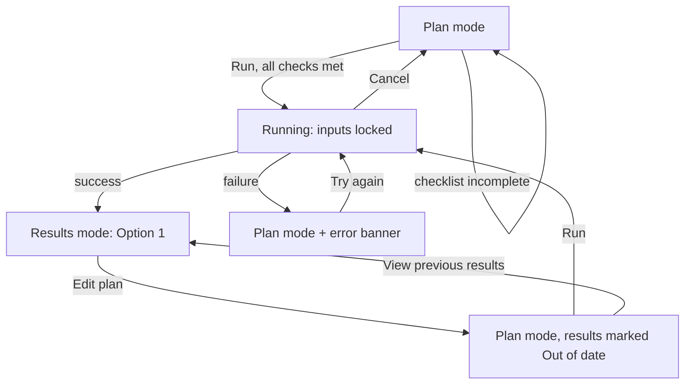

# UX: DSSeating Web (visual classroom seating)

**Status:** Draft, revision 1 (check-report B-1, B-2, B-3, W-4, W-6 addressed; aligned to amended PRD FR-1..FR-37)
**Author:** Sally
**Last updated:** 2026-11-21
**Sources:** `docs/dsseating-web/prd.md` (approved, amended at Gate 1b), `docs/dsseating-web/routing.md`, `docs/dsseating-web/check-report.md`. Existing UI: none (the repo is a Go CLI; there is no web design system to reuse). The only carried-over product language is the CLI's: "Isle" spelling, "student", plain one-line messages that name the offending item.

## 1. Goal

A teacher on a laptop draws their real classroom, lists up to 50 students, states who needs the front, who must be apart and who needs an outside column, presses Run once, and sees the best three seating plans drawn on their own room. They can tell at a glance which rules each plan breaks, and why. Success is "I would put this on the board", not "I understood a genetic algorithm".

## 2. Recommended direction

One page, two modes, one persistent canvas.

- **Plan mode (editor).** The room canvas is always the center. A tool palette on the left places desks and room markers. A right-hand panel has two tabs, Students and Rules. A header holds the app name, an Undo/Redo pair, and one primary **Run** button with a live readiness checklist beside it. The teacher can work in any order; the checklist tells them what is left.
- **Results mode.** Same canvas, read-only, now showing student names on desks. A rank switcher (Option 1, 2, 3) sits above it and a rule-outcomes list replaces the right panel. "Edit plan" returns to Plan mode without losing anything.

Why this and not a wizard: the three inputs (room, students, rules) are small, interdependent (desk count must equal student count), and the teacher will bounce between them. A wizard hides that dependency; a persistent readiness checklist makes it visible.

Key design bets:

1. **Every drag has a non-drag equivalent** (click-to-place, keyboard pick-up/move/drop). Required by WCAG 2.5.7 and also faster for 50 desks.
2. **Markers are tokens in grid cells** (FR-5, D-4). The Front token must sit on a non-corner cell on the grid's outer edge; the edge it sits on is the front edge, any of the four. Back, Side, Door and Teacher's desk are visual only and never affect results.
3. **Plain language first, jargon as gloss.** "Isle" is kept as the label (FR-13) with the gloss "outside columns, next to the walls".
4. **Outcomes are never color-only**: icon, text label ("Met", "Neutral", "Not met"), and outline style on affected desks.
5. **Failure never loses input**: Run failures are a banner in Plan mode; nothing is cleared. Nothing is saved between sessions; a leave-page warning and **Start over** are the only guards (FR-33).

## 3. PRD review (UX lens)

The PRD was amended and approved at Gate 1b. My round-1 findings are now closed by the PRD; the table records where each landed so nothing is silently dropped. New findings from this revision are at the end.

| ID | Status | Finding (round 1) | Resolution in PRD / this spec |
|----|--------|-------------------|-------------------------------|
| PRD-1 | Closed | Grid limits were TBD. | FR-1: 1 x 1 to 15 x 15, default 8 x 6. Spec uses exactly this (check-report B-2). Server enforces the same limit with identical messages. |
| PRD-2 | Closed (owner chose cell markers) | Wall markers vs cell markers. | FR-5, FR-6, D-4: cell tokens; Front on a non-corner edge cell, edge = front edge. Wall-frame design removed (B-1). |
| PRD-3 | Closed | 50 drags is tedious. | FR-29 Fill room (P1). |
| PRD-4 | Closed | Typing 50 names. | FR-30 Paste a list (P1). |
| PRD-5 | Closed (autosave rejected) | Loss of work on refresh. | FR-33: leave-page warning and Start over; autosave out of scope. Undo/Redo FR-31. |
| PRD-6 | Closed | 1:1 is a hard block. | FR-16 keeps 1:1 and requires the fix hint; "desks > students" is future. |
| PRD-7 | Closed | No way out of a long run. | FR-32 Cancel (P1). |
| PRD-8 | Closed | "Satisfied" undefined. | D-1..D-3; Front has three states. Placeholders replaced in S3 and S5. |
| PRD-9 | Closed | Score display. | FR-36: "N of M rules met", score secondary, signed. Arch returns `weighted100`; display is value / 100. |
| PRD-10 | Closed | Impossible rules. | FR-37 (P1). |
| PRD-11 | Closed | Marker limits. | FR-5: Front 1, Back 1, Side 2, Door 3, Teacher's desk 1. |
| PRD-12 | Closed | FR-28 wording. | Now "Results are read-only". |
| PRD-13 | Closed | Name rules. | FR-7 (trim, max 40), FR-10 (trim, case-insensitive, normalization-insensitive). |
| PRD-14, PRD-15 | Closed | A11y owned by UX; differences toggle. | Section 10; FR-34 (P2). |
| PRD-16 | Medium, new | FR-36: Neutral front outcomes count as not met in the "N of M" total, but the rule list shows them as Neutral. A teacher can see "9 of 10 met" and find no row marked "Not met". | Spec resolves it in the UI: the summary line always reads "N of M rules met" followed by a breakdown when needed ("1 Neutral"), and the rule list groups "Not met", "Neutral", "Met". PRD wording to be kept as is; no change requested. |
| PRD-17 | Low, new | FR-17 says "busy indicator", FR-32 allows Cancel; neither states what happens to a run whose response arrives after Cancel. | Spec: late response discarded, no message (FR-32). |
| PRD-18 | Low, new | FR-23 says renames do not mark results out of date. A teacher renaming a student may expect results to follow. | Spec: results keep names as of the run, with the explicit label "Names as of the last run" in the stale banner. |

## 4. Users and jobs

- **Primary:** a classroom teacher on a laptop or desktop with a mouse or trackpad (also keyboard-only and screen-reader users, per WCAG). Job: get a seating plan that respects a handful of known constraints without hand-shuffling 50 names.
- **Secondary:** none for MVP.
- **Context:** infrequent, goal-driven use (start of term, after a conflict). No training. Often interrupted. Probably many rules are about 3 to 10 students, not all 50.
- **Existing patterns reused:** the CLI's "Isle" terminology, one-line error messages that quote the offending token, and "student" as the user-facing noun. No visual system exists; the front end should adopt a lightweight accessible component base (see section 12) rather than invent one.
- **Not a decision for this spec:** the visual brand. Tokens below are neutral and swappable.

## 5. Key flow

Happy path:

1. Teacher opens the app. Plan mode, empty 8 x 6 grid, onboarding hint on the canvas. Run checklist shows 4 unmet items.
2. Sets grid size if needed (Columns, Rows steppers above the canvas).
3. Places desks (drag from palette, click-to-place, or Fill room) and moves them to match the real room.
4. Drags the Front marker onto a non-corner cell on the edge of the room where the board is. Optionally places Teacher's desk, Doors, Side, Back.
5. Opens the Students tab, pastes or types names. Counter shows "25 / 50"; checklist shows "25 students, 25 desks".
6. Opens the Rules tab, adds rules via the form (Front, Not near, Isle). Rule list shows plain sentences.
7. Checklist is all green. Teacher presses Run. Inputs lock, a busy panel (no percentage; the engine reports no progress) shows "Finding seating plans" with a Cancel button.
8. Results mode opens on Option 1. Teacher reads "9 of 10 rules met", clicks the one "Not met" rule, sees the two students outlined on the canvas.
9. Switches to Option 2 and 3, picks one. (Export is out of scope for the MVP; they read it from the screen.)

Recovery paths:

- **Run blocked:** the Run button is announced as unavailable and the checklist says exactly why, each line linking to the fix.
- **Service failure or unreachable:** stays in Plan mode, banner with Try again; all inputs intact (FR-25).
- **Edit after results:** "Edit plan" returns to Plan mode. Old results stay reachable but marked **Out of date** (FR-23) until the next Run replaces them.
- **Wrong drop:** dropping a desk on an occupied cell, outside the grid, or a marker where it is not allowed returns the item to origin with a message.
- **Accidental delete or shrink:** Undo.

## 6. Information architecture and navigation

Single page, no routes for MVP (no saved classrooms). Hierarchy:

- App header: product name, Undo, Redo, readiness summary, Run (Plan mode) or "Edit plan" (Results mode).
- Mode switch: a two-item tab list in the header, **Plan** and **Results**. Results is disabled until a run completes; after edits it shows an "Out of date" badge.
- Plan mode:
  - Left: Room tools (palette + room size + Fill room).
  - Center: canvas.
  - Right: tab list, **Students** and **Rules**, each with a count badge (and an error badge if rules have problems).
- Results mode:
  - Top: option switcher (Option 1, 2, 3).
  - Center: read-only canvas.
  - Right: Rule outcomes list.

Entry points: the app root only. No names or inputs are placed in the URL (privacy rule, and there is nothing to deep-link yet).

## 7. Screen inventory

| Screen | Purpose | Primary FR IDs |
|--------|---------|----------------|
| S1 Plan: room canvas and tools | Size the room, place and move desks and markers | FR-1, FR-2, FR-3, FR-4, FR-5, FR-6 |
| S2 Plan: Students tab | Add, bulk-add, edit, remove students | FR-7, FR-8, FR-9, FR-10 |
| S3 Plan: Rules tab | Add, list, edit, delete rules; validation | FR-11, FR-12, FR-13, FR-14, FR-15 |
| S4 Run readiness and running state | Explain what blocks Run; show busy state; cancel | FR-16, FR-17, FR-24 |
| S5 Results | Switch among 3 options, see score and rule outcomes, inspect a rule | FR-19, FR-20, FR-21, FR-22, FR-28 |
| S6 Error and stale states | Service failure, retry, out-of-date results | FR-23, FR-25 |
| S7 Dialogs | Paste students, confirm destructive actions, shrink room, leave page | FR-1, FR-8, FR-9 |

FR-18, FR-26, FR-27 are not screens; they constrain the service contract (section 12).

## 8. Screen specifications

### S1 Plan: room canvas and tools

Purpose: build the real room.

#### Structure

1. **Room size bar** (above canvas): "Columns" stepper (1 to 15), "Rows" stepper (1 to 15), default 8 x 6, and a live count "12 of 50 desks". Steppers are number inputs with +/- buttons; typed values are clamped with an inline message ("Rooms can be up to 15 columns wide" / "...15 rows tall"), the same wording the server uses. The client never accepts a size the server would reject (FR-1).
2. **Palette** (left), two groups:
   - Desks: **Desk** (draggable tool), **Fill room** (button, opens S7 Fill dialog; FR-29). When the room has 50 desks both are shown as unavailable with the text "Room is full (50 desks)." (never hidden).
   - Room markers: **Front** (required, shows a required indicator), **Back**, **Side**, **Door**, **Teacher's desk**. Each shows "placed / limit" (Front 1, Back 1, Side 2, Door 3, Teacher's desk 1; for example "Door 1 of 3"). At its limit a tool is unavailable with the text "Already placed. Move or remove it."
3. **Canvas**: the grid; every cell is a drop target. Empty cells have a dotted outline and a faint "+" on hover/focus when a tool is active. Desks are rounded rectangles labeled "Desk" in Plan mode. Markers are labeled tokens in a cell, each with icon + text: Front ("Front"), Back, Side, Door, Teacher's desk. A marker cell holds no desk and does not count toward the 50-desk cap or toward the student/desk match.
   - **Front edge indicator:** when the Front token is validly placed, a thick bar labeled "Front of room" is drawn along the whole grid edge it sits on, so the teacher sees which side counts as the front. The token itself is not drawn as a bar.
   - **Invalid Front placement:** Front may only go on a non-corner cell on the outer edge of the grid. The Front tool is unavailable only when both dimensions are 2 or less (1 x 1, 1 x 2, 2 x 1, 2 x 2): "This room has no valid spot for the Front marker. Make it at least 3 wide or 3 tall." Single-line rooms with 3 or more cells (1 x M columns by rows, or N x 1) are valid and runnable: every non-corner cell is on the outer ring. The "Front of room" bar is drawn on the edge the model derives for these rooms: the left edge for a single-column room (1 x M), the top edge for a single-row room (N x 1). In every other room it is the edge the token sits on.
4. **Selection strip** under the canvas: shows the selected item ("Desk at row 3, column 4") with **Remove** and, for markers, **Move**. This is the always-visible alternative to drag-to-remove and context menus.
5. First-use hint on an empty canvas: "Drag a Desk onto the grid, or click Desk and then click a cell. Drag Front onto a cell on the edge of the room where your board is." Dismissible; reappears only if the room is empty again.
6. **Start over** (text button in the room tools, FR-33): appears when the room or students have any content. Opens a confirm: "Start over? This clears the room, students and rules." (and any results). Cancel / **Start over**. Start over clears the room, markers, students, rules and any results (stored RunResult, so the Results tab returns to disabled and no stale view remains), and is a single undoable step: Undo restores all of them together, including the results. A toast offers "Undo".

#### Interactions

- **Add desk, drag (FR-2):** pick Desk from the palette, drag over the grid. The cell under the pointer highlights as a snap target (solid outline plus faint desk ghost); drop adds a desk. Dropping outside the grid cancels with no change.
- **Add desk, click:** select the Desk tool (stays active, shown as pressed), click an empty cell to place; click-drag across cells (paint) places along the path. Esc or clicking the tool again exits. Clicking an existing desk with the tool active selects it, never replaces it.
- **50-desk cap (FR-2, W-4):** applies identically to drag, click-to-place, paint-drag, keyboard placement and Fill room.
  - Placing the 51st desk by drag or click: refused, item returns to origin or nothing is placed, message "Room is full (50 desks)." in the inline caption and live region. The Desk tool becomes unavailable (S1 palette text).
  - Paint-drag: places desks until the 50th, then stops; the drag may continue without effect; on release the caption says "Room is full (50 desks). Some cells were not filled." only if the stroke was cut short.
  - Removing a desk (or Undo) re-enables the tools immediately.
  - Moving a desk never changes the count and is always allowed (FR-3).
  - Fill room: see S7 (cap enforced in the preview, not after).
- **Move desk (FR-3):** drag a placed desk to an empty cell. Snap highlight as above. Dropping on an occupied cell: item returns to origin (animation 150 ms, none under reduced motion) and the live region says "That cell already has a desk. Desk returned." No dialogs.
- **Remove desk (FR-4):** select it, press Delete/Backspace or click **Remove**; or drag it out of the grid onto the palette. Undo is offered in a toast ("Desk removed. Undo").
- **Markers (FR-5, FR-6):** drag a marker token (or click the tool, then a cell) onto an empty cell. A marker can only go on an empty cell; an occupied cell rejects it like a desk (token returns). Placing a second Front moves the existing one (never duplicates). Back, Side, Door and Teacher's desk can go on any empty cell, up to their limits; they never affect results.
  - **Front validity:** valid cells are the non-corner cells on the outer ring of the grid. While dragging Front, valid cells are highlighted and the rest show a "not allowed" cursor and are not drop targets. Dropping Front on an invalid cell returns it with "The Front marker goes on the edge of the room, not in a corner or the middle." (message also exposed for keyboard placement).
  - **Front invalid after an edit:** shrinking the room can leave the Front token in a corner or off the outer ring. It then shows a warning outline plus icon, the front-edge bar is hidden, and the checklist shows "Move the Front marker to the edge of the room, not a corner." (S4, FR-16).
  - **Front missing:** persistent notice "Place the Front marker on a cell at the edge of the room, where your board is."
  - Marker removal: select + Delete or **Remove**; undoable.
- **Resize room (FR-1):** changing Columns/Rows resizes immediately if nothing is lost. If desks or marker tokens would be cut off, a confirm dialog lists the count ("Removing rows 6 and 7 deletes 3 desks and the Door marker. Shrink room?" Cancel / Shrink room). Undo available. After a shrink, a Front token that survives but now sits in a corner or off the outer ring is flagged as invalid (above).
- **Undo/Redo (FR-31):** Ctrl/Cmd+Z, Ctrl/Cmd+Shift+Z, plus header buttons that name the action in their accessible description ("Undo: remove desk"). History covers room edits, student and rule edits including removals (one stack) within the session; cleared on page leave or Start over is itself one undoable step. Undo/Redo is unavailable while a run is in progress.
- **Selection:** click or Space/Enter selects. Esc deselects.

Keyboard model (grid pattern, one tab stop):

- The canvas is one composite widget. Tab enters it, Arrow keys move focus cell to cell, Tab leaves it.
- Enter/Space on a **placed item** picks it up ("Desk picked up from row 3, column 4. Use arrow keys to choose a cell, Enter to drop, Escape to cancel"). Arrows move a ghost; Enter drops (same occupied-cell rule); Esc cancels.
- Enter/Space on an **empty cell with a tool active** places the item.
- With a palette tool focused, Enter/Space activates it; the next canvas Enter places.
- Delete removes the focused item.

#### States

- **Loading:** none (all local).
- **Empty:** empty grid plus first-use hint; palette fully enabled; header checklist shows unmet items.
- **Error:**
  - Invalid drop: item returns, message in the live region and as a short inline caption under the canvas (not a toast only), cleared on next action.
  - Marker limit reached: tool unavailable with reason (above).
  - Desk cap reached: "Room is full (50 desks)." (above).
  - Front missing or invalid: persistent notice above the canvas (see Markers), also a checklist item.
- **Success:** placed item shown with brief highlight (none under reduced motion); count text updates; live region "Desk added at row 3, column 4. 13 desks."
- **Destructive:** shrink confirm; Remove uses Undo, not a confirm (cheap, reversible).
- **Locked:** while a run is in progress (S4) the canvas is read-only (tools unavailable, items not draggable) with a visible overlay label "Running".

#### Responsive behavior

- Desktop only (laptop and up). Supported viewport 1024 px and wider.
- >= 1280 px: three columns: palette 200 px, canvas flexible, right panel 360 px.
- 1024 to 1279 px: palette becomes a horizontal toolbar above the canvas; right panel 320 px.
- < 1024 px: not supported; show a non-blocking banner "DSSeating works best on a laptop or larger screen" and stack panels; everything remains reachable (needed for 200 to 400 percent zoom reflow, WCAG 1.4.10).
- Cell width auto-scales between 72 and 112 px (height 56 to 72 px); if 15 columns do not fit, the canvas scrolls horizontally inside its own region (grid is a two-dimensional graphic, exempt from reflow scrolling). Page itself does not scroll sideways.
- Drag stays smooth with 50 desks: placement ghosts and snap highlight are CSS-only; no re-layout per pointer move. `[NFR]`

#### Accessibility

- Canvas: `role="grid"` with rows and `gridcell`; each cell's name states position and content: "Row 3, column 4, desk" / "empty" / "Front marker, top edge". Picked-up and dropped states announced via a polite live region (WCAG 4.1.3).
- Cells are at least 44 x 44 px (exceeds 24 x 24, WCAG 2.5.8).
- Focus ring 3 px, offset, 3:1 against adjacent colors, never clipped by the canvas scroll area (2.4.11, 2.4.13).
- Drag alternatives for every drag (2.5.7): click-to-place, keyboard pick-up, selection strip Move/Remove.
- Marker meaning conveyed by icon + text label, not color alone.
- Pointer cancel: a drag cancels if released outside valid targets or on Esc (2.5.2).
- Reduced motion: no snap/return animation.

### S2 Plan: Students tab

Purpose: build the class list, up to 50, unique names.

#### Structure

1. Header line: "Students" and counter "23 of 50".
2. **Add student**: text input (label "Student name", visible), **Add** button. Enter submits and keeps focus in the field for fast entry. Helper under it: "Names appear exactly as you type them."
3. **Paste a list** link (FR-30, P1) opens S7 dialog.
4. **List**: ordered by entry, newest at the bottom, auto-scrolled into view. Each row: name (wraps; never truncated in the list), a small "2 rules" badge when applicable, **Edit** and **Remove** icon buttons (with text labels visible at >= 1280 px, tooltips otherwise; accessible names always include the student name, for example "Remove Maya"). A search/filter field appears above the list once there are more than 15 students.
5. Footer match line (also a checklist source): "23 students, 25 desks. Add 2 students or remove 2 desks." with a state icon.

#### Interactions

- **Add (FR-7):** trims, validates, appends, clears input, announces "Maya added. 24 of 50." Names are stored and displayed exactly as entered (after trim).
- **Edit (FR-8):** row switches to an inline input with Save/Cancel (Enter/Esc). Renaming updates every rule that references the student. Same validation as add.
- **Remove (FR-8):** if the student has no rules, removes immediately with an Undo toast. If rules exist, a popover confirm: "Remove Maya? This also removes 2 rules." Cancel / **Remove student and 2 rules**. Both are undoable.
- **Limit (FR-9):** at 50, the input and Add are unavailable and the text under the field says "You've reached the 50-student limit. Remove a student to add another." Pasting more than the remaining room imports none and says how many to remove (S7).
- **Duplicate (FR-10):** blocks with "There is already a student named 'Maya' (names are compared without regard to case or accent encoding)." Comparison is after trimming, case-insensitive and Unicode-normalization-insensitive (FR-10). and keeps the typed value so it can be fixed. Shown inline, linked to the input by `aria-describedby`, plus focus stays in the field.
- **Empty or whitespace-only:** "Enter a name."
- **Too long:** counter and message at 40 characters.

#### States

- **Empty:** illustration-free message "No students yet. Add names one at a time or paste a list." Input focused on tab open.
- **Loading:** none.
- **Error:** inline field errors above; none block the rest of the page.
- **Success:** live-region confirmations; the new row is briefly highlighted (not under reduced motion).
- **Full (50):** see limit.
- **Destructive:** remove with rules requires confirm; always undoable.
- **Locked during run:** controls unavailable, list readable.

#### Responsive behavior

Panel is a fixed-width column (>= 1024 px). The list scrolls inside the panel; the add form stays pinned at the top of the panel. At narrow widths or zoom, the panel stacks below the canvas.

#### Accessibility

- Each field has a visible label; errors are text with an icon, tied by `aria-describedby`, and announced (3.3.1, 3.3.3).
- Remove/Edit buttons are 44 px targets.
- Counter updates are polite live-region announcements, throttled when pasting.
- Long names wrap; no hover-only content.
- Redundant entry avoided: a failed Add keeps the typed text (3.3.7).

### S3 Plan: Rules tab

Purpose: state constraints in plain language and keep the set valid.

#### Structure

1. Header line: "Rules" and count.
2. **Add a rule**: a segmented choice with three options, each with a one-line description:
   - **Front**: "Sits near the front of the room." Definition (D-1): "Rows are counted from the front-most desk row. Each row gets a score that runs from best at the front to worst at the back. A row above zero is Met, a row at exactly zero is Neutral, a row below zero is Not met. Neutral only happens in rooms with an odd number of desk rows (3 or more); rooms with an even number of rows have no Neutral row. In a 5-row room, rows 1 and 2 are Met, row 3 Neutral, rows 4 and 5 Not met." Shown in a "How rules are judged" disclosure, with the same text on S5.
   - **Not near**: "Two students should not sit near each other." Definition (D-2): "Near means 2 desk steps or fewer (rows plus columns; gaps count; diagonal neighbours and two desks apart in a row are near). Met only when they are more than 2 steps apart."
   - **Isle**: "Sits in an outside column, next to a wall (an aisle seat)." Label stays "Isle" per FR-13; the gloss is always visible. Definition (D-3): "Met when the student sits in the leftmost or rightmost column that has a desk."
   Below, the form for the chosen type:
   - Front and Isle: one **Student** field.
   - Not near: **Student** and **Other student** fields.
   Student fields are searchable select (combobox) lists of current students, alphabetized, with a visible label. For Not near, the second list excludes the first student. **Add rule** button.
3. **Rule list**: one row per rule, written as a sentence: "Maya sits near the front", "Maya and Leo do not sit near each other", "Sam sits on an Isle (outside column)". Each row has **Edit** and **Delete**. Rows are grouped under type headings (Front, Not near, Isle) with counts. Rows with a problem show an error icon + text.
4. When the class has fewer than 2 students, Not near is unavailable with the reason.

#### Interactions

- **Add (FR-11, 12, 13):** choose type, pick student(s), Add. The new rule is appended and announced "Rule added: Maya and Leo do not sit near each other."
- **Edit (FR-14):** row expands to the same form prefilled; Save/Cancel.
- **Delete (FR-14):** removes immediately with Undo toast (no confirm; reversible and low cost).
- **Validation (FR-15):**
  - Duplicate: "Maya already has a Front rule." For Not near, reverse order counts: "Leo and Maya already have a Not near rule."
  - Self-pairing: prevented by excluding the first student from the second list; if reached by typing, "Choose two different students."
  - Missing student: should be impossible (removal cascades), but if state ever contains one, the row shows "This rule names a student who was removed" with a Delete action and counts as a rule error in the checklist.
  - Add is available but returns the error (rather than staying disabled with no explanation).
- A student may hold Front and Isle together; this is allowed (different rules). `[ASSUMPTION]` consistent with CLI strictness, which only forbids duplicate entries.

#### States

- **Empty:** "No rules yet. Rules are optional, but without them the plan is only about fitting everyone in." (rules are not required by FR-16; Run is allowed with zero rules `[ASSUMPTION]`).
- **Loading:** none.
- **Error:** inline per field (above); rows with problems flagged; tab shows an error badge with count.
- **Success:** live-region confirmation; row highlight.
- **Destructive:** delete via Undo.
- **Many rules:** list scrolls inside the panel; filter field appears above 15 rules; filter matches student names.

#### Responsive behavior

As S2.

#### Accessibility

- Segmented control is a radio group with arrow-key navigation; descriptions are part of each radio's accessible description.
- Combobox follows the ARIA combobox pattern; selected value shown as text; target 44 px.
- Rule sentences are the accessible names; Edit/Delete names include the sentence ("Delete rule: Maya and Leo do not sit near each other").
- Errors have icon + text, not color alone.

### S4 Run readiness and running state

Purpose: make the Run condition (FR-16) transparent, then keep the teacher oriented during the wait (FR-17).

#### Structure

1. **Run button** (header, primary). Label "Run". It is not removed from the tab order when blocked: it uses `aria-disabled="true"` with an adjacent text summary, so keyboard and screen-reader users discover why instead of skipping a dead control. Activating it while blocked opens the checklist popover instead of running.
2. **Readiness summary** beside Run: "Ready to run" or "2 things to fix" (button, opens the checklist popover).
3. **Checklist** (popover, also reachable from a "Run checklist" section at the bottom of the right panel so it is not hover-only). Four lines, each with state icon + text + link to the fix:
   - Desks and students match: "25 desks, 23 students. Add 2 students or remove 2 desks." (link to Students)
   - At least one student: "Add at least 1 student." (link to Students)
   - Front of room marked: "Place the Front marker on a cell at the edge of the room." (link to canvas Front tool). A second line covers an invalid Front: "Move the Front marker to the edge of the room, not a corner." (FR-16)
   - Rules are valid: "1 rule needs attention." (link to Rules, focuses the first problem)
4. **Running panel** (replaces the checklist popover on Run): busy indicator (spinner, non-essential) plus text "Finding the best seating plans for 25 students..." and a **Cancel** button (FR-32). `role="status"`. The engine reports no progress, so there is no bar or percentage (FR-17). After 10 seconds the text adds "Larger rooms can take a bit longer." (no numbers until A-4 is confirmed; proposed target p95 <= 5 s).

#### Interactions

- **Run enabled (all 4 met):** click or Enter/Space starts the run. A snapshot of room, students and rules is taken and sent; the editor locks (S1, S2, S3 controls unavailable, readable; canvas overlay "Running"). Second Run presses do nothing (FR-17).
- **Cancel (FR-32):** unlocks the editor immediately, returns focus to the Run button, announces "Run cancelled. Your room, students and rules are unchanged." A response that arrives later is discarded silently; it never opens Results or alters the stored results. Existing earlier results are untouched.
- **Success:** mode switches to Results, focus moves to the Results heading, live region "Results ready. 3 options."
- **Failure:** see S6.
- **Determinism (FR-24):** no seed control. Within a session, running twice with unchanged inputs shows identical results (retyping the same roster may differ, because student ids are generated; the UI does not explain this); the UI does not claim "new options". If results are identical to the existing ones, the post-run live message is "Same arrangements as before. Change the room, students or rules to get different ones." so the teacher is not confused by an unchanged screen.

#### States

- **Blocked:** per above.
- **Running:** per above; Run button shows "Running..." and is unavailable.
- **Error:** S6.
- **Success:** to S5.

#### Responsive behavior

Header collapses secondary text at < 1280 px: the summary becomes an icon + count, still a button with a text accessible name.

#### Accessibility

- The status text is the single source for the blocked/running state and is live-region announced when it changes (4.1.3).
- The spinner has no accessible name (decorative); the text carries meaning.
- Reduced motion: spinner replaced by static "Working..." text with animated ellipsis disabled.
- No timeout on the teacher's side (2.2.1).

### S5 Results

Purpose: compare the top 3 seating plans on the teacher's own room and see exactly which rules each one breaks.

#### Structure

1. **Heading**: "Seating plans" with a one-line explanation: "Three best arrangements found. Option 1 scores highest."
2. **Option switcher**: three tabs: "Option 1", "Option 2", "Option 3" (fewer if fewer exist, FR-19). Each tab shows the primary metric "9 of 10 rules met" (FR-36) and a smaller secondary "Score (higher is better): 12.40" (service `weighted100` divided by 100, fixed two decimals, real minus sign if negative). "N" and "M" are `rulesMet` and `rulesTotal` exactly as the service supplies them; the client tallies nothing. The service counts Neutral Front outcomes as not met; when any Neutral outcome exists the line continues "(1 Neutral)" so the number can be reconciled with the list. A "How is the score calculated?" disclosure: "Higher is better. Scores are only useful for comparing these options with each other." Rank is the tab order; ties are labeled "Tied with Option 1".
3. **Canvas** (read-only, same geometry as the Plan canvas): each desk shows the student's name (wrapping to two lines, ellipsis after that; full name in the details strip and accessible name). Desks involved in any Not met rule carry a corner **warning marker** (icon plus "Not met" in its accessible name) and a dashed outline. Desks involved only in a Neutral Front outcome carry a neutral **dash marker** (icon plus "Neutral") and a dotted outline. Marker tokens (Front, Door, and so on) are drawn in their cells as in Plan mode, read-only.
4. **Rule outcomes list** (right panel): header "Rules: 9 met, 1 neutral, 1 not met" (zero counts omitted; counts here are of the listed outcomes, while the "N of M" figure in the option tab comes from the service). Groups in order: Not met, Neutral, Met. Each row: status icon (warning triangle, dash, or check), text "Not met", "Neutral" or "Met", the rule sentence, and the reason line. Only Front rules can be Neutral (D-1); Neutral explanation: "Neutral: sits in a row that scores exactly zero, neither near the front nor at the back. This only happens in rooms with an odd number of desk rows (3 or more)." Rows are selectable.
5. **Details strip** under the canvas: "Maya: Desk row 2, column 3. 1 rule involves Maya." When nothing is selected, it shows the room summary.
6. **Show differences from Option 1** toggle (FR-34, P2): on Option 2 and 3, desks whose student differs from Option 1 get a badge and the strip lists the count ("4 students sit elsewhere").
7. **Banner** (when relevant, FR-37): "No option satisfies every rule. Option 2 breaks the fewest." naming the option with the highest `rulesMet` (ties: lowest rank). The comparison uses the service's `rulesMet`; the client does not count outcomes; "Only 2 different arrangements exist." (fewer than 3, FR-19); "Only 1 arrangement exists." (one result; the switcher is a single non-interactive label).
8. **Stale banner** (S6) when applicable.
9. Header action: **Edit plan**.

#### Interactions

- **Switch option:** click or arrow keys on the tab list; the canvas, rule list and details strip update; selection of a rule persists across options (so the teacher can follow one rule through the three plans). Live region: "Option 2 selected. 8 of 10 rules met."
- **Select a rule (FR-22):** the involved desks get a thick high-contrast outline, all other desks dim to 60 percent; for Not near, a connecting line is drawn between the two desks and labeled with the distance text ("2 desks apart"). The row is expanded to show the plain-language reason built only from service data (FR-35, never computed in the browser): not near, "Maya sits 1 desk from Leo" (distance in desk steps); front, "Maya sits in row 4 of 5" (row position); Isle, "Sam sits in column 3 of 6, not an outside column" (column position). The connecting-line label uses the same service distance. Requires the contract to return distance, row position and column position per outcome (check-report B-3).
- **Select a desk/student:** the rule list filters to "Rules involving Maya" (with a Clear link). Equivalent keyboard path exists (Enter on a desk).
- **Clear selection:** Esc or a "Clear selection" button.
- **Edit plan:** returns to Plan mode, focus on the previously focused Plan control; results stay but are marked Out of date once any input changes (S6).
- Results are read-only (FR-28): no drag, rename or reorder.

#### States

- **Loading:** S4 running state; Results tab disabled until the first success.
- **Empty:** not reachable; Results is disabled until a run succeeds. If a service returns zero arrangements (should not happen), show "No seating plan could be produced. Try again, or check your rules." with Edit plan and Try again.
- **Error:** none inline; failures return to Plan mode (S6).
- **Success:** as above. All rules met shows a positive summary ("All 10 rules met") with check icon plus text. A result with no Not met but some Neutral reads "9 of 10 rules met (1 Neutral)".
- **Large:** 50 desks and 50 rules: lists scroll; canvas scrolls inside its region.
- **Long names:** wrap, then ellipsis on the desk; full text in the strip and accessible name.

#### Responsive behavior

>= 1280 px: canvas left, rule list right. 1024 to 1279 px: rule list narrows to 320 px. Below 1024 px or at 400 percent zoom: stacked, rule list under the canvas; option tabs remain at top, wrapping. The canvas keeps its own scroll region.

#### Accessibility

- Option switcher is a tab list with `aria-selected`; the panel is labeled by the selected tab.
- Outcomes are conveyed by icon shape (check, dash, warning triangle), text ("Met"/"Neutral"/"Not met"), and outline style (solid, dotted, dashed). Colors have >= 4.5:1 for text and >= 3:1 for icons and outlines in both themes (1.4.1, 1.4.3, 1.4.11).
- The canvas in Results is a read-only grid; each desk's accessible name: "Row 2, column 3: Maya. 1 rule not met." Rule-involvement highlights are mirrored in the details strip text, so non-visual users get the same information.
- Dimming never reduces text below 4.5:1 for focused or selected desks; dimmed desks remain readable at 3:1 (they are inactive; still no information is carried only by dimming).
- Connecting line has a text equivalent in the rule row.
- Live regions announce option changes and selections.

### S6 Error and stale states

Purpose: protect input and keep results honest.

#### Structure and behavior

- **Service failure (FR-25):** a banner at the top of the Plan canvas (`role="alert"`, receives focus once): "We couldn't get seating plans because the seating service didn't respond. Your room, students and rules are still here." Buttons: **Try again** (re-sends the same snapshot), **Dismiss**. Variants (same pattern, different first sentence):
  - Unreachable/offline: "We can't reach the seating service. Check your connection and try again."
  - Timeout: "The seating service took too long. Try again."
  - Service rejected the input: "The seating service couldn't use this room: {service reason in plain words}." with a link to fix (this should be rare; the front end already validates).
  - Unexpected: "Something went wrong on our side. Try again." No technical details by default; "Show details" disclosure holds an error code.
- **Stale results (FR-23, check-report W-3):** the instant a Plan input changes after a successful run, the Results tab gets an **Out of date** badge. Opening it shows a banner: "These arrangements are for an earlier version of your room, students or rules. Names are as of the last run. Run again to refresh." The canvas shows the run's snapshot (room cells, markers, students as named at the time of the run), never the live editor state, with a text label "Out of date" (not only a hatch pattern). Rules:
  - Changes that mark results out of date: any room edit (desks, markers, grid size), adding or removing a student, adding, editing or deleting a rule, Start over.
  - **Renaming a student alone does not mark results out of date**; the results keep the old name, hence the "Names as of the last run" wording.
  - Removing a student does mark them out of date; their name remains visible in the stale snapshot (the results store names as of the run).
  - Undo/Redo that returns the inputs exactly to the run's inputs clears the badge. `[ASSUMPTION]`
  - Pressing Run replaces results; Start over clears them after its confirm; they are never silently deleted otherwise.
- **Leave-page warning (FR-33):** when the room has any desk, marker or student, the browser's leave prompt is armed; **Start over** (S1) is the intentional reset. Nothing is saved between sessions, so a refresh clears everything; the warning is the only guard.

#### Accessibility

- Alert is announced assertively once; focus moves to the banner heading, not the button.
- The Try again button is the first focusable element in the banner; Dismiss second.

### S7 Dialogs

All dialogs are modal, labeled, trap focus, close on Esc (unless a destructive confirm needs choice, where Esc = Cancel), and return focus to the invoker.

- **Paste a list (FR-30):** textarea "One name per line", live preview: "18 names ready. 2 duplicates skipped: Maya, Leo. 0 over limit." Buttons: Cancel, **Add 18 students**. If the total would exceed 50: "That would be 56 students. The limit is 50. Remove 6 names or remove students first." and the Add button is replaced by a disabled-with-reason state (`aria-disabled` plus text). Blank lines ignored. Duplicates vs existing and within the paste are shown by name; they are skipped, never silently.
- **Fill room (FR-29):** fields Columns x Rows of desks (limited to the current grid, which is at most 15 x 15) and optional "Leave a center aisle"; live preview "This places 36 desks." If the result would exceed 50: "That would be 56 desks. Room is full at 50 desks. Reduce columns or rows." and **Fill room** is unavailable with that reason (never placed partially). If it overwrites existing desks: "This replaces 12 existing desks." Marker tokens are never overwritten; cells holding them are skipped and the preview says how many. Cancel / **Fill room**. One undo step.
- **Shrink room:** see S1.
- **Remove student with rules:** see S2.
- Dialog buttons are real buttons with specific labels (not OK/Cancel alone).

## 9. States and edge cases

- **Empty room, no students:** onboarding hint; checklist lists all unmet items; Run blocked with reasons.
- **Desks > students or students > desks:** actionable mismatch line (S2, S4); Run blocked (FR-16).
- **No Front marker, Front in a corner, or Front not on the edge:** notice and checklist line (S1, S4); Run blocked. Only one Front exists; dragging it moves it. Rooms too small for a non-corner edge cell (S1) cannot be run.
- **Desk cap:** 50 desks maximum by every route; "Room is full (50 desks)." (S1).
- **Irregular room (gaps, uneven rows, single desk):** allowed. Rule meaning on irregular rooms follows D-1..D-3 (front rows counted from the front-most desk row; Isle = leftmost/rightmost occupied column; not near counts gaps in desk steps). Results shows the service reason for every outcome. A "How rules are judged" disclosure on S3 and S5 holds the same text.
- **One student, one desk:** Run works; rule options limited accordingly (Not near unavailable).
- **50 students/50 desks:** limits reached; list scrolling, filters, canvas scrolling all verified at this size.
- **Fewer than 3 distinct plans:** show only those that exist (S5 banner).
- **Impossible rules:** best effort shown with the FR-37 banner; never a blank result.
- **Names:** very long, emoji, right-to-left, accented characters, names that differ only by case (blocked as duplicates), leading/trailing spaces (trimmed). Names are rendered as text, never as HTML.
- **Rapid drag/drop, double-click on Run, double-click on a palette tool:** idempotent; second Run ignored; tool toggles.
- **Undo after Run:** undo only affects Plan inputs; marks results Out of date like any edit (unless it restores the run's exact inputs). Undo/Redo is unavailable during a run.
- **Offline during Plan editing:** nothing needs the network until Run; no offline notice until a run fails.
- **Browser back/refresh:** leave warning; refresh loses state (FR-33).
- **Privacy:** no names in URLs, page titles or analytics event names; test data only for MVP (PRD section 5).
- **Window resize while dragging:** drag cancels cleanly, item returns to origin.
- **Touch input:** unsupported (PRD), but pointer events are used so it does not break.

## 10. Accessibility

Commitments (WCAG 2.2 AA), all requirements:

- **Keyboard (2.1.1, 2.1.2, 2.4.3, 2.4.7):** everything operable by keyboard; canvas is a single composite tab stop with arrow navigation, pick-up/drop with Enter, Esc cancel, Delete remove. No keyboard traps. Visible focus everywhere (2.4.11, 2.4.13); sticky header and popovers must not obscure the focused element (scroll-padding set).
- **Dragging alternatives (2.5.7):** click-to-place, keyboard moves, Move/Remove in the selection strip.
- **Target size (2.5.8):** all controls >= 44 x 44 px (minimum 24).
- **Not color alone (1.4.1):** violated/satisfied, markers, errors, selected, dimmed all carry icon and/or text and/or outline style.
- **Contrast (1.4.3, 1.4.11):** text 4.5:1, large text and UI/graphics 3:1, in light and dark themes (theme follows system setting).
- **Reflow and zoom (1.4.4, 1.4.10, 1.4.12):** works to 200 percent zoom without loss; at 400 percent the layout stacks; canvas may scroll in two directions inside its own region (exempt as a graphic).
- **Names and labels (1.3.1, 2.5.3, 3.3.2, 4.1.2):** visible labels contained in accessible names; each desk, marker, and rule row has a meaningful accessible name; no placeholder-only labels.
- **Errors (3.3.1, 3.3.3, 3.3.4):** plain-language text identifying the field and the fix; destructive and bulk actions are confirmable or undoable.
- **Status messages (4.1.3):** live regions for adds/removes, drop outcomes, option changes, run state, results ready, errors. Polite for progress, assertive only for run failure.
- **Redundant entry (3.3.7), consistent help and navigation (3.2.3, 3.2.6):** failed adds keep input; "How rules are judged" is in the same place on both screens.
- **Motion (2.3.3 spirit, prefers-reduced-motion):** no animation of drops/returns, no spinner animation.
- **Screen-reader smoke test (acceptance):** build a 6-desk room, add 6 students, add 3 rules, run, inspect a violated rule, using only the keyboard and a screen reader.
- **Language:** `lang` set; student names marked with `lang` unset (do not guess).

## 11. Open questions and assumptions

- **Open (A-4):** run-time target is proposed p95 <= 5 s, to be confirmed after measurement; the "still working" message threshold (10 s) follows from it. Grid max is closed at 15 x 15.
- **Closed:** rule definitions D-1..D-3 are in S3 and S5. Reason text uses FR-35 data only.
- **Closed:** score is returned as `weighted100`; display is value / 100 with a fixed number of decimals and a real minus sign.
- **Closed (owner):** Cancel, Fill room, Paste a list, Undo/Redo are in (FR-29..FR-32); autosave is out (FR-33).
- **Assumed `[ASSUMPTION]`:** zero rules is a valid run; Front and Isle may both apply to one student; theme follows the system light/dark setting.
- **Assumed `[ASSUMPTION]`:** no research validates these flows. The primary risk (teachers find the top 3 usable, PRD section 8) should be tested with 3 to 5 teachers on a real roster before the next phase.
- **Deferred (PRD out of scope):** save/reopen, print/export, mobile/touch, manual editing of results, GA tuning, free-form placement.

## 12. Implementation notes

- **Existing UI to reuse:** none in this repo. Reuse nothing from the CLI except terminology. Choose one accessible, headless component base for tabs, dialogs, popovers, combobox, radio group and toast (for example Radix UI or React Aria) rather than hand-rolling; the keyboard-accessible drag-and-drop grid is the one genuinely custom piece. Dragging should use a library with built-in keyboard sensors and live-region announcements (for example dnd-kit) or a custom pointer-events + roving-tabindex implementation; native HTML5 drag-and-drop does not meet the keyboard and announcement requirements by itself.
- **New components required:** `RoomCanvas` (shared by Plan and Results, with a `mode` of edit or readonly), `MarkerToken`, `FrontEdgeIndicator`, `PalettePanel`, `SelectionStrip`, `StudentList`, `RuleForm`, `RuleList`, `ReadinessChecklist`, `OptionTabs`, `RuleOutcomeList`, `LiveAnnouncer`, `UndoStack`, `ConfirmDialog`, `FillRoomDialog`, `PasteListDialog`, `StartOverButton`.
- **State and contract constraints (UX needs, not architecture decisions):**
  - Plan state is a single serializable snapshot: grid size, desks (positions), markers (kind and location), students (id, display name), rules (id, type, student id(s)). Sent as-is on Run (FR-17, FR-18, FR-26). Student ids are opaque; names are display-only and need not leave the browser except as the architect decides (privacy gate).
  - The result for each of up to 3 arrangements includes: rank, displayable score, desk-to-student-id assignment, and per-rule outcome with a three-state result for Front (Met, Neutral, Not met) and two-state for not near and Isle, plus the FR-35 reason data: distance in desk steps (not near), row position and row count (front), column position and column count (Isle). `weighted100` is displayed as value / 100. The front end formats text but does no GA scoring (FR-26). A front-end recomputation exists only in tests (PRD section 2, trustworthiness metric).
  - Results are stored together with the room cells, markers and student names as of the run, so Out of date results stay renderable even after a rename or removal (S6, FR-23). The architect decides where this lives; the UI requires it.
  - Limits shared with the server (FR-1, FR-2, FR-9): 15 x 15 grid, 50 desks, 50 students, 40-character names, same messages ("Room is full (50 desks)").
  - Client history (Undo/Redo, FR-31) and Cancel (FR-32) are client concerns: the run state machine needs a cancelled state that discards late responses.
- **Performance:** keep desk/cell elements to O(cells); memoize cells so a drag over 50 desks does not re-render the grid; highlight via CSS classes.
- **Do not implement here:** this spec contains no application code. Component names above are suggestions to the architect and implementer, not binding structure.
